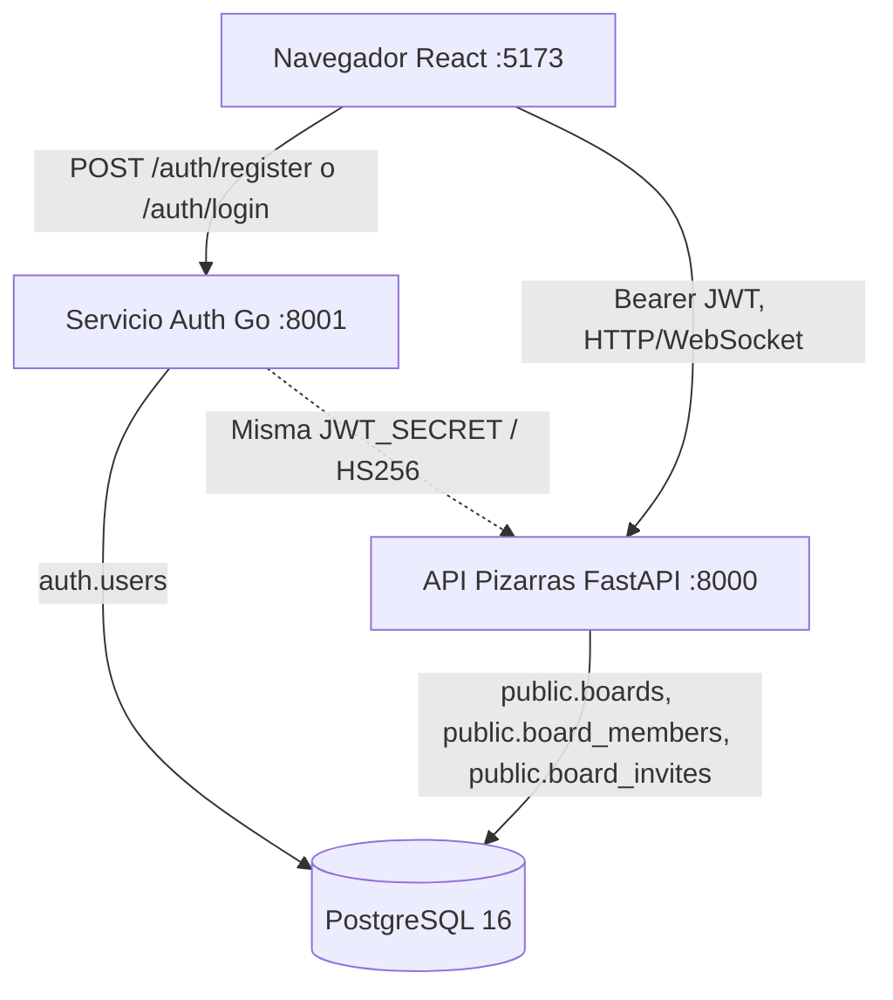

# Arquitectura e integración: autenticación Go (rama `auth/login`)

## Alcance del prototipo

- Registro abierto con nombre, correo válido, contraseña y confirmación.
- Inicio de sesión con correo + contraseña y acceso inmediato al dashboard.
- Recuperación de contraseña, verificación del correo y Google OAuth quedan fuera del alcance.
- Implementación desacoplada: `auth-service` (Go), `backend` (FastAPI), `frontend` (React), `db` (PostgreSQL).
- Despliegue local: `docker compose up --build`.

## Estructura de despliegue



La base de datos de autenticación vive en el esquema `auth`, con `auth.users`.
No tiene claves foráneas hacia `public` ni modifica migraciones Alembic existentes.
El identificador UUID se serializa como string de 36 caracteres en el campo `sub` del JWT.
El módulo Go firma el JWT con HS256 y el Python existente valida firma y expiración.

## Correspondencia con la vista C&C del equipo

| Elemento de la vista C&C | Implementación en esta rama |
|---|---|
| `auth_frontend` (Web) | Componentes de registro e inicio de sesión dentro del frontend React `:5173`; no levanta otro puerto. |
| `auth_backend` `:8001` | **Go + Chi**, emisor de **JWT HS256**, verificación de contraseñas con **Argon2id** (no FastAPI/bcrypt). |
| `HTTP REST :8001/auth` | Rutas `/auth/register`, `/auth/login` y `/auth/me` del microservicio Go. |
| `sql_db :5432` | PostgreSQL 16, esquema `auth` y tabla `auth.users`; el backend FastAPI usa `public`. |
| `pizarra_backend :8000` | Servicio FastAPI existente; valida los JWT emitidos por Go. |
| `pixel_backend :8080` y `colaboracion_module :8002` | Módulos de otros integrantes ilustrados en la arquitectura objetivo; **no** son servicios nuevos creados por este módulo. |

La figura original del equipo debe actualizar sus textos `FastAPI (Módulo Auth)` y
`bcrypt` por `Go + Chi (Módulo Auth)` y `Argon2id`, respectivamente. El
frontend de autenticación está integrado dentro de React `:5173`.

## API

| Método | Endpoint | Éxito | Errores frecuentes |
|---|---|---|---|
| `POST` | `/auth/register` | `201` sesión | `409` correo registrado, `422` campos inválidos |
| `POST` | `/auth/login` | `200` sesión | `401` credenciales inválidas, `429` demasiados intentos |
| `GET` | `/auth/me` | `200` usuario | `401` token inválido o expirado |
| `GET` | `/health` | `200 {"status":"ok"}` | — |

Ejemplo de registro:

```json
{"name":"Ana Gómez","email":"ana@example.com","password":"contraseña-larga-123","confirm_password":"contraseña-larga-123"}
```

Respuesta de registro e inicio de sesión:

```json
{
 "access_token":"<JWT firmado>",
 "token_type":"bearer",
 "user":{"id":"550e8400-e29b-41d4-a716-446655440000","name":"Ana Gómez","email":"ana@example.com","created_at":"2026-10-12T20:00:00Z"}
}
```

El usuario de frontend llama `useAuth.getState().setSession(access_token)` y React navega
al destino obtenido con `safeNext(next)`. Si la ruta original era `/join/:token`, el
flujo de invitación permanece intacto.

## Pruebas

```bash
# Desde la raíz de CollaBoard
docker compose up --build -d
curl -f http://localhost:8001/health
curl -f http://localhost:8000/health
# Abrir http://localhost:5173
```

**Prueba manual:** registrar Ana, crear tablero, compartir link de editor, abrir
ventana privada, registrar Beto a través del link, unirse, dibujar en tiempo real,
recargar y verificar acceso. Finalmente comprobar que Beto no puede abrir tableros
para los que no es miembro.

Automatización: `go test ./...`, `npm test`, `pytest e2e` y CI Docker Compose.

## Seguridad y próximos incrementos

Se utiliza Argon2id; claves JWT de al menos 32 bytes; token de acceso de una hora;
validación estricta de JSON y de campos; CORS por origen; limitación de intentos
de login por IP/correo (en memoria). En el entorno integrado,
`AUTH_DEV_MODE=false`, eliminando `POST /dev/token` y el header `X-User-Id`.

El token de sesión permanece en localStorage para respetar el adaptador del
frontend actual. En un sistema público se recomienda evaluar cookies HttpOnly,
revocación/refresh de sesiones, rate limit compartido, CSP, TLS, política de
contraseñas/registro y verificación de correo.
