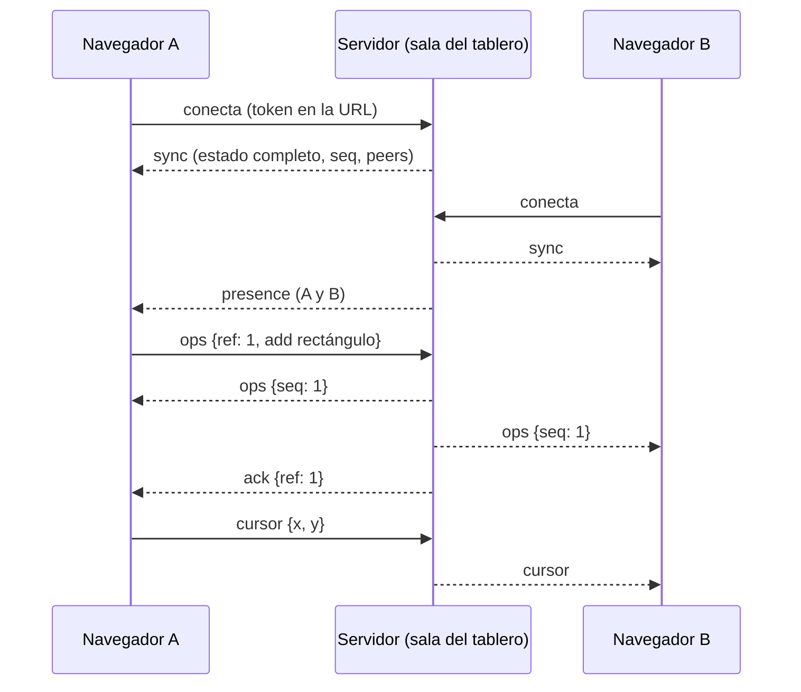

# Sincronización en tiempo real

Dos o más personas en el mismo tablero ven en vivo lo que dibujan las demás: trazos, movimientos, borrados, cursores y la lista de conectados.

Antes de esta rama no existía nada de tiempo real (ni WebSocket, ni presencia, ni cursores).

## Resumen

| Capacidad | Cómo funciona |
|---|---|
| Sala por tablero | `WS /ws/boards/{board_id}?token=<JWT>` |
| Crear / mover / borrar / editar | El frontend detecta el cambio en el store y lo envía como operación; el servidor la valida y la difunde |
| Trazo en curso | Se ve mientras el otro dibuja (mensaje efímero `draft`) |
| Cursores en vivo | Mensaje efímero `cursor`, limitado a ~25 por segundo |
| Presencia | Lista de conectados con color estable por usuario |
| Orden de eventos | Número de secuencia (`seq`) por sala, asignado por el servidor |
| Reconexión | Espera exponencial, estado completo al volver y reenvío de lo no confirmado |
| Permisos | `viewer` solo mira y mueve el cursor; `editor` y `owner` dibujan |

## Arquitectura



El servidor es el único que decide el orden. Cada lote de operaciones recibe un `seq` creciente y se envía a **todos, incluido el autor**. Así, si dos personas editan a la vez, todos terminan aplicando los cambios en el mismo orden y ven el mismo resultado.

## Protocolo

Mensajes JSON. Códigos de cierre propios: `4401` token inválido, `4403` no es miembro (o dejó de serlo). En ambos casos el cliente **no** reintenta.

### Cliente a servidor

| Mensaje | Descripción | Rol requerido |
|---|---|---|
| `{"type":"ops","ref":1,"ops":[...]}` | Crear, mover, editar o borrar elementos | editor u owner |
| `{"type":"cursor","x":10,"y":20}` | Posición del cursor | cualquiera |
| `{"type":"draft","element":{...}\|null}` | Trazo en curso (`null` = terminó) | editor u owner |
| `{"type":"resync"}` | Pide el estado completo otra vez | cualquiera |
| `{"type":"ping"}` | Latido | cualquiera |

### Servidor a cliente

| Mensaje | Descripción |
|---|---|
| `{"type":"sync","seq","you","elements","peers"}` | Estado completo. Se envía al conectar y tras un `resync` |
| `{"type":"ops","seq","conn","user_id","ops"}` | Lote de operaciones ya validadas |
| `{"type":"ack","ref","seq"}` | Confirma el lote `ref` del autor (`seq` es `null` si no se aplicó nada) |
| `{"type":"presence","peers":[...]}` | Lista de conexiones activas |
| `{"type":"cursor","conn","x","y"}` | Cursor de otra persona |
| `{"type":"draft","conn","element"}` | Trazo en curso de otra persona |
| `{"type":"error","code","message"}` | `forbidden`, `bad_message`, `too_large` |
| `{"type":"pong"}` | Respuesta al latido |

### Operaciones (`ops`)

```json
{ "op": "add",    "element": { "id": "...", "type": "rectangle", "x": 0, "y": 0, "width": 10, "height": 10 } }
{ "op": "update", "id": "...", "patch": { "x": 50, "text": null } }
{ "op": "delete", "id": "..." }
```

- Son **idempotentes**: repetir un `add`, `update` o `delete` deja el mismo resultado. Esto permite reenviar con seguridad tras una reconexión.
- En un `update`, un valor `null` borra un campo opcional (`points`, `text`, `textColor`, `fontFamily`).
- Un `update` solo puede cambiar `x`, `y`, `width`, `height`, `strokeWidth`, `fillColor`, `strokeColor`, `textColor`, `fontFamily`, `points` y `text`. No puede cambiar `id`, `type` ni `authorId`.

### Peer

```json
{ "conn": "a1b2c3d4e5f6", "user_id": "ana", "name": "Ana", "color": "#2563EB", "role": "editor" }
```

`conn` identifica una conexión, no a la persona: un mismo usuario con dos pestañas aparece dos veces en `peers`, y la interfaz lo muestra una sola vez.

## Garantías y manejo de fallos

**Orden.** El cliente guarda el último `seq` aplicado. Si llega uno repetido, lo ignora. Si falta alguno (hueco), pide un `sync` completo y descarta los lotes siguientes hasta recibirlo.

**Reconexión.** Si el socket se cae, el cliente reintenta con espera de 0,5 s, 1 s, 2 s… hasta 10 s, con un poco de aleatoriedad. También reintenta al volver la red (`online`). Al reconectar:

1. El servidor envía el estado completo.
2. El cliente reemplaza su tablero con ese estado.
3. Reenvía los lotes que no fueron confirmados con `ack`, así no se pierde lo dibujado sin conexión.

**Conexiones muertas.** El cliente manda `ping` cada 20 s y, si pasan 50 s sin recibir nada, cierra y reconecta.

**Deshacer/rehacer.** El store guarda "fotos" completas del tablero. Para que un `undo` propio no borre lo que dibujó otra persona, cada cambio remoto se aplica también a todas las fotos del historial.

**Permisos.** El rol se vuelve a consultar en la base de datos antes de cada lote de dibujo y, como máximo cada 5 s, en el resto de mensajes. Si el owner quita a alguien, se le cierra la conexión con `4403`. Si degrada a alguien a `viewer`, sus dibujos se rechazan con `error: forbidden` y su cliente se resincroniza.

**Validación.** El servidor nunca confía en el cliente:
- Solo acepta campos conocidos, con el tipo correcto y valores finitos.
- Fija `authorId` al usuario autenticado (no se puede suplantar).
- Límites: 5000 elementos por tablero, 5000 operaciones por mensaje, 50 000 números en `points`, 5000 caracteres de texto y 2 MB por mensaje.

## Archivos

### Backend (nuevos)

| Archivo | Contenido |
|---|---|
| `backend/app/routers/ws.py` | Endpoint WebSocket: autenticación, permisos y bucle de mensajes |
| `backend/app/realtime/rooms.py` | Salas: estado, presencia, orden (`seq`) y difusión |
| `backend/app/realtime/validation.py` | Validación y limpieza de elementos y parches |
| `backend/tests/test_realtime.py` | 16 tests |

### Frontend (nuevos)

| Archivo | Contenido |
|---|---|
| `frontend/src/realtime/RealtimeClient.ts` | Conexión, reconexión, orden de eventos y cola de pendientes (sin React) |
| `frontend/src/realtime/useBoardRealtime.ts` | Hook que conecta el store con la red |
| `frontend/src/realtime/boardBridge.ts` | Aplica eventos remotos al store y al historial |
| `frontend/src/realtime/elementOps.ts` | Funciones puras: `diffElements` (cambios a operaciones) y `applyOps` |
| `frontend/src/realtime/realtimeStore.ts` | Estado efímero: conexión, conectados, cursores y trazos ajenos |
| `frontend/src/realtime/protocol.ts` | Tipos de los mensajes |
| `frontend/src/components/PresenceBar.tsx` | Estado de la conexión y avatares de los conectados |
| `frontend/src/components/RemoteCursors.tsx` | Cursores de los demás sobre el lienzo |
| `frontend/src/components/presence.css` | Estilos de lo anterior |
| `frontend/src/realtime/*.test.ts` | Tests del cliente, la conversión de operaciones y el puente con el store |

### Archivos existentes modificados (cambio mínimo)

| Archivo | Cambio |
|---|---|
| `backend/app/main.py` | Registra el router `ws` (2 líneas) |
| `frontend/src/pages/BoardPage.tsx` | Llama a `useBoardRealtime`, muestra `PresenceBar` y `RemoteCursors` |
| `frontend/src/presentation/components/canvas/CanvasBoard.tsx` | Publica el trazo en curso propio y dibuja los trazos en curso de los demás (unas 6 líneas) |

`useBoardStore` **no se modificó**: los cambios locales se detectan suscribiéndose a él.

## Cómo probarlo

### Automático

```bash
# Backend
cd backend
pytest tests/test_realtime.py

# Frontend
cd frontend
npm test
npm run typecheck
npm run lint
```

### Manual (dos navegadores)

1. Levantar el backend y el frontend como siempre.
2. Iniciar sesión con dos usuarios distintos (por ejemplo, un navegador normal y otro en modo incógnito).
3. Con el primero, crear un tablero y compartirlo por link con el segundo.
4. Abrir el mismo tablero en los dos. Dibujar en uno: el trazo aparece en el otro mientras se dibuja, y se ven los cursores y los avatares arriba.
5. Probar la reconexión: apagar el backend unos segundos y volver a levantarlo. El indicador pasa a "Reconectando…" y luego a "En línea".

## Limitaciones conocidas

- **Persistencia.** Mientras alguien dibuja, el estado vive en memoria y el autosave lo copia a PostgreSQL (ver [PERSISTENCIA.md](PERSISTENCIA.md)). Al reiniciar el servidor, la primera persona que entra recibe lo guardado. Lo que ocurrió en los últimos segundos antes de una caída brusca puede perderse.
- **Un solo proceso.** Con varios workers de uvicorn cada uno tendría sus propias salas. Habría que añadir un bus (por ejemplo, Redis pub/sub).
- **Mover en vivo.** Mover o redimensionar un elemento se ve en los demás al soltarlo, no mientras se arrastra. Los trazos nuevos sí se ven mientras se dibujan.
- **Conflictos.** Si dos personas editan el mismo campo del mismo elemento a la vez, gana el último lote que procesó el servidor (último en escribir gana).
- **Token en la URL.** El navegador no puede mandar cabeceras en un WebSocket, así que el JWT va en la query. Conviene usar `wss://` en producción y no registrar las URLs completas en los logs del proxy.
- **Coordenadas de los cursores.** Se envían tal cual en píxeles de la ventana. Si dos personas tienen ventanas de tamaños muy distintos, el cursor puede no coincidir exactamente con el elemento que señalan.

## Para el resto del equipo

- **Canvas (Persona 2):** cualquier cambio que se haga en `useBoardStore.elements` se sincroniza solo. Si se añaden campos nuevos a `CanvasElement`, hay que agregarlos a las listas de `backend/app/realtime/validation.py` y de `frontend/src/realtime/elementOps.ts`; si no, no viajarán por la red.
- **Persistencia (Persona 4):** ya está conectada con `manager.loader` y `manager.on_ops`. Ver [PERSISTENCIA.md](PERSISTENCIA.md).
- **Auth:** el WebSocket usa `decode_token` de `backend/app/auth.py`, igual que el resto de la API.
