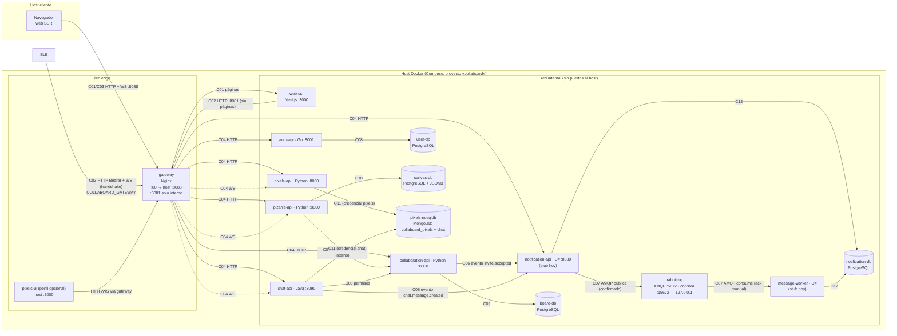

# Vista de despliegue del prototipo 2

Coherente con [`docker-compose.yml`](../docker-compose.yml) (servicios, redes, puertos y volúmenes
reales). Decisiones: [docs/adr/](adr/). Pendientes de otros paquetes: [p2-pendientes-coordinacion.md](p2-pendientes-coordinacion.md).

## Diagrama

## Contenedores, puertos y volúmenes

| Servicio (Compose) | Imagen / origen | Puerto en contenedor | Publicado al host | Red | Volumen |
|---|---|---|---|---|---|
| `gateway` | `gateway/` (nginx:1.27-alpine) | 80 público, 8081 interno | **8088→80** | edge + internal | — |
| `web-ssr` | `web-ssr/` | 3000 | — | internal | — |
| `auth-api` | `authentication-module/` | 8001 | — | internal | — |
| `collaboration-api` | `colaboracion-module/` | 8000 | — | internal | — |
| `pizarra-api` | `pizarra-module/pizarra-backend/` | 8000 | — | internal | — |
| `chat-api` | `chat-module/` | 8090 | — | internal | — |
| `pixels-api` | `pixels-module/pixel-backend/` | 8000 | — | internal | — |
| `notification-api` | `stubs/notification-api/` (stub) | 8080 | — | internal | — |
| `message-worker` | `stubs/message-worker/` (stub) | 8080 (solo /health) | — | internal | — |
| `rabbitmq` | `rabbitmq/` (3.13-management) | 5672, 15672 | **127.0.0.1:15672** | internal | `rabbitmq_data` |
| `user-db` (D1) | postgres:16-alpine | 5432 | — | internal | `user_db_data` |
| `board-db` (D2) | postgres:16-alpine | 5432 | — | internal | `board_db_data` |
| `canvas-db` (D3) | postgres:16-alpine | 5432 | — | internal | `canvas_db_data` |
| `notification-db` (D5) | postgres:16-alpine | 5432 | — | internal | `notification_db_data` |
| `pixels-nosqldb` (D4) | mongo:7 | 27017 | — | internal | `pixels_mongo_data` |
| `pixels-ui` (perfil `pixels-ui`) | `pixels-module/pixel-frontend/` | 80 | **3000** | edge | — |

Cinco almacenes de datos, dos motores (PostgreSQL y MongoDB). RabbitMQ no cuenta como base de datos.

## Catálogo de conectores de infraestructura

| ID | Origen → destino | Protocolo | Cómo lo resuelve la infraestructura |
|---|---|---|---|
| C01 | Navegador → web SSR | HTTP | `location /` del gateway público |
| C02 | web SSR → gateway | HTTP interno | Segundo `server` del gateway en `:8081`, **solo en la red `internal`** y **sin `location /`**: el SSR no puede pedirse páginas a sí mismo (sin bucles). Sin límite de tasa (una sola IP origen). Ver [ADR 0002](adr/0002-ruta-interna-ssr-gateway.md) |
| C03 | Navegador → gateway | HTTP REST + WebSocket | Único puerto público (`8088`). Cookie `cb_session` (web) o `Authorization: Bearer`, reenviadas sin modificar |
| C04 | Gateway → 6 APIs | HTTP; WS a Pizarra, Chat y Pixels | Plantillas envsubst; `Upgrade`/`Connection`, HTTP/1.1, `proxy_read_timeout 1h` en WS; reescritura de rutas de Pizarra ([ADR 0001](adr/0001-gateway-nginx-y-reescritura-de-rutas.md)) |
| C07 | NotificationAPI → RabbitMQ → worker | AMQP | vhost `collaboard`, exchange `notifications.events`, cola quorum `notifications.tasks` con DLQ; usuarios de mínimo privilegio ([ADR 0005](adr/0005-topologia-rabbitmq-y-permisos.md)) |
| C11 | Pixels / Chat → MongoDB | Protocolo MongoDB | Dos bases (`collaboard_pixels`, `chat`) con **usuarios separados** y rol `readWrite` solo sobre la suya ([ADR 0010](adr/0010-mongodb-bases-y-credenciales-separadas.md)) |

C05, C06 y C08–C10, C12 son conexiones de las propias APIs a su destino dentro de la red `internal`
(nombres DNS de Compose); la infraestructura solo garantiza alcanzabilidad y orden de arranque
(`depends_on` con `service_healthy`).

## Patrones de despliegue

Gateway / punto de entrada único · segmentación en redes (`edge`/`internal`) · una base por dominio
(persistencia políglota) · contenedor por servicio con *healthcheck* y arranque ordenado · volumen con nombre
por almacén · configuración por variables de entorno (12-factor) · *stubs* intercambiables por el servicio real
sin tocar el gateway.

## Estado actual honesto

- `notification-api` y `message-worker` son **stubs** (no consumen RabbitMQ). El broker, sus permisos y la DLQ
  están verificados con `scripts/rabbit_smoke_test.py`, no con el flujo real.
- Pizarra aún lleva su propia copia del CRUD de tableros; para el recorrido completo se usa el override
  `docker-compose.compat-shared-db.yml` (ver pendientes).
