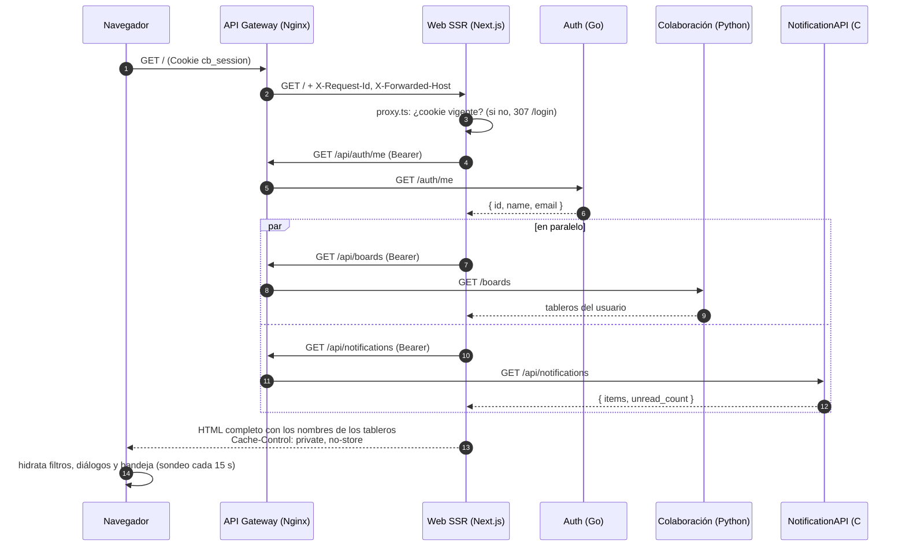
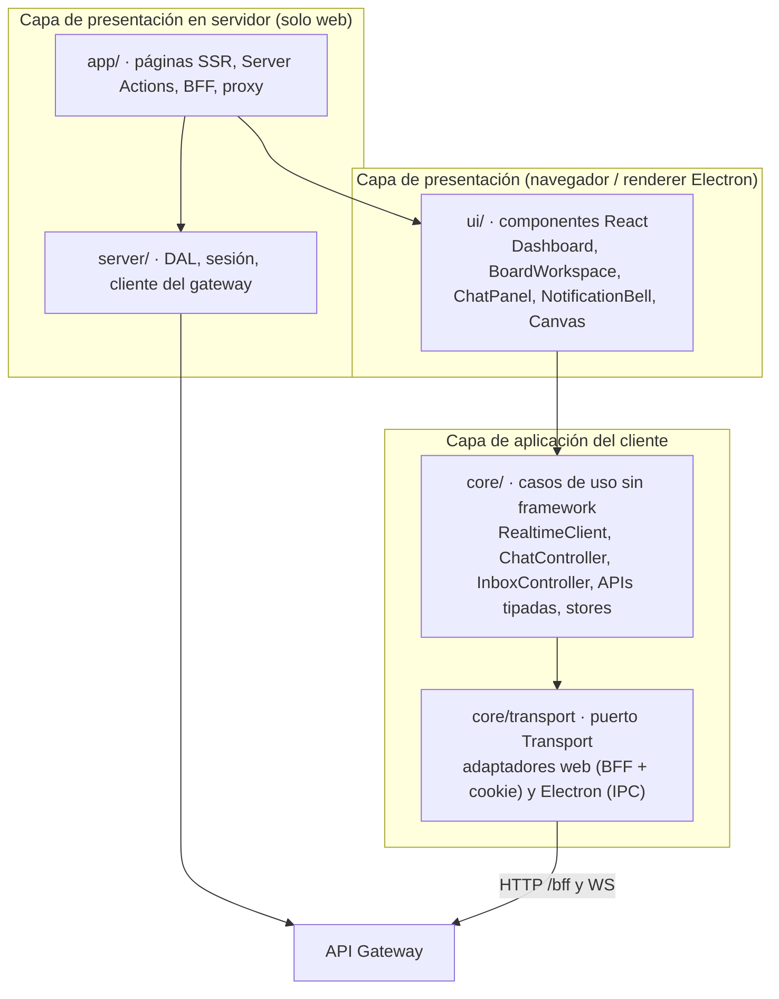

# Web SSR — presentación web del prototipo 2

**Paquete A del plan P2 · Responsable: Jhon Prieto · Revisor: Estefan (Stephan)**
Código: [`web-ssr/`](../../web-ssr/) · Contratos: [CONTRATOS_WEB.md](CONTRATOS_WEB.md) ·
Cliente local: [ADAPTADOR_ELECTRON.md](ADAPTADOR_ELECTRON.md)

## 1. Qué cambia respecto al prototipo 1

| Prototipo 1 | Prototipo 2 |
|---|---|
| SPA de Vite: el HTML llega vacío y el navegador pide todo | Next.js 16 renderiza en el servidor, **por petición**, el dashboard y la cabecera de cada tablero |
| JWT en `localStorage` (legible por cualquier script) | JWT en cookie **HttpOnly + SameSite=Lax**; el JavaScript del navegador nunca lo ve |
| El navegador llama a cada backend por su puerto (`:8000`, `:8001`, `:8002`) | Un solo origen: el navegador habla con el gateway; las páginas y el BFF con `/api/*` |
| Token en la URL del WebSocket (`?token=`) | El WebSocket se abre en el mismo origen y la cookie viaja sola |
| Sin chat ni notificaciones | Panel de chat (historial, envío idempotente, en vivo) y bandeja con contador |
| Componentes atados a react-router y `localStorage` | `core/` y `ui/` sin Next.js, reutilizables por el cliente Electron |

## 2. Decisiones de diseño

| # | Decisión | Motivo | Alternativa descartada |
|---|---|---|---|
| D1 | App Router **sin** Cache Components; páginas privadas con `dynamic = "force-dynamic"` | El HTML inicial debe traer los datos del usuario completos (no un "shell" con streaming); cada respuesta lleva `Cache-Control: private, no-store` | Prerender estático o caché compartida: podría mezclar datos entre cuentas |
| D2 | Sesión = el mismo JWT de Auth (Go) dentro de una cookie HttpOnly | El gateway y las APIs pueden leerlo para autenticar el WebSocket; no hay un segundo almacén de sesiones | Sesión cifrada propia de Next (iron-session): las APIs no podrían validarla |
| D3 | **BFF** `/bff/*` en Next: lee la cookie y reenvía con `Authorization: Bearer` | Las APIs reciben siempre Bearer (igual que desde Electron); CSRF y lista blanca en un solo lugar | Que cada API lea cookies: más superficie de CSRF repartida entre 6 servicios |
| D4 | WebSocket directo al gateway (no pasa por Next) | Next no hace *proxy* de WebSocket; el gateway sí (Upgrade/Connection) | Servidor Node propio delante de Next: más piezas sin beneficio |
| D5 | Konva solo en el navegador (`next/dynamic` con `ssr: false`) | Konva necesita `window` y `<canvas>`; el servidor entrega un marcador accesible | Renderizar el lienzo en el servidor con `node-canvas`: costoso y sin interacción |
| D6 | Capas `core/` → `ui/` → `server/` + `app/`, verificadas con ESLint | El cliente Electron reutiliza `core/` y `ui/` sin arrastrar Next.js | Copiar componentes en el cliente local: dos implementaciones divergentes |
| D7 | Stores por instancia (`createStore`) para chat y bandeja | En el servidor un store global se compartiría entre peticiones | Store global de zustand inicializado en el render (fuga entre usuarios) |
| D8 | Zona horaria fija `America/Bogota` al formatear horas | El servidor (UTC en Docker) y el navegador producen el mismo texto: la hidratación no falla | Hora local del navegador: diferencias entre HTML del servidor y del cliente |
| D9 | Mocks de Chat y Notificaciones con el contrato del plan | Permiten construir y probar la interfaz antes de que existan los servicios Java y C# | Esperar a los servicios: bloquearía el paquete A hasta el día 29 |

## 3. Flujo de una página SSR

Todas las llamadas del servidor web llevan el mismo `X-Request-Id` que asignó el gateway,
así se puede seguir una petición en los logs de los tres servicios (los logs de la web son
JSON de una línea y nunca incluyen tokens ni cuerpos).

## 4. Qué se renderiza dónde (límite cliente/servidor)

| Elemento | Servidor (HTML inicial) | Navegador (tras hidratar) |
|---|---|---|
| Dashboard | Lista real de tableros, saludo, contador de la bandeja | Filtros, búsqueda, crear/renombrar/borrar/salir (por BFF) |
| Página del tablero | Título, nombre, rol, número de miembros, primer bloque del chat, estado guardado | Lienzo Konva, WebSocket de dibujo, presencia, cursores, guardado, chat en vivo |
| Invitación | Nombre del tablero y rol ofrecido | Aceptar (Server Action; funciona también sin JavaScript) |
| Login / registro | Formulario completo | Mostrar/ocultar contraseña y estados de envío (Server Action) |

Si una consulta **opcional** del SSR falla (estado del lienzo, chat o bandeja), la página se
sirve igual y el navegador la pide después; si falla una consulta **esencial** (sesión o
tablero), se responde con la página de error o con 404.

## 5. Sesión y seguridad

- **Inicio de sesión**: el formulario envía a una *Server Action*; el servidor web llama a
  `POST /api/auth/login` y guarda el JWT en `cb_session` (`HttpOnly`, `SameSite=Lax`, `Path=/`,
  `Max-Age` = vida restante del token, `Secure` con `SESSION_COOKIE_SECURE=true`).
- **Verificación**: `proxy.ts` hace una comprobación optimista (cookie presente y no vencida);
  la verificación real ocurre en la DAL (`GET /api/auth/me`, una vez por petición) y en cada API.
- **Cierre de sesión**: *Server Action* que borra la cookie en el servidor. Un 401 de cualquier
  API lleva a `/session/expired`, que también la borra.
- **CSRF**: las *Server Actions* comparan `Origin` con el host; el BFF exige, en métodos que
  modifican, `Origin` del propio sitio y la cabecera `x-collaboard-client: web`. Con
  `SameSite=Lax` la cookie no viaja en peticiones de otros sitios.
- **Lista blanca**: el BFF solo reenvía `/api/boards`, `/api/invites`, `/api/canvas`,
  `/api/chat`, `/api/notifications` y `/api/pixels`; rechaza `..`, segmentos codificados y
  cualquier `internal`. El gateway también bloquea `/internal/*`.
- **Sin fugas**: el HTML no contiene el JWT (verificado en pruebas); ninguna función de la DAL
  recibe un `userId` externo, siempre usa la identidad de la sesión.
- **Cabeceras**: `X-Content-Type-Options`, `X-Frame-Options: DENY`, `Referrer-Policy`,
  `Permissions-Policy` y `Cross-Origin-Opener-Policy`.

## 6. Vista de capas de la presentación (aporte a la sección *Layered*)

| Capa | Elementos | Puede usar | No puede usar |
|---|---|---|---|
| `core/` | Dominio (tableros, chat, notificaciones, lienzo), transporte, APIs, clientes de tiempo real | Nada más que sí misma | React, Next.js, `server/`, `ui/` |
| `ui/` | Componentes y hooks de React | `core/` | Next.js, `server/`, `app/` |
| `server/` | DAL, sesión, gateway, políticas BFF | `core/` | `ui/` (no renderiza) |
| `app/` | Rutas y adaptadores web (`next/link`, `useRouter`, transporte web) | Todas | — |

Patrones: **capas estrictas** (reglas de ESLint), **puertos y adaptadores** (`Transport`
con adaptador web y Electron), **BFF**, **DAL** (acceso a datos centralizado y autorizado),
**SSR + hidratación** e **inyección de dependencias** por contexto de React
(`AppProvider`, `NavigationProvider`).

## 7. Conectores en los que participa la web

| ID | Origen → destino | Protocolo | Implementación |
|---|---|---|---|
| C01 | Navegador → Web SSR | HTTP (documento, recursos, BFF, Server Actions) | Gateway `location /` → `web-ssr:3000` |
| C02 | Web SSR → Gateway | HTTP interno con Bearer y `X-Request-Id` | `server/gateway.ts` (`GATEWAY_INTERNAL_URL`) |
| C03 | Navegador → Gateway | WebSocket (`/ws/boards/{id}`, `/ws/chat/boards/{id}`) con cookie | `core/transport/webTransport.ts` |

## 8. Pruebas ejecutadas

Resultados del 25 de octubre de 2026 sobre la rama `feature/web-ssr` (Windows 11, Node 24,
Docker 28):

| Suite | Herramienta | Resultado | Qué demuestra |
|---|---|---|---|
| Unitarias y de componentes | Vitest + Testing Library | **119/119** | Transporte, BFF, chat (idempotencia, reintento, sondeo, 4403), bandeja (optimista y reversión), tiempo real (`saved`/`restored`), componentes por rol |
| Integración SSR | Vitest + servidor Next compilado + gateway falso | **10/10** | HTML con datos antes de JS, cuentas aisladas en paralelo, sin JWT, `no-store`, redirecciones, 404 sin revelar nombres, BFF y CSRF |
| Contrato Chat/Notificaciones | `node:test` sobre los mocks | **10/10** | JWT, membresía, `client_message_id`, cursores, WebSocket solo a miembros, notificaciones solo a terceros, eventos internos idempotentes |
| De punta a punta | Playwright + stack Docker (gateway, Auth, Colaboración, Pizarra, mocks) | **3/3** | SSR con JavaScript desactivado, recorrido de dos usuarios (crear, dibujar, compartir, unirse, chatear, notificar), *viewer* sin herramientas, cierre de sesión |
| Estáticas | ESLint (límites de capas) + `tsc --strict` + `next build` | Sin errores | Todas las rutas privadas son dinámicas (`ƒ`) |

Comandos para repetirlas: ver [`web-ssr/README.md`](../../web-ssr/README.md#pruebas).

## 9. Pendientes de integración con el equipo

| Con | Qué falta | Estado hoy |
|---|---|---|
| **Sebastian** (gateway) | Publicar las rutas de la sección 4 del plan; para el WS de Pizarra, pasar la cookie (o traducirla a `Authorization`) | `web-ssr/dev/gateway/nginx.conf` replica las rutas; traduce cookie → `?token=` **solo como transición** |
| **Sebastian** (Electron) | Implementar `CollaBoardBridge` en `preload`/`main` y montar `ui/` con `createElectronTransport` | Contrato tipado y pruebas en `core/transport/electronTransport.ts` |
| **David / Marlon** (Pizarra WS) | Que `/ws/boards/{id}` acepte la cookie `cb_session` o `Authorization: Bearer` además de `?token=` | Mientras tanto lo cubre el gateway de desarrollo |
| **Marlon** (Chat Java) | Implementar el contrato de [CONTRATOS_WEB.md §2](CONTRATOS_WEB.md#2-chat-api-java) | La web funciona contra el mock; las pruebas del mock sirven de especificación |
| **Cristian** (NotificationAPI C#) | Implementar el contrato de [CONTRATOS_WEB.md §3](CONTRATOS_WEB.md#3-notificationapi-c) | Igual que Chat |
| **Estefan** (persistencia) | Mantener `GET /boards/{id}/state` (expuesto como `/api/canvas/boards/{id}/state`) al separar CanvasDB | Ya lo consume el SSR del tablero |
| **David** (Colaboración) | Emitir `invite.accepted` hacia NotificationAPI | La bandeja ya lo muestra (probado con el evento interno del mock) |

## 10. Limitaciones conocidas

- Una réplica de Pizarra y de Chat (las salas viven en memoria de cada proceso).
- Sin modo *offline*: si se cae la red, el dibujo se encola en memoria y se reenvía al
  reconectar, pero no sobrevive a recargar la página.
- La bandeja se actualiza por sondeo (15 s); no hay WebSocket de notificaciones (decisión del plan).
- El gateway de desarrollo no es el definitivo: no aplica límites de tasa ni TLS.
