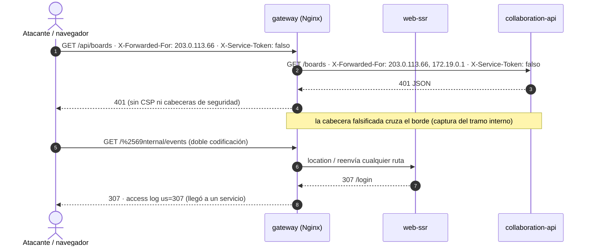
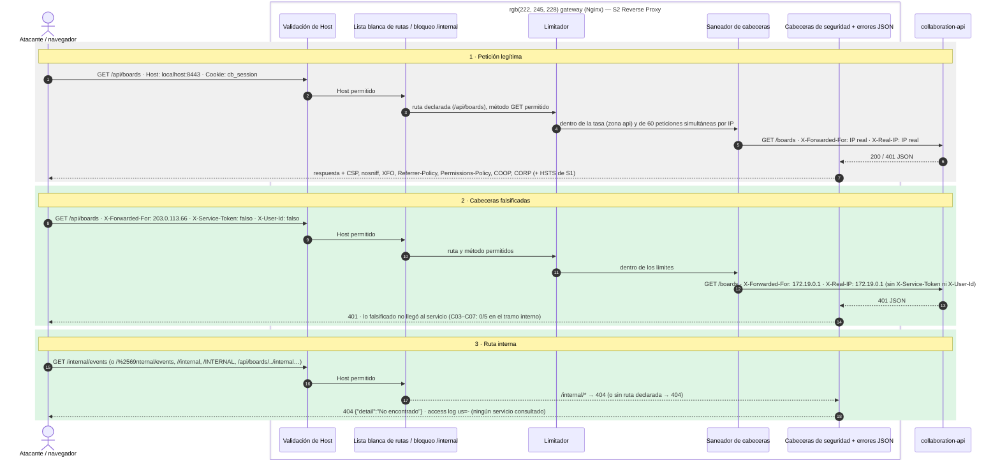

## S2 — Reverse Proxy (gateway endurecido, punto único de entrada)

Color del escenario: **verde** (borde y etiqueta, p. ej. `#2E9E44`). Los elementos del P2 no cambian de
color. Nombres de servicio idénticos a `docker-compose.yml`. Cada conector con protocolo y puerto.

**Estado de los archivos.** En `docs/p3/diagramas/base/` solo existe la base de C&C
(`vista-cc.base.drawio`); las bases de despliegue, capas y descomposición del reparto (§4.2, paso 1) aún
no están en el repositorio, y en este equipo no hay draw.io para exportar los PNG a 150 dpi. Por eso este
documento da la **lista exacta de cambios** por vista y el **diagrama de secuencia en Mermaid**, para
pasarlos a `vista-*.S2.drawio` (copias de cada base) en verde y con leyenda («negro/gris = P2 · azul = S1 ·
verde = S2»). Todo lo listado existe en `docker-compose.yml` o en `gateway/`.

### Vista C&C (`vista-cc.S2.drawio`, copia de `base/vista-cc.base.drawio`)
- Añadido: dentro de `gateway (Nginx)`, el estereotipo «reverse proxy» y sus módulos (cajas verdes):
  - **Validación de Host**: `GATEWAY_ALLOWED_HOSTS`; otro Host → 421.
  - **Lista blanca de rutas y métodos**: `api-routes`, `web-routes`, `limit_except`; lo demás → 404 o 405.
  - **Bloqueo de rutas internas**: `/internal/*` → 404.
  - **Saneador de cabeceras**: `proxy-sanitize.conf`.
  - **Limitador**: zonas `api`, `auth` y `web`; `conn` y `conn_ws` por IP; tiempos de 10 s; tamaños.
  - **Cabeceras de seguridad**: CSP, nosniff, XFO, Referrer-Policy, Permissions-Policy, COOP y CORP.
  - **Errores JSON**.
  - **X-Request-ID**: ya existía en el P2 y queda en negro.
- Añadido: conector Browser → `gateway` con la etiqueta `HTTPS :443 /pixels/` (documento y estáticos de la UI de Pixels).
- Añadido: conector `gateway` → `pixels-ui` con la etiqueta `HTTP :80 (red edge)`.
- Modificado: conector Browser → `gateway` (`HTTPS / WSS :443`, de S1): nota verde «único punto de entrada; todo pasa por la política de borde».
- Eliminado: conector Browser → `pixels-ui` (`HTTP :3000`). El navegador ya no llega a `pixels-ui` sin pasar por el gateway.
- Sin cambios: el conector desde la SPA de Pixels (en el navegador) a `gateway` (`HTTPS + WSS :443`, de S1) y los conectores `gateway` → APIs (`HTTP` en la red `internal`).
- Estilos/patrones a describir en el texto: **Reverse Proxy** (único punto de entrada, lista blanca, saneado, límites); se apoya en **Secure Channel** (S1) en el mismo borde.

### Vista de despliegue (`vista-despliegue.S2.drawio`)
- Modificado: nodo `pixels-ui` (`Nginx / Static`): se elimina el puerto publicado `3000 → 80`; queda solo `80` interno en la red `edge`.
- Añadido: anotación verde junto a `gateway`: «únicos puertos publicados: `8088 → 80` (solo 301) y `8443 → 443`; más la consola de RabbitMQ en `127.0.0.1:15672`».
- Añadido: conector `gateway` → `pixels-ui` `HTTP :80` dentro de `edge`.
- Eliminado: el acceso del host/LAN a `3000`. Corrige el texto del P2 «Únicamente el gateway (8088) y el frontend pixels-ui (3000:80) exponen interfaces».
- Sin cambios: redes `edge` e `internal` (son de S3), bases y broker sin puertos publicados, volumen de certificados de S1.

### Vista de capas (`vista-capas.S2.drawio`)
- Añadido: en la **Communication Tier**, dentro de `gateway Nginx`, el bloque verde «reverse proxy» con los módulos de la vista C&C (validación de Host, lista blanca, saneador, limitador, cabeceras de seguridad, bloqueo de rutas internas, errores JSON), junto al bloque azul de S1.
- Modificado: `pixels-ui Frontend SPA` (Presentation Tier) se usa a través de la Communication Tier. La flecha *Allow to use* Presentation → Communication sigue siendo la única entrada; no hay ninguna flecha de `pixels-ui` al navegador que la salte.
- Eliminado: ninguno.

### Vista de descomposición (`vista-descomposicion.S2.drawio`)
- Añadido: en el subsistema **Gateway y trazabilidad** → `gateway (Nginx)`, siete módulos nuevos en verde (junto a *Proxy HTTP / WS*, *Enrutar a las APIs* y *X-Request-ID* del P2, y *Terminación TLS y certificados* de S1):

  | Módulo nuevo | Archivos |
  |---|---|
  | Validación de Host | `gateway/allowed-hosts.envsh`, `templates/snippets/hardening.conf.template` |
  | Lista blanca de rutas y métodos | `templates/snippets/api-routes.conf.template`, `templates/snippets/web-routes.conf.template` |
  | Bloqueo de rutas internas | `templates/snippets/api-routes.conf.template` |
  | Saneador de cabeceras | `snippets/proxy-sanitize.conf` |
  | Limitador de tasa y conexiones | `templates/10-hardening.conf.template` |
  | Cabeceras de seguridad | `templates/snippets/security-headers.conf.template` |
  | Errores JSON | `templates/snippets/error-pages.conf.template` |

- Modificado: `pixels-ui (React / Vite)` (subsistema **Creatividad**): anotación «servido en `/pixels/` por el gateway (`VITE_BASE_PATH`)».
- Eliminado: ninguno. No se renombra ningún subsistema ni módulo del P2.

### Diagrama de secuencia del escenario (`secuencia-S2.drawio`; fuente Mermaid abajo)

Muestra el estímulo → respuesta de tres peticiones: una legítima, una con cabeceras falsificadas y una a
`/internal`, primero en el P2 y luego en el P3. En el P3 se indica qué filtro actúa en cada una (en
verde, los módulos de S2). Los valores salen de `docs/p3/evidencia/S2/`.

**Antes (P2):**

**Después (P3):**

Para draw.io: cada mensaje como flecha con su etiqueta; los participantes de S2 (y la banda de los
casos 2 y 3) en verde; leyenda «negro = P2 · verde = S2». En el diagrama «antes», marcar en rojo la
flecha `gateway → collaboration-api` con la cabecera falsificada y la flecha `gateway → web-ssr` de la
doble codificación.
