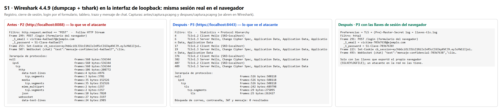

# S1 · Evidencia con Wireshark

Capturas hechas con Wireshark 4.4.9 (dumpcap) en la interfaz **Adapter for loopback traffic capture**
(Npcap) del equipo, mientras un navegador real (Chromium) usa la web: se registra, cierra sesión,
inicia sesión por el formulario, crea un tablero, dibuja y escribe en el chat. La interfaz de loopback
ve exactamente los bytes que el navegador envía al gateway: lo mismo que vería alguien en la red.

| Carpeta | Sistema | Resultado |
|---|---|---|
| `antes/` | P2 (`main` @ `593b626`), `http://localhost:8088` | correo 28, contraseña 42, JWT 131 y mensaje 41 apariciones legibles |
| `despues/` | P3 (`p3/s1-tls`), `https://localhost:8443` | **0** apariciones sin llaves; con las llaves del navegador, la misma captura sí contiene la sesión |

Cada carpeta tiene `captura.pcapng` (se abre en Wireshark), `paquetes-*.txt` (la lista de paquetes
relevantes), `resumen.json` y `salida.txt`. `despues/llaves-tls.log` son los secretos de sesión TLS
que exportó el navegador (`SSLKEYLOGFILE`). Solo abren esta captura y no sirven para nada más.



## Mostrarlo en la interfaz de Wireshark

**Antes (P2):** abrir `antes/captura.pcapng`.
1. Filtro `http.request.method == "POST"`. En el paquete `POST /login` → panel de detalle →
   *MIME Multipart* → partes `_1_email` y `_1_password`: el correo y la contraseña en claro.
2. Clic derecho → *Follow* → *HTTP Stream*: toda la conversación legible, incluido el
   `Set-Cookie: cb_session=eyJ…` (el JWT de la sesión).
3. Filtro `websocket`: las tramas del chat con el texto del mensaje. Wireshark las desenmascara solo,
   porque la máscara viaja en la misma trama.
4. *Edit → Find Packet → String* con la contraseña: aparece.

**Después (P3):** abrir `despues/captura.pcapng`.
1. Filtro `tls`: solo *Client Hello* (SNI `localhost`), *Server Hello* y *Application Data*.
   Wireshark etiqueta el *Client Hello* como "TLSv1.2" porque en TLS 1.3 el registro lleva la versión
   heredada por compatibilidad; la versión real va en la extensión `supported_versions` (TLS 1.3, `0x0304`),
   y el *Server Hello* sí aparece como TLSv1.3.
2. *Statistics → Protocol Hierarchy*: solo `tls`, sin `http`.
3. *Edit → Find Packet → String* con la contraseña o el correo: no aparece.
4. Algunos *Server Hello* no traen certificado: es la **reanudación de sesión** (`ssl_session_cache`),
   la mitigación de rendimiento de la sección 8.
5. Para comprobar que la captura sí era esa sesión: *Edit → Preferences → Protocols → TLS →
   (Pre)-Master-Secret log filename* = `despues/llaves-tls.log`. Con el filtro `http2`, ahora se ven el
   `POST /login` con `_1_email`/`_1_password`, el `set-cookie` y el chat. Sin esas llaves, que solo tiene
   el navegador, no hay forma de leerlo.

## Repetirlo (o hacerlo en vivo)

```bash
pip install -r e2e/requirements.txt          # Playwright
python -m playwright install chromium
# P3 arriba: docker compose up -d --build --wait
python security-tests/s1_wireshark.py --base https://localhost:8443 --out <carpeta> --headed
# P2 (para el antes): levantar main y usar --base http://localhost:8088
```

`--headed` muestra el navegador mientras captura. Para la demo en vivo también sirve Wireshark
directamente: *Capture → Adapter for loopback traffic capture* con el filtro de captura
`tcp port 8088 or tcp port 8443`, y usar la web a mano en `http://localhost:8088` (P2) o
`https://localhost:8443` (P3).

La verificación automática del escenario (redirección, versiones de TLS, HSTS, cookie `Secure`, `wss://`
y captura con `tcpdump` en la interfaz del gateway) es `security-tests/s1_tls.py` y corre en el CI.
