# Prototipo 3 — Prueba de rendimiento integral de `GET /api/boards`

**Autor de la prueba:** Marlon David Pabón Muñoz
**Arquitectura de Software 2026-II · Universidad Nacional de Colombia**

---

## Resumen

Se caracterizó el rendimiento de `GET /api/boards` (listar los tableros del usuario) sobre el sistema
integrado del Prototipo 3, con TLS, reverse proxy endurecido, redes segmentadas, JWT y autorización por
roles en el camino de cada petición. La campaña registró **64 corridas, de las cuales 62 son válidas**; las
dos excluidas se conservan con su causa. Los resultados principales son:

- **E1, gateway con los límites de producción.** Desde una sola IP, los primeros HTTP 429 aparecen entre
  **30 y 40 req/s**. A 40 req/s el gateway rechazó el **23,35 %** de los intentos y a 60 req/s el
  **48,90 %**, mientras las TPM exitosas se quedaron en 1.840 (1.800 sostenidas más la ráfaga inicial).
  Los rechazos se responden en 2 ms (p95) y la CPU media de `collaboration-api` no superó el 33,25 % de su núcleo (mediana por nivel).
- **E2, servicio original.** El punto óptimo operativo es **1 VU (5.972 TPM, p95 14 ms)**, la rodilla está
  en **2–3 VUs** y el límite práctico de throughput es **2 VUs (7.090 TPM de mediana)**, con
  `collaboration-api` a ~100 % de su núcleo. Con más concurrencia aparece un segundo régimen, más grave:
  los **primeros timeouts se observan entre 16 y 24 VUs** y a **32 VUs fallan hasta el 49,23 %** de los
  intentos, con las 15 conexiones del pool de SQLAlchemy retenidas en `idle in transaction`. Es el mismo
  defecto que se encontró en el Laboratorio 6, porque su corrección no está en la rama P3.
- **E2, variante con el pool corregido.** La rodilla sigue en **2–3 VUs** y el límite práctico de
  throughput en **2 VUs (6.472 TPM)**, porque el recurso que se satura sigue siendo la CPU. Lo que cambia es
  el comportamiento bajo sobrecarga: **0 fallos en 197.178 intentos válidos**, hasta 200 VUs. El SLO de
  latencia se cumple en 3/3 réplicas a 24 VUs, en 1/3 a 28 VUs y en 0/3 a 32 VUs. A 200 VUs (40 s) el
  sistema sostuvo 5.389,5 TPM con p95 de 2.878 ms y 0 % de errores. **No se observó un umbral de errores**
  en la carga ensayada: un intento de ampliar a 250 VUs se detuvo antes de medir por falta de memoria
  disponible en el host, de modo que 200 VUs es el máximo nivel válido.

La corrección del pool **no aumentó el throughput máximo**: eliminó el colapso por agotamiento de
conexiones y convirtió la degradación en una cola que crece de forma ordenada. El cuello de botella del
recorrido es la CPU de `collaboration-api`, limitada a un núcleo.

---

## 1. Introducción y objetivos

En el Laboratorio 6 medimos `GET /api/boards` contra el sistema del Prototipo 2: un gateway HTTP,
`collaboration-api` y `board-db`. Allí encontramos primero un bloqueo del servicio por un pool de
conexiones demasiado pequeño y, después de corregirlo, una curva cuya rodilla ubicamos en ~200 usuarios
concurrentes (~10.037 TPM), con `collaboration-api` al límite de su CPU.

En el Laboratorio 6 la petición ya llevaba un JWT y pasaba por un gateway Nginx con limitación de tasa por
IP. El Prototipo 3 modificó y endureció ese camino: ahora entra por HTTPS (S1), atraviesa un reverse proxy
endurecido con listas blancas y límites por IP (S2), viaja por redes segmentadas (S3), usa un esquema de
sesión con JWT de vida corta (S4) y se resuelve dentro de un modelo de autorización por roles (S5).
Esas tácticas fueron diseñadas e implementadas por otros integrantes del grupo y están documentadas en sus
propios fragmentos; aquí no se modifican ni se evalúan como tácticas de seguridad. **Lo que se evalúa es
cómo se comporta el sistema integrado cuando la funcionalidad recibe carga concurrente**, ya con todos esos
controles en el camino.

El aporte de este fragmento frente al Laboratorio 6 es metodológico y de alcance: (1) se separa de forma
explícita el límite que impone la política del gateway (E1) de la capacidad del recorrido detrás de él
(E2); (2) se distinguen con reglas explícitas el punto óptimo, la rodilla, el incumplimiento
del SLO, el primer error y el límite de capacidad; (3) cada nivel formal se mide tres veces con ventanas de
90 s; (4) se diagnostica el pool de conexiones con telemetría de PostgreSQL y logs correlacionados; y (5) se
compara de forma controlada el código original con una variante corregida sobre el mismo entorno.

Los objetivos son:

1. Caracterizar el efecto del limitador de tasa del gateway sobre una fuente de tráfico, con la
   configuración de producción (**E1**).
2. Construir la curva de rendimiento del recorrido completo con el limitador elevado solo en el entorno de
   laboratorio (**E2**) y ubicar en ella, por separado, el punto óptimo, la rodilla y el límite práctico.
3. Refinar los intervalos donde el comportamiento cambia.
4. Explicar la forma de las curvas a partir de lo que ocurre en la arquitectura (gateway, proceso de
   Python, pool de conexiones y PostgreSQL).
5. Verificar si el defecto del pool observado en el Laboratorio 6 reaparece en P3 y medir el efecto de su
   corrección.

### 1.1 Escenario de calidad de rendimiento

| Parte | Descripción |
|---|---|
| **Fuente** | Usuarios autenticados de CollaBoard que abren su lista de tableros (simulados con k6) |
| **Estímulo** | Peticiones concurrentes `GET /api/boards` con `Authorization: Bearer <JWT>`, a tasa fija (E1) o con un número fijo de usuarios concurrentes (E2) |
| **Artefacto** | Recorrido completo: gateway Nginx (TLS y controles de borde) → `collaboration-api` (FastAPI) → `board-db` (PostgreSQL 16) |
| **Entorno** | Sistema P3 integrado, en un proyecto de Compose aislado del de desarrollo, con 1 CPU por contenedor en los tres componentes del recorrido; E1 con los límites del gateway de producción y E2 con el limitador elevado |
| **Respuesta** | El sistema devuelve la lista completa y correcta de los tableros del usuario, o rechaza la petición de forma controlada (429 en E1) |
| **Medida** | TPM exitosas; latencia p50, p95 y p99 de las respuestas exitosas; porcentaje de fallos por categoría; CPU y RAM por contenedor; conexiones de PostgreSQL por estado |

### 1.2 Hipótesis

Las hipótesis se escribieron antes de ejecutar la campaña. Cada una indica qué observación la
contradiría.

**H1 (E1, el gateway como primer límite).** Desde una sola IP, el gateway admite de forma sostenida unas
30 req/s hacia `/api/boards` (zona `api`: `30r/s`, ráfaga 60 sin demora). Si la tasa ofrecida λ supera ese
valor, las TPM exitosas deberían quedarse cerca de 30 × 60 = **1.800 TPM** (más el aporte único de la
ráfaga) y la fracción de 429 debería acercarse a 1 − 30/λ. *La contradiría:* un techo claramente distinto
de ~1.800 TPM o 429 con latencias del orden de las respuestas exitosas.

**H2 (E2, el recurso que se satura).** Sin el limitador, las TPM exitosas deberían crecer hasta que se
agote la CPU de `collaboration-api`, que corre en un único proceso `uvicorn` limitado a 1 CPU. A partir de
ahí las TPM se aplanan y la latencia crece aproximadamente en proporción al número de usuarios. *La
contradiría:* una meseta de TPM con `collaboration-api` lejos del 100 % de CPU, o un cuello en el gateway o
en `board-db`.

**H3 (E2, el pool de conexiones).** En la rama P3, el *engine* de SQLAlchemy de Colaboración se crea sin
parámetros de pool (`colaboracion-module/app/database.py:11`: 5 + 10 conexiones y 30 s de espera) y el
listado no devuelve la conexión antes de terminar (`app/routers/boards.py:65-96`). La corrección del
Laboratorio 6 **no está en esta rama**, así que puede reaparecer el bloqueo cuando haya más de 15
peticiones simultáneas dentro del servicio: 15 conexiones retenidas en `board-db` con pocas o ninguna
consulta activa, CPU baja en el servicio y timeouts del cliente. *La contradiría:* superar holgadamente 15
usuarios concurrentes sin conexiones retenidas ni timeouts.

H2 y H3 compiten: si H3 se cumple, el comportamiento bajo sobrecarga lo fija el pool y no la CPU.
Distinguirlas es una de las razones para medir PostgreSQL y no solo k6.

---

## 2. Por qué se reutiliza `GET /api/boards`

Se mantiene la funcionalidad del Laboratorio 6 por tres razones:

1. **Comparabilidad.** Existe una línea base medida del mismo endpoint, con su curva, su rodilla y el
   diagnóstico del pool. Repetir el estudio sobre P3 permite preguntar qué cambió en el sistema integrado
   sin cambiar la funcionalidad.
2. **Repetibilidad.** Es una lectura que no modifica la base de datos, así que cada corrida parte del mismo
   estado y las tres repeticiones de un nivel son comparables entre sí.
3. **Cobertura del nuevo recorrido.** La petición atraviesa todas las tácticas de P3 que afectan al tráfico
   HTTP autenticado (TLS, controles de borde, segmentación, JWT y autorización por rol) y llega hasta la
   base de datos.

Se descartaron otras funcionalidades por las mismas razones del Laboratorio 6: el *login* mediría sobre
todo el costo del hash de contraseñas; el chat y la pizarra usan WebSocket; y crear tableros modificaría
la base de datos entre corridas.

---

## 3. Arquitectura y recorrido de la petición

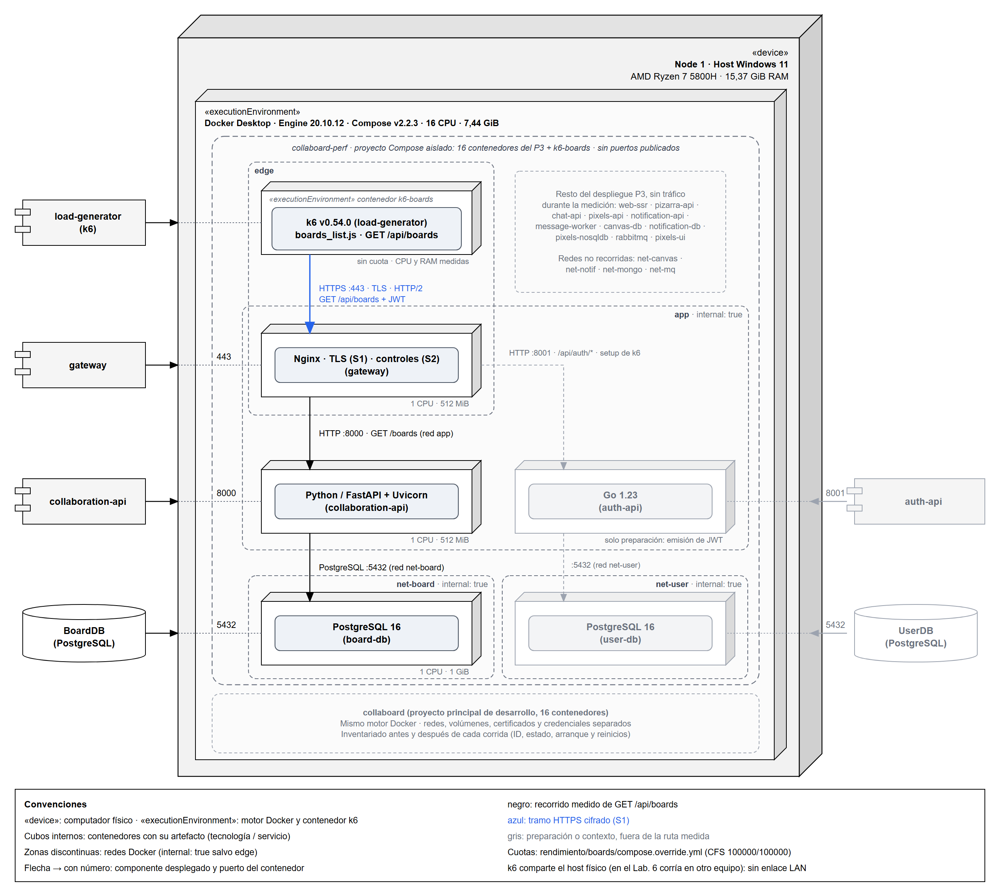

*Figura 1. Vista UML de despliegue de la prueba, con la notación del Deployment View del P3. El único
computador físico es `«device» Node 1`; dentro, el `«executionEnvironment»` Docker Engine aloja el proyecto
aislado `collaboard-perf` con los 16 contenedores del P3 y el generador. Como en el Laboratorio 6, el
generador se representa como unidad de ejecución propia (`«executionEnvironment»` contenedor `k6-boards`, con
el artefacto k6 v0.54.0 y el componente `load-generator`), pero en el mismo host y sin enlace LAN. Las zonas
discontinuas son las redes Docker. El recorrido medido va de `k6-boards` al gateway por HTTPS :443 (azul, S1),
a `collaboration-api` por HTTP :8000 y a `board-db` por PostgreSQL :5432. `auth-api` y `user-db` (gris) solo
intervienen en la emisión de los JWT durante la preparación; los otros 11 contenedores, las 4 redes restantes y
el proyecto principal `collaboard` están desplegados sin tráfico. Fuente editable:
`docs/p3/diagramas/vista-despliegue-perf-boards.drawio`.*

| Paso | Componente | Qué ocurre | Táctica | Evidencia en el repositorio |
|---|---|---|---|---|
| 1 | Gateway `:443` | Negociación TLS 1.2/1.3 (solo cifrados AEAD con ECDHE) | S1 | `gateway/templates/snippets/tls.conf.template` |
| 2 | Gateway | Validación del `Host` contra la lista blanca y límite de peticiones simultáneas por IP | S2 | `gateway/templates/snippets/hardening.conf.template` |
| 3 | Gateway, `location = /api/boards` | Límite de tasa de la zona `api` (30 r/s por IP, ráfaga 60), métodos permitidos y reescritura a `/boards` | S2 | `gateway/templates/snippets/api-routes.conf.template` |
| 4 | Gateway | Saneado de cabeceras de identidad | S2 | `gateway/snippets/proxy-sanitize.conf` |
| 5 | Redes | `edge` → `app` → `net-board` | S3 | `docker-compose.yml` |
| 6 | `collaboration-api` | Validación local del JWT (HS256, emisor y `sub`) | S4 | `colaboracion-module/app/auth.py` |
| 7–8 | `collaboration-api` → `board-db` | Una consulta: tableros activos donde el usuario es miembro, con su rol y el conteo de miembros | S5 | `colaboracion-module/app/routers/boards.py:65-96` |

Dos detalles importan para interpretar los resultados. Primero, `auth-api` **no** está en el camino de cada
petición: el JWT se valida dentro de `collaboration-api`. Segundo, `GET /api/boards` no consulta un PDP
externo: la autorización se resuelve en la misma consulta SQL. Por eso este experimento no mide el costo de
la caché de autorización de los PEP; ese análisis pertenece al fragmento de S5.

`collaboration-api` ejecuta un único proceso `uvicorn` sin `--workers` (`colaboracion-module/Dockerfile:20`).
Los endpoints son síncronos (`def`), así que corren en el *threadpool* de anyio (40 hilos por defecto), y
cada petición toma una conexión del pool de SQLAlchemy.

---

## 4. Ambiente experimental y aislamiento

| Elemento | Detalle |
|---|---|
| Host (SUT y generador) | Portátil con AMD Ryzen 7 5800H, 15,37 GiB de RAM visibles, Windows 11 Home (build 26300). Docker Desktop con Docker Engine 20.10.12, Compose v2.2.3 y cgroup v1; 16 CPU lógicas y 7,44 GiB asignados a Docker |
| Generador de carga | k6 v0.54.0 (`grafana/k6:0.54.0`) en un contenedor del mismo host, conectado solo a la red `edge` del proyecto experimental |
| Gateway | Nginx con TLS terminado en el gateway (S1) y controles de borde (S2); cuota de 1 CPU y 512 MiB |
| Microservicio | `collaboration-api`: FastAPI, un proceso `uvicorn`, endpoints síncronos; cuota de 1 CPU y 512 MiB |
| Base de datos | `board-db`: PostgreSQL 16; cuota de 1 CPU y 1 GiB |
| Resto del sistema | `web-ssr`, `auth-api` y su base, pizarra, chat, pixels, MongoDB, RabbitMQ y notificaciones: levantados y sin tráfico durante la medición |
| Revisión del código | `p3/performance`, commit `a60851ff3bcb6d4aafbd05ec228931b1f533ea73` (registrado en el `meta.json` de las 64 corridas) |

**Aislamiento.** El experimento corre en un proyecto de Compose propio, `collaboard-perf`, con volúmenes,
redes, certificados y credenciales exclusivos y sin puertos publicados en el host. El banco aborta si
encuentra un recurso con ese nombre que no lleve su etiqueta de propiedad. Antes y después de cada corrida
se inventariaron los 16 contenedores del proyecto principal `collaboard` (ID, estado, hora de arranque y
reinicios): en las 63 corridas con ese registro se conservaron sin cambios dentro de cada ventana.

**Cuotas.** Los límites se aplican con `rendimiento/boards/compose.override.yml`, que no modifica los
archivos versionados del sistema. Compose v2.2.3 dejaba la cuota en cero con `cpus: 1.0`, por lo que el
banco usa `cpu_period`/`cpu_quota` (100000/100000) y verifica las cuotas efectivas antes de cada corrida.

**Diferencia frente al Laboratorio 6:** allí el generador estaba en otro equipo; en P3 comparte el host con
el sistema. Se compensa midiendo la CPU del contenedor de k6 e invalidando las corridas con iteraciones
descartadas, y queda registrado como amenaza a la validez (sección 16).

---

## 5. Diseño de las pruebas con k6

### 5.1 Datos de prueba y validación de respuestas

El banco siembra **20 usuarios sintéticos con 10 tableros privados cada uno** (`example.invalid`), siempre
en el proyecto experimental. En el Laboratorio 6 había un solo usuario con 10 tableros; 20 cuentas
distribuyen la carga sin cambiar el tamaño de cada respuesta. k6 rota entre las cuentas en cada iteración.

Una respuesta es **exitosa** solo si es HTTP 200, tiene tipo `application/json` y contiene exactamente los
10 tableros esperados del usuario, con identificador, propietario, rol, número de miembros y fechas
válidas. Antes de medir, cada corrida inicia sesión con las 20 cuentas, comprueba que una petición sin
token reciba 401 y verifica el catálogo de cada usuario.

### 5.2 Modelos de carga

- **E1, tasa fija de llegadas** (`constant-arrival-rate`): k6 inicia λ peticiones por segundo sin importar
  cuánto tarden las anteriores. Es el modelo adecuado para estudiar un limitador de tasa.
- **E2, usuarios concurrentes** (`constant-vus`): cada VU repite *petición → petición*, **sin pausa**. Con
  N VUs hay como máximo N peticiones en curso y la tasa la decide la latencia del sistema.
- **Calentamiento, drenaje y medición:** 30 s de calentamiento **al mismo nivel** que se va a medir, 12 s
  de separación para que terminen las peticiones en curso y la ventana de medición. Entre corridas hay al
  menos 60 s de enfriamiento y se comprueba que la CPU de Colaboración baje de 15 % y que quede como
  máximo una conexión ocupada en PostgreSQL.
- **Sin reintentos** y con un *timeout* de cliente de **10 s** (en el Laboratorio 6 era el valor por
  defecto de k6, 60 s). Una petición que tarda más de 10 s cuenta como fallo.
- **Sesiones:** los JWT se obtienen en `setup`, fuera de la ventana medida, a un ritmo que no activa los
  límites de `/api/auth/*`.

> **Los VUs de E2 no equivalen a los del Laboratorio 6.** Allí cada VU esperaba 1 s entre peticiones, así
> que N VUs ofrecían como máximo ~N req/s. En E2 no hay pausa: la ley de Little queda como X = N / R en
> lugar de X = N / (R + 1 s). Por eso **la comparación con el Laboratorio 6 se hace en TPM, latencia y
> concurrencia dentro del servicio**, no en número de VUs.

### 5.3 Separación del limitador de tasa

El limitador no se desactiva: se estudia en E1 y se eleva solo en E2, mediante variables de entorno que ya
existen en la plantilla del gateway y únicamente en el proyecto experimental. Las directivas `limit_req` y
`limit_conn` siguen ejecutándose, así que el camino de código es el de producción. Las directivas efectivas
se extrajeron con `nginx -T` y se guardaron en el `meta.json` de cada corrida.

| Parámetro del gateway | Producción y E1 | E2 (solo laboratorio) |
|---|---:|---:|
| Zona `api` | 30 r/s | 100.000 r/s |
| Ráfaga de la zona `api` | 60 | 100.000 |
| Peticiones simultáneas por IP | 60 | 10.000 |
| Zona `auth` | 5 r/s, ráfaga 10 | 5 r/s, ráfaga 10 |

El primer arranque con 100.000 conexiones simultáneas por IP fue rechazado por Nginx; se fijó 10.000, muy
por encima de cualquier nivel ensayado. TLS, listas blancas, saneado de cabeceras, JWT, roles y
segmentación se mantienen sin cambios. k6 verifica la cadena y el nombre del certificado con la CA del
experimento (no se usa `insecureSkipTLSVerify`).

### 5.4 Fases y niveles ejecutados

| Fase | E1 (req/s) | E2 original (VUs) | E2 pool corregido (VUs) |
|---|---|---|---|
| Piloto | — | 1 VU, 20 s | — |
| Barrido exploratorio | — | 1, 2, 4, 8, 16, 32 · 30 s | — |
| Serie formal (3 réplicas, 90 s) | 20, 30, 40, 60 | 1, 2, 3, 4 | 1, 2, 3, 4, 24, 28, 32 |
| Diagnóstico y pares (40 s) | — | 24, 32 | 24, 32 |
| Extensión exploratoria (40 s) | — | — | 48, 64, 100, 150, 200 |

El barrido exploratorio de la versión original no llegó a 64 VUs: a 32 VUs se alcanzó la regla de parada
(≥ 20 % de fallos distintos de 429). Como la transición por CPU apareció a muy baja concurrencia, el
refinamiento formal se hizo con resolución de 1 VU entre 1 y 4.

---

## 6. SLO, métricas y criterios de validez

**Métricas por corrida:**

- **TPM exitosas** = respuestas exitosas × 60 / segundos medidos. Las **TPM ofrecidas** cuentan las
  peticiones iniciadas en la ventana.
- **Latencia de extremo a extremo** p50, p95 y p99 de las respuestas exitosas, hasta recibir el cuerpo. Los
  percentiles de los 429 se reportan aparte.
- **Fallos por categoría**, como porcentaje de las peticiones iniciadas: 429, 401/403, otros 4xx, 5xx,
  JSON inválido, *timeout* y otros fallos de transporte.
- **CPU y RAM** de `gateway`, `collaboration-api`, `board-db` y del generador, con `docker stats` cada
  ~5 s. 100 % equivale a un núcleo, que es la cuota.
- **Conexiones de `board-db`** por estado (`active`, `idle`, `idle in transaction`, activas en espera),
  con `pg_stat_activity` cada ~5 s.
- **Logs correlacionados** del gateway (estado, duración, ID de correlación, eventos de límite) y de
  Colaboración (estado, duración del handler y avisos de `QueuePool`).

**SLO (fijado antes de medir):** un nivel **cumple** si, en sus tres repeticiones válidas,
**p95 ≤ 500 ms, p99 ≤ 1.000 ms y fallos ≤ 1 %**. En E1 los 429 cuentan como fallos para este juicio,
aunque al mismo tiempo son la evidencia de que el limitador funciona.

**Una corrida es válida** si k6 no descartó ni interrumpió iteraciones, no hubo fallos de autenticación ni
de contrato, la telemetría cubre al menos el 70 % de las muestras esperadas por recurso y en PostgreSQL y,
en E2, no aparece ningún 429. En E1 la tasa programada debe quedar dentro de ±2 % del objetivo. Las
corridas inválidas se conservan, pero no entran en las tablas.

**Criterios de los puntos característicos.** El SLO y las reglas del punto óptimo, la rodilla y el límite
práctico se fijaron en el protocolo antes de la campaña; las de la frontera del SLO y el primer error se
formalizaron durante el análisis, con los mismos umbrales:

| Punto | Qué representa | Regla |
|---|---|---|
| **Punto óptimo operativo** | La carga más alta a la que conviene operar con margen | Mayor nivel que cumple el SLO en las tres repeticiones y queda al menos un 20 % por debajo de la cota inferior de la rodilla |
| **Rodilla** | Donde la curva cambia de régimen | Primer intervalo refinado donde la mediana del p95 sube al menos un 50 % y la pendiente de TPM por unidad de carga cae al 50 % o menos de la del tramo anterior; se confirma con el nivel siguiente y la telemetría. Se reporta como **intervalo** |
| **Límite práctico de throughput** | La mayor carga sostenida antes de degradarse | Último nivel antes de una meseta confirmada (≤ 5 % de ganancia en dos incrementos, con deterioro de latencia o errores) o de una caída sostenida de TPM |
| **Frontera del SLO** | Primera carga donde se incumple el objetivo de latencia | Intervalo entre el último nivel que cumple en 3/3 réplicas y el primero que no |
| **Primer error** | Primera carga con fallos distintos de 429 | Intervalo entre el último nivel sin fallos y el primero con fallos |

El criterio del Laboratorio 6 (menor nivel con al menos el 95 % del throughput máximo) se conserva como
**comprobación retrospectiva**.

---

## 7. Resultados de E1: el gateway como primer límite

Doce corridas válidas, tres por tasa, con ventanas de 90 s. Directivas efectivas comprobadas:
`limit_req_zone … rate=30r/s`, `limit_req zone=api burst=60 nodelay` y `limit_conn conn 60`.

*Tabla 1. E1 (límites de producción, una IP): mediana y rango de tres repeticiones por nivel.*

| λ (req/s) | TPM ofrecidas | TPM exitosas | 429 (%) | Esperado 1 − 30/λ | p95 éxitos, ms (rango) | p95 429 (ms) | Otros fallos | CPU gateway | CPU collab-api |
|---:|---:|---:|---:|---:|---:|---:|---:|---:|---:|
| 20 | 1.200 | 1.200 | 0 | 0 % | 15 (14–25) | — | 0 % | 2,08 % | 23,43 % |
| 30 | 1.800,67 | 1.800,67 | 0 | 0 % | 18 (15–32) | — | 0 % | 3,34 % | 33,25 % |
| 40 | 2.400,67 | 1.840 | 23,35 | 25 % | 16 (16–48) | 2 | 0 % | 3,13 % | 30,36 % |
| 60 | 3.600,67 | 1.840 | 48,90 | 50 % | 17 (15–18) | 2 | 0 % | 4,07 % | 30,29 % |

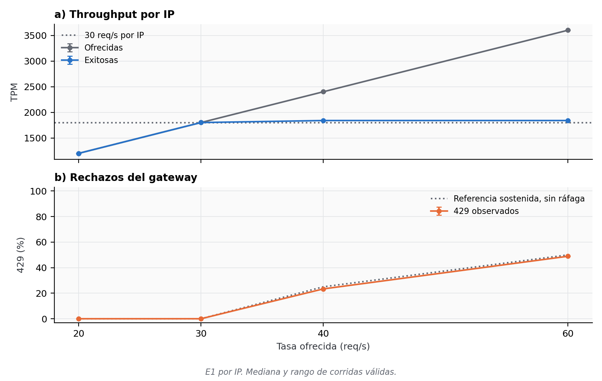

*Figura 2. E1 desde una IP. a) TPM ofrecidas (gris) y exitosas (azul) frente a la tasa ofrecida (req/s);
la línea punteada marca 1.800 TPM, el techo sostenido de 30 req/s. b) Porcentaje de intentos rechazados
con 429; la línea punteada es la referencia 1 − 30/λ sin ráfaga. Mediana y rango de tres réplicas.*

**Interpretación.** H1 se confirma:

- Las TPM exitosas siguen a las ofrecidas hasta 30 req/s y se aplanan en **1.840 TPM** a 40 y 60 req/s. En
  las seis ventanas de esos dos niveles hubo exactamente 2.760 éxitos, que coincide con
  `30 × 90 + 60 = 2.760`: 1.800 TPM sostenidas más la ráfaga de 60 disponible al comienzo de la ventana.
- La fracción de 429 (23,35 % y 48,90 %) queda ligeramente por debajo de 1 − 30/λ (25 % y 50 %); la
  diferencia es exactamente el aporte de la ráfaga.
- Los 10.445 rechazos registrados por k6 coinciden, corrida por corrida, con los eventos de límite de tasa
  en el log de Nginx; el límite de conexiones no registró eventos. Los 429 se responden en 2 ms (p95), sin
  llegar al servicio.
- La CPU de `collaboration-api` se queda en ~30 % aunque λ se duplique de 30 a 60 req/s: **el limitador
  protege al servicio**.

La transición observada queda en **(30, 40] req/s por IP**; la mayor tasa ensayada que cumple el SLO en las
tres ventanas es 30 req/s. Este resultado describe la política **por cliente**, no la capacidad del
sistema: con muchos clientes distintos, cada uno con su cuota, la carga total sí puede llegar al servicio.
Eso es lo que mide E2.

---

## 8. Resultados de E2 con el código original

### 8.1 Barrido exploratorio

Ventanas de 30 s (una corrida por nivel) para localizar las transiciones.

*Tabla 2. E2 original, barrido exploratorio de 30 s.*

| VUs | TPM ofrecidas / exitosas | p50 / p95 / p99 éxitos (ms) | Fallos | CPU collab-api media | PG total / idle in tx (picos) |
|---:|---:|---:|---:|---:|---:|
| 1 | 5.842 / 5.842 | 9 / 14 / 46,4 | 0 | 72,00 % | 2 / 0 |
| 2 | 7.476 / 7.476 | 13 / 26 / 66 | 0 | 88,89 % | 4 / 1 |
| 4 | 6.776 / 6.776 | 30 / 79 / 101 | 0 | 94,19 % | 6 / 4 |
| 8 | 5.370 / 5.370 | 82 / 163,8 / 218 | 0 | 100,41 % | 8 / 5 |
| 16 | 5.860 / 5.860 | 154 / 270 / 314 | 0 | 99,88 % | 13 / 12 |
| 32 | 390 / 198 | 344 / 438 / 510 | **96/195 (49,23 %)** | **6,10 %** | **15 / 15** |

El throughput deja de crecer desde 2 VUs con `collaboration-api` cerca de su núcleo, y a 32 VUs el sistema
colapsa: las TPM caen un 97 %, la CPU del servicio baja a 6 % y aparecen las 15 conexiones retenidas.

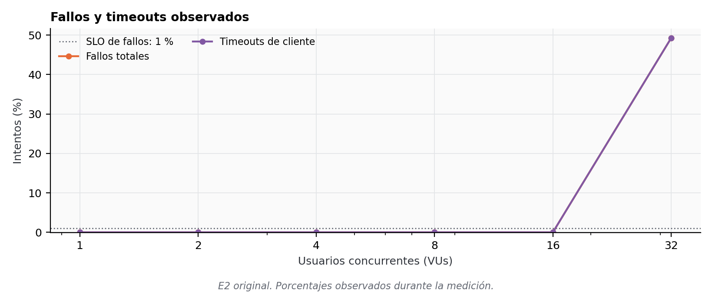

*Figura 3. E2 original, barrido exploratorio: porcentaje de intentos fallidos (naranja) y de timeouts de
cliente de 10 s (morado) por nivel de VUs (escala logarítmica). Ambas curvas coinciden porque todos los
fallos fueron timeouts. La línea punteada marca el SLO de 1 %.*

### 8.2 Serie formal y refinamiento (1–4 VUs)

Doce corridas válidas, tres por nivel, ventanas de 90 s; la segunda réplica se recorrió en orden inverso.
Todos los intentos medidos fueron correctos (0 fallos en 118.413).

*Tabla 3. E2 original: mediana (mínimo–máximo) de tres réplicas de 90 s.*

| VUs | TPM exitosas | Media (ms) | p50 (ms) | p95 (ms) | p99 (ms) | CPU collab-api | CPU gateway | CPU board-db | ¿Cumple SLO? |
|---:|---:|---:|---:|---:|---:|---:|---:|---:|:---:|
| 1 | 5.972 (5.856–6.012) | 9,57 | 8 | 14 (14–15) | 52 | 76,53 % | 8,75 % | 21,58 % | 3/3 |
| 2 | **7.090** (7.088,67–7.215,33) | 16,45 | 14 | 26 (26–28) | 70 | 100,00 % | 9,92 % | 25,47 % | 3/3 |
| 3 | 6.865,33 (6.488,67–6.961,33) | 25,76 | 22 | 46 (46–59) | 81 | 100,97 % | 8,72 % | 23,30 % | 3/3 |
| 4 | 6.402,67 (6.357,33–6.632,67) | 37,02 | 33 | 78 (78–80) | 95 | 97,42 % | 7,95 % | 23,56 % | 3/3 |

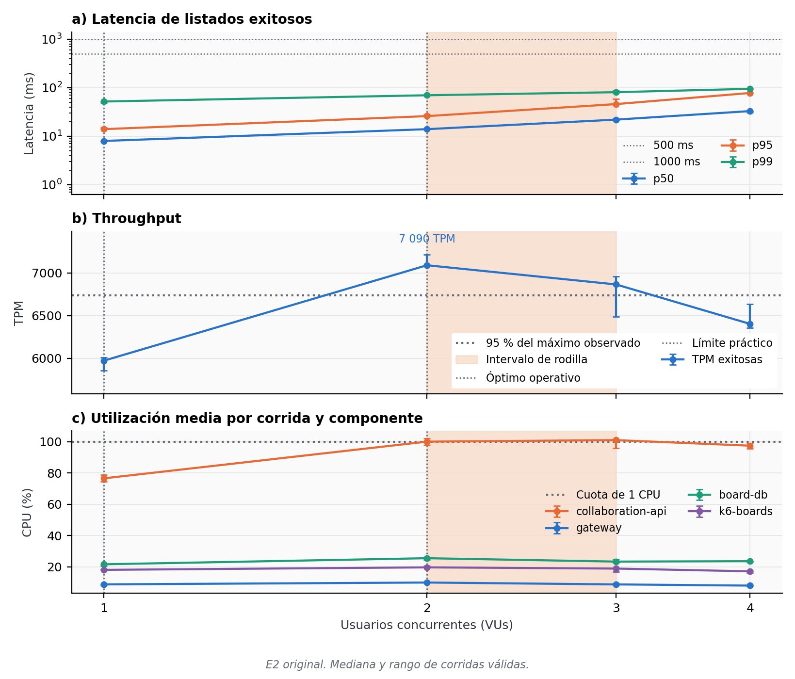

*Figura 4. E2 original, serie formal de 90 s. a) Latencia p50, p95 y p99 de los listados exitosos (ms,
escala logarítmica), con los umbrales de 500 y 1.000 ms. b) TPM exitosas, con la línea del 95 % del
máximo. c) CPU media por corrida de cada componente (% de un núcleo). Mediana y rango de tres réplicas; la
franja sombreada es el intervalo de rodilla.*

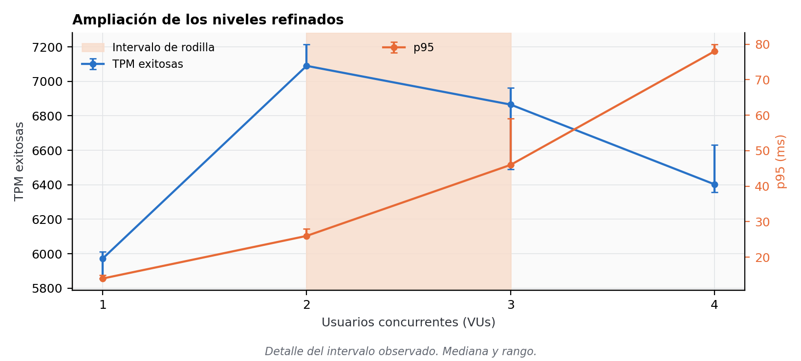

*Figura 5. Ampliación del refinamiento entre 1 y 4 VUs: TPM exitosas y p95 (ms) con eje lineal, con el
intervalo de rodilla sombreado.*

*Tabla 4. Puntos característicos de E2 original.*

| Punto | Carga | TPM | p95 | Sustento |
|---|---:|---:|---:|---|
| Óptimo operativo | **1 VU** | 5.972 | 14 ms | Cumple el SLO en 3/3 y queda 50 % por debajo de la cota inferior de la rodilla |
| Rodilla | **2–3 VUs** | 7.090 → 6.865 | 26 → 46 ms | El p95 mediano sube 76,9 % y la pendiente pasa de +1.118 TPM/VU (1→2) a −224,67 TPM/VU (2→3); se confirma a 4 VUs. Los rangos de p95 de 2 y 3 VUs no se solapan |
| Límite práctico de throughput | **2 VUs** | 7.090 | 26 ms | Último nivel antes de dos caídas consecutivas de TPM con aumento de p95 |
| Comprobación 95 % del máximo (Lab. 6) | 2 VUs | — | — | 95 % de 7.090 = 6.735,5 TPM; el primer nivel que lo alcanza es 2 VUs |
| Primer error | **(16, 24] VUs** | — | — | 0 fallos a 16 VUs (30 s); 9,07 % de timeouts a 24 VUs (40 s) |
| Colapso | **32 VUs** | 198–214,5 | — | 47,23–49,23 % de timeouts en tres corridas independientes |

El throughput **cae** después de 2 VUs en lugar de quedarse en meseta. Las comprobaciones de la sección
9.3 muestran que la demanda de CPU por éxito aumenta con la concurrencia (de 7,64 a 8,96 ms entre 1 y
4 VUs), lo que es compatible con esa caída bajo una cuota fija; las muestras no permiten atribuir el
aumento a una función concreta.

### 8.3 Reproducción del episodio del pool

Para acotar la aparición de errores se midieron corridas de diagnóstico de 40 s con el mismo calentamiento.
La tabla las reúne con el último nivel sin fallos y el nivel de colapso del barrido de 30 s. Es una corrida
por fila, de carácter exploratorio.

*Tabla 5. E2 original: diagnóstico del régimen de fallo.*

| VUs | Ventana | Intentos / éxitos | TPM exitosas | Timeouts | CPU collab-api | PG idle in tx (pico) | Avisos `QueuePool` |
|---:|---:|---:|---:|---:|---:|---:|---:|
| 16 | 30 s | 2.930 / 2.930 | 5.860 | 0 | 99,88 % | 12 | 0 |
| 24 | 40 s | 794 / 722 | 1.083 | 72 (9,07 %) | 26,36 % | 15 | 0 |
| 32 | 30 s | 195 / 99 | 198 | 96 (49,23 %) | 6,10 % | 15 | 6 |
| 32 | 40 s | 271 / 143 | 214,5 | 128 (47,23 %) | 4,92 % | 15 | 11 |
| 32 | 40 s | 267 / 139 | 208,5 | 128 (47,94 %) | 14,43 % | 15 | 10 |

Todos los fallos fueron timeouts de cliente de 10 s; no hubo 429, 5xx ni errores de contrato. El primer
error queda acotado en **(16, 24] VUs**, con ventanas de 30 y 40 s en los extremos.

---

## 9. Diagnóstico de SQLAlchemy y PostgreSQL

### 9.1 Evidencia del agotamiento del pool

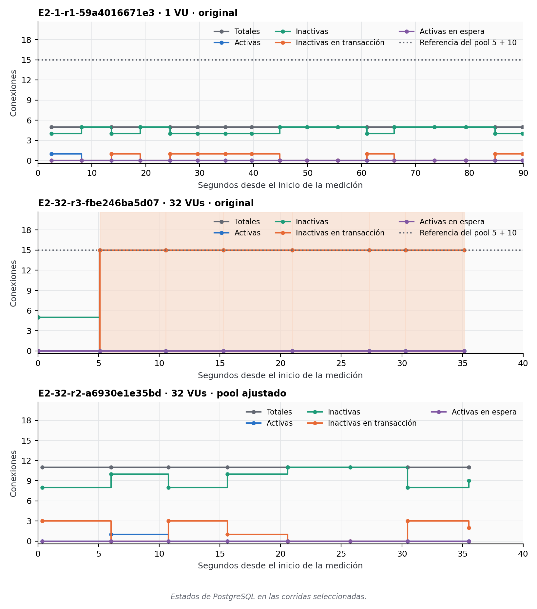

*Figura 6. Conexiones de `board-db` por estado (`pg_stat_activity`, muestras cada ~5 s) frente a los
segundos desde el inicio de la ventana. Arriba: original a 1 VU (control). Centro: original a 32 VUs; la
región sombreada une muestras consecutivas con 15 conexiones `idle in transaction` y cero activas. Abajo:
pool corregido a 32 VUs. La línea punteada marca el tope del pool original (5 + 10).*

En las corridas de fallo coinciden cuatro señales independientes:

1. **PostgreSQL:** las 15 conexiones del pool quedan en `idle in transaction` con **cero consultas
   activas** durante ~30 s (en la Figura 6, de 5 a 35 s). La base de datos no está trabajando: las
   conexiones están retenidas.
2. **CPU:** `collaboration-api` baja de ~100 % a 5–14 % de su núcleo. El servicio no está saturado; está
   esperando.
3. **Logs del servicio:** 6, 11 y 10 avisos `QueuePool limit of size 5 overflow 10 reached, connection timed
   out, timeout 30` en las tres corridas de 32 VUs.
4. **Gateway y cliente:** los intentos vencen a los 10 s en k6 y quedan registrados como 499 en Nginx;
   Colaboración registró 200 después de la cancelación de 90 de esos intentos (las respuestas llegan
   cuando el cliente ya se fue).

**H3 se confirma: el bloqueo del Laboratorio 6 reaparece en P3**, porque la rama conserva el pool por
defecto (5 + 10, 30 s) y el listado no devuelve la conexión antes de terminar.

### 9.2 Mecanismo y alcance de la inferencia

La evidencia demuestra agotamiento del pool y retención de conexiones. El mecanismo propuesto, coherente con
el Laboratorio 6, es que con más de 15 peticiones simultáneas los hilos restantes del *threadpool* (40) se
bloquean esperando una conexión, mientras las peticiones que ya terminaron necesitan un hilo libre para
cerrar su sesión y devolverla; el sistema solo se libera cuando vence el `pool_timeout` de 30 s. Esta
explicación es **consistente con los datos pero no está probada paso a paso**: separar la inanición de hilos
del papel de la tarea asíncrona de *outbox* requeriría trazas de adquisición y devolución por hilo.

Como referencia de orden de magnitud, con la variante corregida a 24 VUs los logs correlacionados dan una
concurrencia media de ~19,7 peticiones dentro del handler (X × R del servicio), ya por encima de las 15
conexiones que admite el pool original. Para la imagen original no hay correlación completa en ese nivel,
así que el valor no se le atribuye directamente.

### 9.3 Leyes operacionales

Con Z = 0, la ley de Little predice X = N / R. La tabla compara el throughput medido con el estimado a partir
de la latencia media, y la demanda de CPU por éxito D = U / X.

*Tabla 6. Comprobaciones operacionales (medianas por nivel de las réplicas de 90 s).*

| Variante | VUs | R medida (ms) | X medido (req/s) | X = N/R (req/s) | Diferencia | D CPU (ms/éxito) | Techo local 60.000/D (TPM) |
|---|---:|---:|---:|---:|---:|---:|---:|
| Original | 1 | 9,57 | 99,53 | 104,45 | −4,83 % | 7,64 | 7.850 |
| Original | 2 | 16,45 | 118,17 | 121,59 | −2,81 % | 8,32 | 7.215 |
| Original | 3 | 25,76 | 114,42 | 116,46 | −1,75 % | 8,82 | 6.799 |
| Original | 4 | 37,02 | 106,71 | 108,04 | −1,23 % | 8,96 | 6.693 |
| Corregida | 1 | 9,90 | 96,72 | 100,98 | −4,21 % | 7,77 | 7.724 |
| Corregida | 2 | 18,05 | 107,87 | 110,82 | −2,61 % | 9,39 | 6.393 |
| Corregida | 24 | 276,72 | 86,70 | 86,73 | −0,03 % | 11,67 | 5.142 |
| Corregida | 32 | 392,43 | 81,57 | 81,54 | +0,05 % | 12,52 | 4.792 |

- **Little se cumple** con diferencias de −4,83 % a +0,05 %. La diferencia negativa a baja carga se explica
  porque R mide hasta recibir el cuerpo, mientras N/X también incluye el trabajo de k6 entre iteraciones;
  pesa más cuando R es de pocos milisegundos.
- **Ley de utilización.** A 2 VUs (original), D ≈ 8,32 ms implica un techo local de ~7.215 TPM, que coincide
  con el máximo puntual medido (7.215,33 TPM). La demanda por éxito **crece** con la concurrencia (7,6 →
  12,5 ms), de modo que el techo efectivo baja; esto es compatible con que el throughput descienda en lugar
  de quedarse en meseta, aunque las muestras no identifican qué parte del procesamiento encarece cada éxito. En el Laboratorio 6 la demanda fue ~5,6 ms por petición.

---

## 10. Diseño y verificación de la variante corregida

### 10.1 Cambios

La variante reproduce la corrección del Laboratorio 6 en una imagen derivada que solo se instala en
`collaboard-perf`. **No modifica el código de la rama**: `preparar_variante.py` genera un contexto aislado
que hereda la imagen original y sustituye tres archivos, con huellas SHA-256 registradas antes y después.

1. **Pool dimensionado:** `pool_size=25`, `max_overflow=25` (50 ≥ 40 hilos del *threadpool*),
   `pool_timeout=5` s y `pool_pre_ping=True`.
2. **Pool propio del *outbox*:** 2 + 0 conexiones con timeout de 5 s, para que la tarea de fondo no
   compita con las peticiones.
3. **Devolución temprana de la conexión:** el listado materializa todos los `BoardOut` y luego hace
   `rollback()`, evitando la regresión N+1 que tuvo la primera versión del Laboratorio 6.

### 10.2 Verificación funcional

- **Regresión en SQLite** (contenedor sin red, base descartable): JWT ausente e inválido, privacidad de los
  tableros, **un solo SELECT** al serializar diez tableros, liberación de la transacción dentro del
  handler, reintento de *outbox* 503→202 con el mismo identificador y borrado coordinado.
- **PostgreSQL real:** adquisición, parámetros y devolución de conexiones de ambos pools mediante
  `SELECT 1`.
- **Preflight de k6:** los 20 catálogos privados se validan por HTTPS con JWT antes de cada corrida.

### 10.3 Comparación pareada

Cada par usa una corrida por imagen, con la misma ventana (40 s), calentamiento, cuotas, gateway, dataset y
versión de k6; solo cambia la imagen de `collaboration-api`.

*Tabla 7. Pares original frente a corregido.*

| Nivel | Variante | TPM exitosas | Timeouts | p95 éxitos (ms) | CPU collab-api | PG idle in tx (pico) | `QueuePool` |
|---:|---|---:|---:|---:|---:|---:|---:|
| 24 VUs | Original | 1.083 | 72 de 794 (9,07 %) | 484,75 | 26,36 % | 15 | 0 |
| 24 VUs | Corregida | 4.188 | 0 de 2.792 | 479,45 | 93,84 % | 3 | 0 |
| 32 VUs | Original | 208,5 | 128 de 267 (47,94 %) | 1.238,6 | 14,43 % | 15 | 10 |
| 32 VUs | Corregida | 5.379 | 0 de 3.586 | 578,75 | 98,43 % | 3 | 0 |

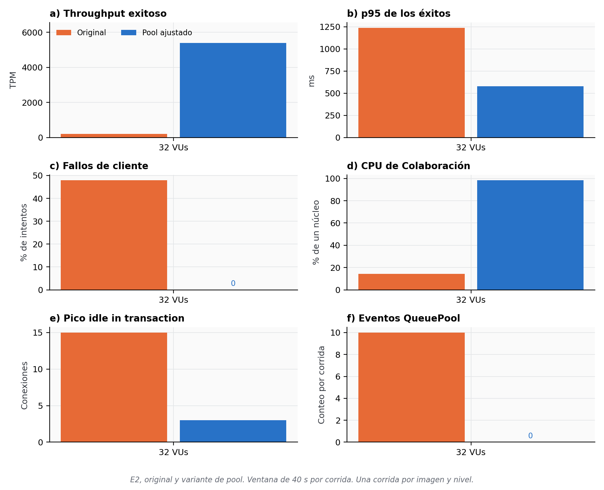

*Figura 7. Comparación pareada a 32 VUs (ventana de 40 s, una corrida por imagen): a) TPM exitosas,
b) p95 de los éxitos (ms), c) fallos de cliente (% de intentos), d) CPU de Colaboración (% de un núcleo),
e) pico de conexiones `idle in transaction` y f) avisos de `QueuePool` por corrida. El par a 24 VUs está
en [fig07b-par-24vus.png](../evidencia/rendimiento/figuras/fig07b-par-24vus.png).*

En sobrecarga, la variante multiplicó las TPM por **3,87 a 24 VUs** y por **25,80 a 32 VUs**, eliminó los
timeouts y los avisos de pool y redujo el pico de conexiones retenidas de 15 a 3. La CPU del servicio volvió
a estar cerca de su cuota: el recurso que limita deja de ser el pool y vuelve a ser la CPU. Como los tres
cambios se aplicaron juntos, **la evidencia mide su efecto conjunto y no aísla la contribución de cada
uno**.

---

## 11. Resultados de E2 con el pool corregido

### 11.1 Serie formal de 90 s

La cohorte tiene **21 corridas válidas**, tres réplicas a 1, 2, 3, 4, 24, 28 y 32 VUs.

*Tabla 8. E2 corregido: mediana (mínimo–máximo) de tres réplicas de 90 s.*

| VUs | TPM exitosas | p50 (ms) | p95 (ms) | p99 (ms) | Fallos / intentos | CPU collab-api | PG total / idle in tx (pico máx.) | Cumplen SLO |
|---:|---:|---:|---:|---:|---:|---:|---:|---:|
| 1 | 5.803,33 (5.530,67–5.870,67) | 9 | 14 (14–15,25) | 48 (48–49,95) | 0 / 25.807 | 75,81 % | 12 / 1 | 3/3 |
| 2 | **6.472** (5.902–7.092) | 15 | 32 (27–42) | 75 (71–76) | 0 / 29.199 | 100,42 % | 12 / 2 | 3/3 |
| 3 | 6.048,67 (5.432,67–6.585,33) | 25 | 70 (55–73) | 90 (86–92) | 0 / 27.100 | 101,71 % | 15 / 3 | 3/3 |
| 4 | 6.082,67 (5.721,33–6.187,33) | 35 | 80 (80–84) | 101 (99–103) | 0 / 26.987 | 100,62 % | 15 / 3 | 3/3 |
| 24 | 5.202 (4.616,67–5.281,33) | 261 | 425 (421,95–500) | 578,79 (563,94–616) | 0 / 22.650 | 101,16 % | 16 / 6 | 3/3 |
| 28 | 4.804,67 (3.566,67–5.174) | 320 | 582,7 (498–883) | 799,88 (649,4–1.406,65) | 0 / 20.318 | 101,09 % | 16 / 5 | **1/3** |
| 32 | 4.894 (4.686,67–5.180,67) | 354 | 622 (588–671) | 782 (771,9–892,2) | 0 / 22.142 | 102,13 % | 16 / 5 | **0/3** |

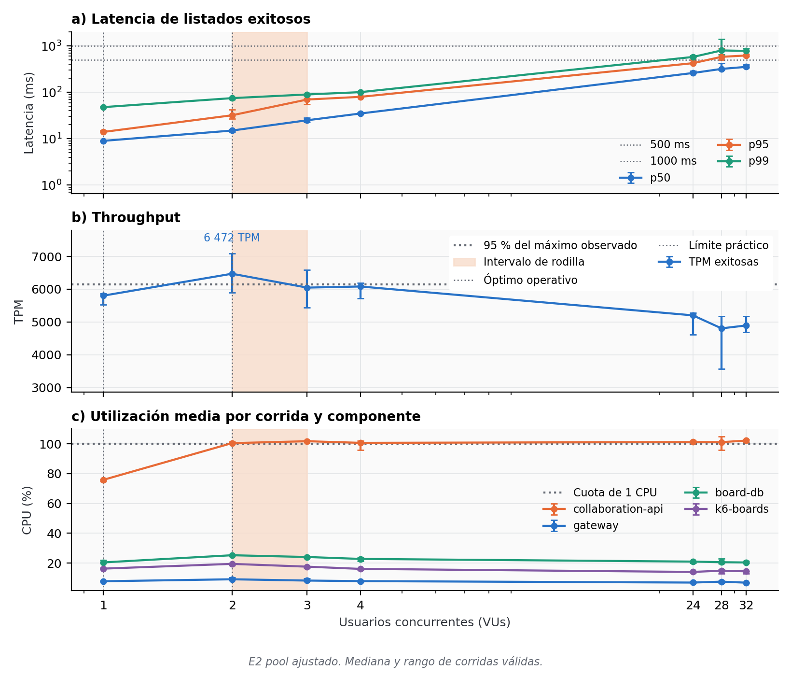

*Figura 8. E2 con el pool corregido, serie formal de 90 s. a) Latencia p50, p95 y p99 de los éxitos (ms,
escala logarítmica) con los umbrales del SLO. b) TPM exitosas con la línea del 95 % del máximo. c) CPU
media por corrida y componente (% de un núcleo). Eje x en escala logarítmica; mediana y rango de tres
réplicas; franja de rodilla sombreada.*

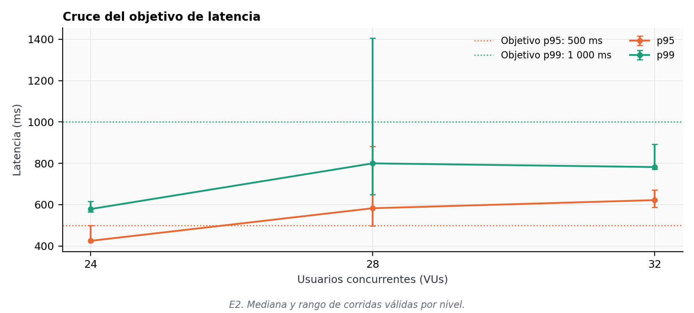

*Figura 9. Cruce del objetivo de latencia entre 24 y 32 VUs: p95 (naranja) y p99 (verde) en ms, con los
objetivos de 500 y 1.000 ms. Mediana y rango de tres réplicas por nivel.*

*Tabla 9. Puntos característicos de E2 corregido.*

| Punto | Resultado | Sustento |
|---|---|---|
| Óptimo operativo | **1 VU, 5.803,33 TPM, p95 14 ms** | Cumple el SLO en 3/3 y queda 50 % por debajo de la cota inferior de la rodilla |
| Rodilla | **2–3 VUs** | El p95 mediano sube de 32 a 70 ms (+118,75 %) con rangos separados (27–42 y 55–73 ms); la pendiente pasa de +668,67 TPM/VU a −423,33 TPM/VU; a 4 VUs solo se recuperan 34 TPM/VU mientras el p95 sube a 80 ms |
| Límite práctico de throughput | **2 VUs, 6.472 TPM** | A 3 y 4 VUs las medianas quedan 6,54 % y 6,02 % por debajo y ningún nivel posterior lo supera. El 95 % del máximo (6.148,4 TPM) se alcanza por primera vez a 2 VUs |
| Frontera del SLO de latencia | **(24, 28] VUs** | 3/3 réplicas cumplen a 24 VUs (una justo en p95 = 500 ms), 1/3 a 28 VUs y 0/3 a 32 VUs |
| Primer error | **No observado** | 0 fallos en 197.178 intentos válidos (174.203 en 90 s y 22.975 en 40 s) |

La dispersión entre réplicas es mayor que en la serie original (por ejemplo, 5.902–7.092 TPM a 2 VUs), así
que los rangos de TPM se solapan entre niveles; la rodilla se sostiene sobre todo por el salto del p95, cuyos
rangos no se solapan.

### 11.2 Extensión exploratoria hasta 200 VUs

Una corrida válida por nivel, ventana de 40 s, mismo calentamiento y drenaje. Regla de parada adicional:
1 % de fallos distintos de 429 o p99 ≥ 8 s.

*Tabla 10. E2 corregido, extensión exploratoria (40 s).*

| VUs | Éxitos / intentos | TPM | Media (ms) | p50 / p95 / p99 (ms) | Fallos | CPU collab-api | RAM collab-api pico (MiB) | PG total / idle in tx (picos) |
|---:|---:|---:|---:|---:|---:|---:|---:|---:|
| 32 | 3.586 / 3.586 | 5.379 | 357,99 | 329 / 578,75 / 867,55 | 0 | 98,43 % | 85,52 | 11 / 3 |
| 48 | 3.091 / 3.091 | 4.636,5 | 624,64 | 575 / 1.002,5 / 1.595,5 | 0 | 102,83 % | 82,83 | 10 / 4 |
| 64 | 3.383 / 3.383 | 5.074,5 | 764,30 | 715 / 1.208 / 1.373,36 | 0 | 102,16 % | 83,83 | 12 / 4 |
| 100 | 3.265 / 3.265 | 4.897,5 | 1.241,73 | 1.228 / 1.605 / 1.862,72 | 0 | 87,92 % | 85,82 | 12 / 5 |
| 150 | 3.265 / 3.265 | 4.897,5 | 1.890,77 | 1.864 / 2.536 / 2.997 | 0 | 101,55 % | 85,92 | 12 / 4 |
| 200 | 3.593 / 3.593 | 5.389,5 | 2.285,07 | 2.309 / 2.878 / 3.004,24 | 0 | 101,22 % | 86,03 | 12 / 3 |

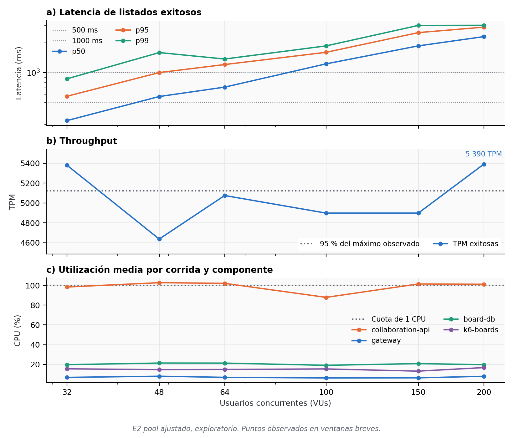

*Figura 10. E2 corregido, extensión exploratoria de 40 s (una corrida por nivel). a) Latencia p50, p95 y
p99 de los éxitos (ms, escala logarítmica) con los umbrales del SLO. b) TPM exitosas con la línea del 95 %
del máximo observado en la extensión. c) CPU media por corrida y componente (% de un núcleo).*

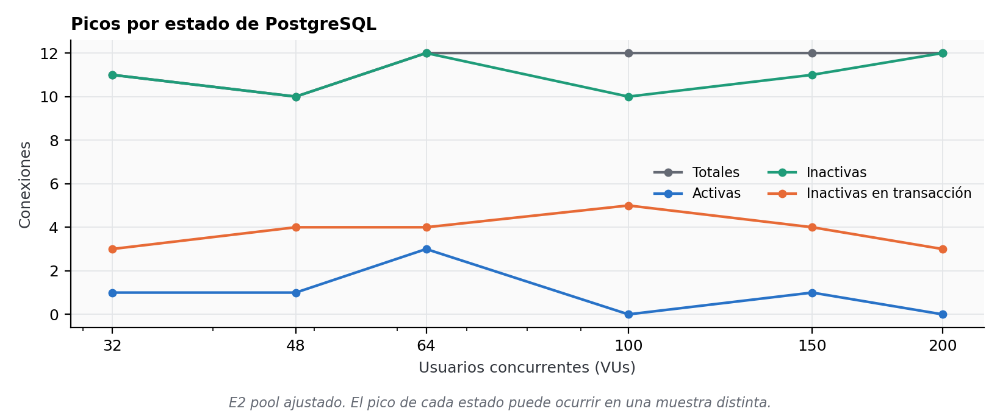

*Figura 11. Picos de conexiones de `board-db` por estado (conexiones) en cada nivel de la extensión
exploratoria. Los picos de cada estado pueden ocurrir en muestras distintas.*

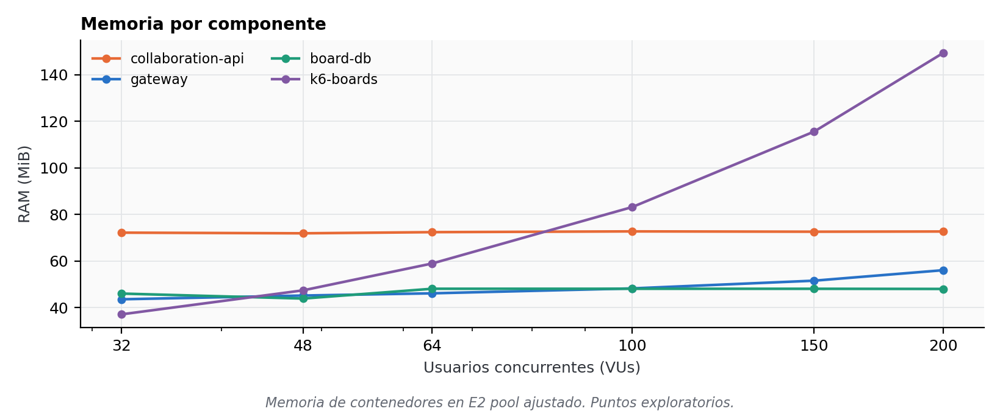

*Figura 12. Memoria por componente (MiB, mediana de las muestras de cada corrida) en la extensión
exploratoria. Los servicios se mantienen estables (Colaboración ~72 MiB, con picos de 82,83–86,03 MiB, frente
a su límite de 512 MiB); solo el generador k6 crece con los VUs, hasta ~150 MiB a 200 VUs.*

Entre 32 y 200 VUs el throughput se mantuvo en una meseta (4.636,5–5.389,5 TPM; los extremos difieren
0,20 %) mientras el p95 se multiplicó por 4,97. `collaboration-api` estuvo entre 98,43 % y 102,83 % de su
núcleo en cinco de seis corridas, el gateway entre 6,20 % y 7,94 % y PostgreSQL entre 19,02 % y 21,29 %. El
mayor pico de k6 fue 28,16 % de un núcleo y 150,5 MiB, sin iteraciones descartadas. Little se cumplió con
diferencias de +0,29 % a +2,89 %.

Los logs correlacionaron los 20.183 éxitos con el gateway y con Colaboración, todos sobre HTTP/2 con
reutilización de conexiones, sin 429, timeouts, 499 ni avisos `QueuePool`. El tiempo medio registrado por
el handler quedó entre 248,79 y 289,45 ms mientras la media de extremo a extremo pasó de 358 a 2.285 ms: **el
crecimiento de la latencia ocurre fuera del intervalo cronometrado por el handler**, es decir, en la espera
antes de que la petición sea atendida. Las trazas disponibles no localizan esa cola en un punto preciso del
recorrido.

**El máximo validado es 200 VUs**, con 5.389,5 TPM, p95 de 2.878 ms y 0 % de errores. A ese nivel el p95 y el
p99 ya superan sus objetivos. **El primer error de la variante no se observó** en la carga ensayada.

---

## 12. Pruebas adicionales de concurrencia por encima de 200 VUs

**Objetivo.** Buscar el primer error de la variante corregida por encima del máximo explorado (200 VUs), con
niveles previstos de 250, 300, 400 y 500 VUs, sin cambiar cuotas, scripts, endpoint ni protocolo: variante
`Pool`, ventanas de 40 s, 30 s de calentamiento, 12 s de drenaje, 60 s de enfriamiento y parada con 1 % de
fallos distintos de 429 o p99 ≥ 8 s.

**Verificación previa (23 de noviembre, 16:29–16:31).**

| Control | Resultado |
|---|---|
| Docker | Engine 20.10.12 y Compose v2.2.3 respondiendo |
| Aislamiento | `collaboard` y `collaboard-perf` con 16 contenedores cada uno, sanos y sin cambios de estado |
| Variante y cuotas | `collaboard-perf_collaboration-api:pool-lab6`; 1 CPU (CFS 100000/100000) y 512 MiB para gateway y Colaboración, 1 CPU y 1 GiB para PostgreSQL |
| Generador | Ningún k6 activo |
| Memoria de la VM de Docker | 4,2 GiB disponibles de 7,44 GiB (umbral del banco: 15 %) |
| Memoria del host Windows | 0,8–1,4 GiB disponibles de 15,37 GiB, con el 92 % de la memoria comprometida y carga de CPU del 15–70 % sin prueba en curso |

Dado el escaso margen del host, se añadió un control de seguridad: si la memoria disponible de Windows bajaba
de 700 MB, se detenía únicamente el contenedor k6 del banco, identificado por sus etiquetas.

**Resultado.** La corrida `E2-250-r1-ea211df4f024` (250 VUs) arrancó a las 16:32:11. Nueve segundos
después, todavía en la fase de preparación de k6 y antes del calentamiento, la memoria disponible del host
cayó a 675 MB y el control detuvo el generador. La corrida no produjo resumen de k6 (`k6.json`), así que no
contiene ninguna medición; el analizador la registra como incompleta en `incidencias.csv` y no entra en
ninguna tabla. Tras la parada, Colaboración volvió a 0,36 % de CPU, PostgreSQL quedó sin conexiones
retenidas y el `meta.json` registra que el proyecto principal no cambió de estado.

Conforme a las condiciones de parada del protocolo (memoria insuficiente para continuar con seguridad), **no
se reintentó la escalada** ni se modificó el entorno para obtener margen. **El máximo nivel válido explorado
sigue siendo 200 VUs** y **no se observó un límite por errores** de la variante corregida. La estimación de la
sección 15 (punto 4), que sitúa la aparición de timeouts del orden de 800–900 VUs, se mantiene como
hipótesis sin confirmar.

---

## 13. Comparación con el Laboratorio 6

*Tabla 11. Comparación en unidades comparables.*

| Magnitud | Laboratorio 6 v2 (HTTP, pausa de 1 s, 30 s) | P3 original (HTTPS, sin pausa) | P3 pool corregido (HTTPS, sin pausa) |
|---|---:|---:|---:|
| Throughput máximo observado | 10.360,2 TPM (1.000 VUs) | 7.090 TPM mediana (2 VUs); 7.476 TPM puntual (30 s) | 6.472 TPM mediana (2 VUs); 7.092 TPM puntual |
| Throughput en meseta con alta concurrencia | ~10.037–10.360 TPM | — (colapso a 32 VUs) | 4.636,5–5.389,5 TPM (32–200 VUs) |
| Demanda de CPU por petición | ~5,6 ms | 7,64–8,96 ms (1–4 VUs) | 7,77–12,52 ms (1–32 VUs) |
| Errores en sobrecarga | 0 % hasta 2.000 VUs (timeout 60 s) | 47–49 % a 32 VUs (timeout 10 s) | 0 % hasta 200 VUs (timeout 10 s) |
| Patrón del pool | Original: 15 conexiones retenidas y errores de 30 s; v2 lo corrige | Reproduce las 15 conexiones retenidas | Pico de 3–6 conexiones `idle in transaction` |
| Recurso que se satura | CPU de `collaboration-api` | CPU de `collaboration-api` (y luego el pool) | CPU de `collaboration-api` |

Las cuotas de CPU y RAM fueron equivalentes, pero entre las dos campañas cambiaron a la vez el hardware
(5800X frente a 5800H), la ubicación del generador, el protocolo (HTTP frente a HTTPS/HTTP/2), las tácticas
de borde, el dataset, el modelo de carga, la duración de las ventanas y el timeout del cliente. La diferencia
de throughput describe **dos configuraciones experimentales** y no permite atribuirla a TLS ni a ninguna
táctica aislada. Lo que sí se mantiene entre ambas campañas es la estructura del problema: el recurso que
limita el throughput es la CPU de `collaboration-api`, y con el pool por defecto el servicio colapsa cuando la
demanda concurrente de conexiones supera las 15 disponibles.

---

## 14. Costo de las tácticas de seguridad en este recorrido

- **S2, limitación de tasa:** E1 muestra su efecto directo: por IP, el cliente recibe a lo sumo 1.800 TPM
  sostenidas más la ráfaga, y los excesos se rechazan en 2 ms sin consumir CPU del servicio.
- **S1 y controles de borde:** la CPU media del gateway en las corridas E2 válidas estuvo entre 0,67 % y
  10,45 % de su núcleo, incluso en la meseta. En este recorrido el gateway con TLS no es el cuello de
  botella. Las respuestas se negociaron sobre HTTP/2 con reutilización de conexiones, de modo que el costo de
  *handshake* por petición no está representado; el costo aislado de TLS corresponde al fragmento de S1.
- **S4 y S5:** la validación del JWT y la autorización en la consulta quedan incluidas en la demanda de
  CPU de `collaboration-api`, pero este diseño no las aísla.

---

## 15. Interpretación de la rodilla y de los límites operativos

Los resultados muestran que **la rodilla, el incumplimiento del SLO, el primer error y el límite de
capacidad son puntos distintos** y que confundirlos lleva a conclusiones erróneas:

| Concepto | E2 original | E2 corregido | Qué lo provoca |
|---|---|---|---|
| Óptimo operativo | 1 VU · 5.972 TPM | 1 VU · 5.803,33 TPM | Margen antes de saturar la CPU |
| Rodilla | 2–3 VUs | 2–3 VUs | CPU de `collaboration-api` llega a ~100 % |
| Límite práctico de throughput | 2 VUs · 7.090 TPM | 2 VUs · 6.472 TPM | Máximo antes de la caída de TPM |
| Incumplimiento del SLO | (16, 24] VUs por fallos (corridas exploratorias únicas); la serie formal de 1–4 VUs cumple en 3/3 | (24, 28] VUs por latencia | Original: timeouts del pool. Corregido: cola detrás de una CPU saturada |
| Primer error | (16, 24] VUs | No observado hasta 200 VUs | Agotamiento del pool (original) |
| Máximo explorado | 32 VUs (colapso) | 200 VUs (40 s) | — |

1. **La rodilla está a muy baja concurrencia porque no hay pausa entre peticiones.** Con Z = 0, dos VUs ya
   mantienen ~1,9 peticiones simultáneas y bastan para ocupar el núcleo de `collaboration-api`. En el
   Laboratorio 6 la pausa de 1 s hacía que hicieran falta ~200 VUs para la misma presión; por eso las cifras
   de VUs no son comparables entre campañas.
2. **Pasada la rodilla, el sistema corregido no falla: hace cola.** Entre 32 y 200 VUs el throughput se
   mantiene y la latencia crece casi en proporción a N (R ≈ N/X), como predice un servidor saturado.
3. **El SLO se incumple mucho antes que el primer error.** Con la variante, el p95 cruza 500 ms entre 24 y
   28 VUs, mientras que no hubo fallos hasta 200 VUs. Para operar, el criterio relevante es el SLO, no la
   ausencia de errores.
4. **El primer error depende del timeout del cliente.** Si el comportamiento observado hasta 200 VUs se
   mantuviera (meseta de CPU, cero fallos), el primer fallo esperable sería que la espera supere los 10 s
   del cliente. Con X ≈ 80–90 req/s, eso requeriría del orden de 800–900 VUs en
   promedio (antes para la cola de la distribución). Este valor es una estimación a partir de la ley de
   Little, **no una medición**.
5. **La corrección no aumentó el throughput.** A baja carga (1–4 VUs), las medianas de la variante fueron
   2,82 %, 8,72 %, 11,90 % y 5,00 % inferiores a las originales. Las cohortes se midieron en momentos
   distintos y con huellas de banco distintas, así que la diferencia es descriptiva y no se atribuye al
   cambio; en cualquier caso, **no hay evidencia de que la corrección mejore el throughput máximo**. Su
   efecto demostrado es eliminar el colapso por el pool.

---

## 16. Amenazas a la validez y limitaciones

- **Generador y sistema en el mismo host.** k6 comparte CPU y memoria con el sistema y con el proyecto
  principal. Se mitigó con cuotas, midiendo la CPU de k6 (pico de 28,16 % de un núcleo) e invalidando
  corridas con descartes, pero no equivale a un generador independiente.
- **Red virtual de Docker y una sola IP de origen.** No hay latencia de red real. E1 caracteriza la política
  por cliente; E2 eleva los límites, así que sus números **no son los del sistema en producción**.
- **Configuración específica:** 1 CPU por contenedor, un proceso `uvicorn` y, en la variante, un pool
  concreto. La rodilla y los límites dependen de esa configuración.
- **Carga sintética:** un único patrón de consulta, 20 cuentas del mismo tamaño, cachés calientes y ningún
  tráfico simultáneo en el resto del sistema.
- **Ventanas y repeticiones.** La serie formal usa tres réplicas de 90 s; el barrido original, el diagnóstico
  y la extensión de la variante usan **una corrida por nivel** con ventanas de 30 o 40 s y deben leerse como
  exploratorias.
- **Comparaciones entre cohortes.** La comparación original–corregida a baja carga (1–4 VUs) cruza cohortes
  medidas en momentos distintos; solo los pares de 24 y 32 VUs son comparaciones emparejadas.
- **Cambio conjunto.** La variante agrupa tres cambios; no se mide la contribución individual de cada uno.
- **Muestreo cada ~5 s.** Episodios más cortos pueden no verse; `pg_stat_activity` no mide la cola de espera
  dentro de SQLAlchemy.
- **Percentiles solo de éxitos.** Cuando hay fallos, los percentiles describen a los supervivientes; por eso
  en los pares la comparación principal es la tasa de fallos y no el p95.
- **Timeout de 10 s.** Convierte esperas largas en fallos; el primer error de la variante depende de ese
  valor.
- **Mecanismo del bloqueo.** La inanición de hilos frente al papel del *outbox* no se probó por separado.
- **Proyecto principal activo.** `collaboard` estuvo levantado en el mismo motor durante la campaña. Sus
  contenedores no cambiaron de estado en ninguna ventana, pero su carga de fondo no se cuantificó.
- **Corridas excluidas.** `E2-16-r2-d65fb054b727` (cuatro muestras de CPU/RAM, mínimo cinco) y
  `E2-32-r1-2cf131b126d5` (cinco muestras, mínimo seis). La segunda produjo 2.021 respuestas correctas sin
  timeouts con la variante, pero no entra en las estadísticas.
- **Extensión por encima de 200 VUs no realizada.** El intento a 250 VUs se detuvo antes de medir por falta
  de memoria disponible en el host (sección 12). El primer error de la variante y su límite de capacidad
  por errores quedan sin medir.
- **Margen del host.** El 23 de noviembre por la tarde el host tenía 0,8–1,4 GiB disponibles, con el
  generador y ambos proyectos Docker activos. La campaña válida no registró descartes ni presión de memoria
  en la VM, pero este margen limita cualquier ampliación en el mismo equipo.
- **Pausa del motor.** La campaña se interrumpió una vez porque el canal de Docker Engine dejó de responder;
  se reanudó tras verificar versiones, salud, aislamiento y directivas, y las nueve corridas restantes fueron
  válidas.

---

## 17. Conclusiones y recomendaciones técnicas

### 17.1 Conclusiones

1. **El cuello de botella del recorrido es la CPU de `collaboration-api`.** En ambas variantes la rodilla
   está en 2–3 VUs, el límite práctico de throughput en 2 VUs (7.090 TPM original, 6.472 TPM corregido) y el
   servicio está a ~100 % de su núcleo, mientras el gateway (< 11 %) y PostgreSQL (~20–25 %) quedan lejos de
   su cuota. H2 se confirma.
2. **El limitador de S2 hace lo que promete por cliente.** Desde una IP, los 429 empiezan entre 30 y
   40 req/s; a 40 y 60 req/s se rechaza el 23,35 % y el 48,90 % de los intentos, el throughput exitoso se
   queda en 1.840 TPM y el servicio no se entera. H1 se confirma.
3. **El defecto del pool del Laboratorio 6 sigue presente en P3.** Con el código de la rama, los primeros
   timeouts aparecen entre 16 y 24 VUs y a 32 VUs falla hasta el 49,23 % de los intentos, con las 15
   conexiones del pool retenidas, cero consultas activas, CPU baja y avisos de `QueuePool`. H3 se confirma.
4. **La corrección elimina el colapso pero no aumenta la capacidad.** Con el pool corregido hubo 0 fallos en
   197.178 intentos válidos hasta 200 VUs, y en sobrecarga el throughput fue 3,87 y 25,80 veces el del
   original a 24 y 32 VUs. El throughput máximo, en cambio, no mejoró: la variante sigue limitada por la
   misma CPU.
5. **El SLO marca el límite operativo antes que los errores.** Con la variante, el p95 supera 500 ms entre
   24 y 28 VUs; el primer error no se observó hasta 200 VUs, el máximo nivel válido. La ampliación a 250 VUs
   se detuvo antes de medir por falta de memoria en el host, así que el límite por errores queda sin medir.
6. **Las leyes operacionales explican los datos.** Little se cumple con diferencias de −4,83 % a +2,89 %; la
   ley de utilización reproduce el techo observado a 2 VUs; y por encima de la rodilla la latencia crece como
   R ≈ N/X.

### 17.2 Recomendaciones

1. **Llevar la corrección del pool a la rama principal** (pool ≥ hilos del *threadpool*, timeout corto, pool
   separado para el *outbox* y devolución de la conexión tras materializar la respuesta). Es la diferencia
   entre degradarse con latencia y colapsar con timeouts.
2. **Para ganar throughput, actuar sobre la CPU de `collaboration-api`**: varios procesos `uvicorn` o
   réplicas detrás del gateway, y perfilar la demanda por petición (7,6–12,5 ms, superior a los ~5,6 ms del
   Laboratorio 6). Cualquier cambio debe medirse de nuevo con este banco.
3. **Medir las tres modificaciones del pool por separado** si se quiere saber cuál es imprescindible.
4. **Revisar con S2 si 30 req/s por IP es adecuado** para clientes detrás de un NAT compartido, una
   consecuencia ya declarada en la ADR 0006. Cualquier cambio de esa política corresponde a S2.
5. **Medir el primer error de la variante con el generador en otro equipo**, con niveles de 250 a 1.000 VUs,
   para confirmar o descartar la estimación de 800–900 VUs basada en la ley de Little.
6. **Repetir la campaña con el generador en otro equipo y varias IP de origen**, con métricas de
   estrangulamiento del cgroup y trazas de espera por petición, para localizar la cola que se forma fuera del
   handler.

---

## Anexo A. Reproducción

Comandos desde la raíz del repositorio (Windows PowerShell 5.1, Docker Engine 20.10.12, Compose v2.2.3). El
detalle de cada acción está en `rendimiento/boards/README.md`.

```powershell
# Validación estática de los modelos de Compose
powershell -NoProfile -ExecutionPolicy Bypass -File .\rendimiento\boards\run.ps1 -Action Config -Experiment E2

# Preparación (construcción y siembra) y piloto
powershell -NoProfile -ExecutionPolicy Bypass -File .\rendimiento\boards\run.ps1 -Action Prepare -Experiment E2
powershell -NoProfile -ExecutionPolicy Bypass -File .\rendimiento\boards\run.ps1 -Action Pilot

# Campañas con enfriamiento, controles de recuperación y reglas de parada
python -B .\rendimiento\boards\campana.py E1 20 30 40 60 --repetitions 1 2 3
python -B .\rendimiento\boards\campana.py E2 1 2 3 4 --repetitions 1 2 3 --phase Refinement

# Variante del pool (imagen derivada, solo en collaboard-perf)
python -B .\rendimiento\boards\preparar_variante.py
docker build --pull=false -t collaboard-perf_collaboration-api:pool-lab6 .\rendimiento\boards\.local\variante-pool
powershell -NoProfile -ExecutionPolicy Bypass -File .\rendimiento\boards\run.ps1 -Action Configure -Experiment E2 -Variant Pool
python -B .\rendimiento\boards\campana.py E2 1 2 3 4 24 28 32 --variant Pool --repetitions 1 2 3
python -B .\rendimiento\boards\campana.py E2 48 64 100 150 200 --variant Pool --seconds 40 --stop-error-pct 1 --stop-p99-ms 8000

# Tablas y figuras
python -B .\rendimiento\boards\analizar.py .\rendimiento\boards\resultados --cohort 546978f9f520 --refinement 1 4 --knee 2 3 --optimum 1 --limit 2
python -B .\rendimiento\boards\analizar.py .\rendimiento\boards\resultados --cohort c9234f423867 --refinement 1 4 --latency-range 24 32 --knee 2 3 --optimum 1 --limit 2
python -B .\rendimiento\boards\analizar.py .\rendimiento\boards\resultados --pg-run E2-1-r1-59a4016671e3 --pg-run E2-32-r3-fbe246ba5d07 --pg-run E2-32-r2-a6930e1e35bd
```

## Anexo B. Evidencia

| Contenido | Ubicación |
|---|---|
| Figuras del informe | `docs/p3/evidencia/rendimiento/figuras/` |
| Tablas agregadas (por corrida, por nivel, comprobaciones, comparaciones, incidencias) | `docs/p3/evidencia/rendimiento/datos/` |
| Evidencia cruda por corrida (`meta.json`, `k6.json`, `recursos.csv`, `postgres.csv`, logs de gateway y Colaboración) | `rendimiento/boards/resultados/<corrida>/` (local, fuera de Git por `.gitignore`) |
| Integración detallada de la campaña e índice de las 64 corridas | `rendimiento/boards/resultados/INTEGRACION.md` (local) |
| Banco experimental | `rendimiento/boards/` (`run.ps1`, `campana.py`, `analizar.py`, `graficas.py`, `k6/`, `preparar_variante.py`, `regresion_variante.py`) |
| Laboratorio 6 | Informe del Laboratorio 6 (referencia metodológica interna, no anexada al repositorio) |
