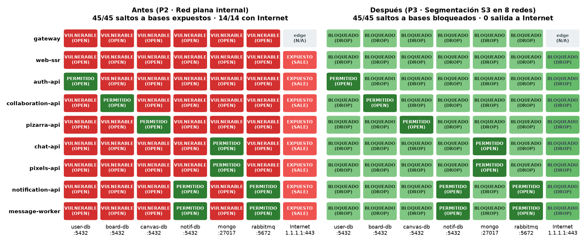
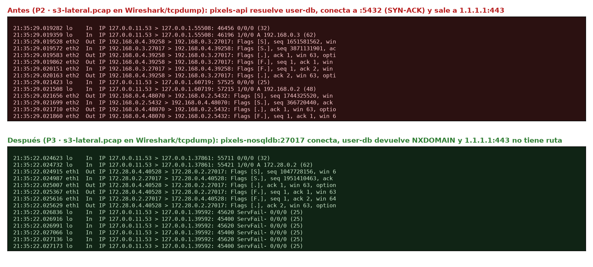
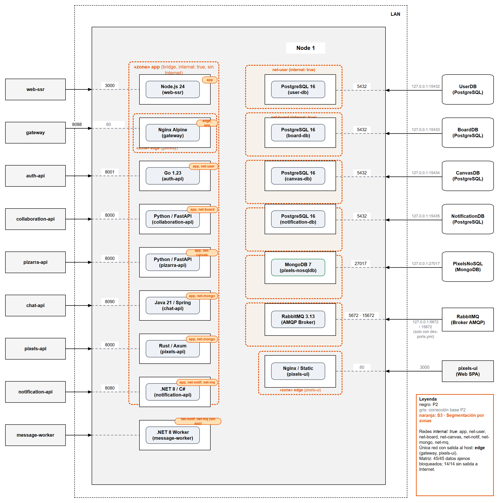
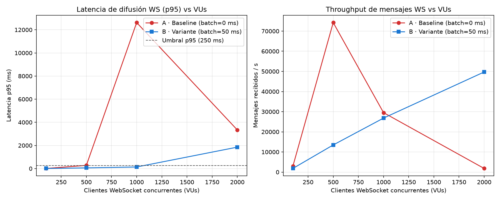

## S3 — Network Segmentation (zonas edge / app / datos / mensajería)

Responsable: Stephan García · Rama: `p3/s3-segmentacion`

### 1. Escenario de seguridad

| Parte | Contenido |
|---|---|
| Fuente | Atacante que ya comprometió un contenedor del sistema (por ejemplo, una API o el servidor SSR) |
| Estímulo | Movimiento lateral: intenta conectarse por TCP a bases de datos que no son del servicio, a RabbitMQ o salir a Internet |
| Artefacto | Redes de contenedores (`docker-compose.yml` y archivos de override) |
| Entorno | Operación normal |
| Respuesta | La red descarta cualquier conexión fuera de la matriz autorizada; las zonas internas (`app` y `net-*`) no tienen salida a Internet (`internal: true`); `message-worker` no tiene acceso a la red `app` |
| Medida | **100 %** de los pares prohibidos hacia bases/broker fallan (`45/45`); **100 %** de los intentos `message-worker → app` fallan (`8/8`); **100 %** de los contenedores internos quedan sin salida a Internet (`14/14`); **100 %** de los pares permitidos funcionan (`22/22`) |

### 2. Problema arquitectónico en el P2

En el P2 ([ADR 0003](../adr/0003-redes-y-puertos-publicados.md)) solo había dos redes: `edge` e `internal` (sin `internal: true`). Los 15 contenedores internos estaban metidos en `internal`, así que todos se veían entre sí por DNS (`127.0.0.11`) y alcanzaban los puertos TCP de las 5 bases de datos y de RabbitMQ. Además, desde cualquiera de ellos se podía abrir una conexión hacia Internet.

**Evidencia en el P2 (`docs/p3/evidencia/S3/antes/`):** probando con `nicolaka/netshoot` dentro del namespace de red de cada contenedor:

```text
$ python security-tests/s3_segmentacion.py --evidence docs/p3/evidencia/S3/antes
OK   gateway: pares permitidos alcanzan su destino — OK (7/7)
FAIL gateway: movimiento lateral prohibido bloqueado — CONECTA a destinos prohibidos: user-db:5432, board-db:5432, canvas-db:5432, notification-db:5432, pixels-nosqldb:27017, rabbitmq:5672
OK   pixels-api: pares permitidos alcanzan su destino — OK (1/1)
FAIL pixels-api: movimiento lateral prohibido bloqueado — CONECTA a destinos prohibidos: user-db:5432, board-db:5432, canvas-db:5432, notification-db:5432, rabbitmq:5672
FAIL pixels-api: sin salida a Internet (1.1.1.1:443) — EXPUESTO (sale a Internet)
FAIL message-worker: movimiento lateral prohibido bloqueado — CONECTA a destinos prohibidos: gateway:80, gateway:8081, web-ssr:3000, auth-api:8001, collaboration-api:8000, pizarra-api:8000, chat-api:8090, pixels-api:8000, user-db:5432, board-db:5432, canvas-db:5432, pixels-nosqldb:27017
...
Resumen S3 — Permitidos: 22/22 | Bloqueados datos/broker: 0/45 | Bloqueados worker->app: 0/8 | Sin egreso a Internet: 0/14
```

**Captura de paquetes en el P2 (`docs/p3/evidencia/S3/antes/s3-lateral.pcap`, abierta con `tcpdump` / Wireshark):** desde `pixels-api`, el DNS interno (`127.0.0.11:53`) resuelve `user-db` (`192.168.0.2`), el contenedor completa el handshake TCP contra PostgreSQL (`:5432`, `Flags [S] → Flags [S.]`) y también abre conexión directa hacia Internet (`1.1.1.1:443`):

```text
127.0.0.11.53 > 127.0.0.1.60719: 57215 1/0/0 A 192.168.0.2 (48)
192.168.0.4.48070 > 192.168.0.2.5432: Flags [S], seq 1744325520
192.168.0.2.5432 > 192.168.0.4.48070: Flags [S.], seq 366720440, ack 1744325521
192.168.0.4.47686 > 1.1.1.1.443: Flags [S], seq 1433817676
1.1.1.1.443 > 192.168.0.4.47686: Flags [S.], seq 2151734611, ack 1433817677
```

### 3. Tácticas aplicadas

| Táctica (Bass) | Categoría | Cómo se aplica en CollaBoard |
|---|---|---|
| Separate entities | Resistir ataques | La red `internal` se divide en 7 redes separadas en `docker-compose.yml`: `app` para los servicios HTTP y 6 redes `net-*` (una por cada base de datos y una para RabbitMQ) |
| Limit access | Resistir ataques | Cada contenedor se conecta únicamente a las redes de su fila en la matriz; `message-worker` se saca de `app` y solo queda en `net-notif` y `net-mq` |
| Limit exposure | Resistir ataques | `internal: true` en `app` y en las 6 redes `net-*` corta la salida a Internet y no permite publicar puertos al host desde esas redes (la consola `15672` pasa a `docker-compose.dev-ports.yml`) |

### 4. Patrón aplicado: Network Segmentation

- **Contexto:** Sistema con 16 contenedores (dos frontends, un gateway, 6 APIs HTTP, un worker en segundo plano, 4 bases PostgreSQL, MongoDB y RabbitMQ).
- **Problema:** En una red plana, comprometer el servicio menos crítico (`pixels-api`) basta para alcanzar `user-db:5432` (donde viven los hashes de contraseñas) o sacar datos a Internet.
- **Solución:** Aislar el tráfico en zonas (`edge`, `app` y 6 redes `net-*` por almacén) con `internal: true`, de modo que entre contenedores no autorizados no exista ni resolución DNS ni interfaz de red común.
- **Consecuencias:** (+) Se bloquean los 45 caminos prohibidos hacia bases de datos y RabbitMQ y se corta el acceso a Internet desde las zonas internas; (−) en `net-mongo` siguen conviviendo `chat-api` y `pixels-api` contra `pixels-nosqldb` (separados por usuarios de MongoDB según la ADR 0010); para abrir puertos de depuración en `127.0.0.1` hay que usar `-f docker-compose.dev-ports.yml`.
- **Dónde vive en el código:**
  - `docker-compose.yml`: declaración de las 8 redes y bloque `networks:` de cada servicio.
  - `notifications-module/compose.gateway.yml` y `docker-compose.stubs.yml`: redes de `notification-api` (`[app, net-notif, net-mq]`) y `message-worker` (`[net-notif, net-mq]`).
  - `docker-compose.dev-ports.yml`: habilita `127.0.0.1:15672` y `internal: false` solo para depuración local.
  - `scripts/Dockerfile.rabbit-smoke`: imagen de `rabbit-smoke` con `pika` ya instalado para correr en `net-mq` sin Internet.
  - `security-tests/s3_segmentacion.py`, `scripts/segmentation_check.sh` y `.github/workflows/ci.yml`.

### 5. Decisiones y alternativas

| Decisión | Alternativas descartadas y por qué |
|---|---|
| Una red `net-*` por cada almacén + `app` (`internal: true`) | *Dejar `internal` plana:* permite los 45 accesos cruzados a datos. *Una sola red `datos` para todas las bases:* cualquier API que toque una base seguiría alcanzando las otras 4 bases y RabbitMQ |
| Sacar a `message-worker` de `app` | El worker solo lee de RabbitMQ y escribe en `notification-db`; meterlo en `app` le daría acceso innecesario a las 6 APIs, al SSR y al gateway |
| Conservar un solo contenedor `pixels-nosqldb` en `net-mongo` | Poner dos contenedores Mongo separados para Chat y Pixels subiría el uso de RAM del stack; se mantiene uno con credenciales separadas (ADR 0010) y se documenta el riesgo residual ([ADR 0013](../adr/0013-segmentacion-de-redes-por-zonas.md)) |
| Mover `127.0.0.1:15672` a `docker-compose.dev-ports.yml` | Docker no publica puertos al host desde una red `internal: true`; pasarlo al override mantiene `net-mq` cerrada en operación normal y en el CI |

### 6. Verificación

Corriendo el mismo script contra el sistema segmentado (`docs/p3/evidencia/S3/despues/`):

```text
$ python security-tests/s3_segmentacion.py --evidence docs/p3/evidencia/S3/despues
OK   gateway: pares permitidos alcanzan su destino — OK (7/7)
OK   gateway: movimiento lateral prohibido bloqueado — 0 fugas
OK   auth-api: movimiento lateral prohibido bloqueado — 0 fugas
OK   pixels-api: pares permitidos alcanzan su destino — OK (1/1)
OK   pixels-api: movimiento lateral prohibido bloqueado — 0 fugas
OK   pixels-api: sin salida a Internet (1.1.1.1:443) — bloqueado
OK   message-worker: pares permitidos alcanzan su destino — OK (2/2)
OK   message-worker: movimiento lateral prohibido bloqueado — 0 fugas
...
Matriz Esperado vs Observado (destinos de datos/broker + egreso):
Origen             | user       | board      | canvas     | notificati | pixels     | rabbitmq   | Internet
-------------------------------------------------------------------------------------------------------------
gateway            | DENY/DROP  | DENY/DROP  | DENY/DROP  | DENY/DROP  | DENY/DROP  | DENY/DROP  | N/A (edge)
web-ssr            | DENY/DROP  | DENY/DROP  | DENY/DROP  | DENY/DROP  | DENY/DROP  | DENY/DROP  | DENY/DROP
auth-api           | ALLOW/OPEN | DENY/DROP  | DENY/DROP  | DENY/DROP  | DENY/DROP  | DENY/DROP  | DENY/DROP
collaboration-api  | DENY/DROP  | ALLOW/OPEN | DENY/DROP  | DENY/DROP  | DENY/DROP  | DENY/DROP  | DENY/DROP
pizarra-api        | DENY/DROP  | DENY/DROP  | ALLOW/OPEN | DENY/DROP  | DENY/DROP  | DENY/DROP  | DENY/DROP
chat-api           | DENY/DROP  | DENY/DROP  | DENY/DROP  | DENY/DROP  | ALLOW/OPEN | DENY/DROP  | DENY/DROP
pixels-api         | DENY/DROP  | DENY/DROP  | DENY/DROP  | DENY/DROP  | ALLOW/OPEN | DENY/DROP  | DENY/DROP
notification-api   | DENY/DROP  | DENY/DROP  | DENY/DROP  | ALLOW/OPEN | DENY/DROP  | ALLOW/OPEN | DENY/DROP
message-worker     | DENY/DROP  | DENY/DROP  | DENY/DROP  | ALLOW/OPEN | DENY/DROP  | ALLOW/OPEN | DENY/DROP

Resumen S3 — Permitidos: 22/22 | Bloqueados datos/broker: 45/45 | Bloqueados worker->app: 8/8 | Sin egreso a Internet: 14/14
Todas las comprobaciones OK
```



**Captura de paquetes Antes vs Después (`antes/s3-lateral.pcap` y `despues/s3-lateral.pcap`):** en el P3, cuando `pixels-api` intenta el mismo salto hacia `user-db:5432`, el servidor DNS `127.0.0.11:53` devuelve `ServFail 0/0/0` (el nombre no existe en `app` ni en `net-mongo` y las redes `internal: true` no reenvían DNS al exterior), y el intento hacia `1.1.1.1:443` ni siquiera emite un `SYN` porque el kernel falla con `Network is unreachable` al no existir ruta de salida:



| Medida de la respuesta | P2 (antes) | P3 (después) |
|---|---|---|
| Pares permitidos que conectan | 22 / 22 (100 %) | **22 / 22 (100 %)** |
| Pares prohibidos hacia bases de datos y RabbitMQ bloqueados | 0 / 45 (0 %) | **45 / 45 (100 %)** |
| Accesos prohibidos `message-worker → app` bloqueados | 0 / 8 (0 %) | **8 / 8 (100 %)** |
| Contenedores internos sin salida a Internet (`internal: true`) | 0 / 14 (0 %) | **14 / 14 (100 %)** |
| Bases/brokers alcanzables desde `pixels-api` | 6 de 6 + Internet | **1 de 6 (`pixels-nosqldb`) y sin Internet** |

Regresión: los 16 contenedores levantan `healthy`, `python security-tests/s1_tls.py` pasa **12/12 OK** y `rabbit-smoke` pasa **7/7 OK** dentro de `net-mq`.

### 7. Cambios en las vistas

Detalle en [`docs/p3/diagramas/CAMBIOS-S3.md`](../diagramas/CAMBIOS-S3.md). Como la segmentación de redes no añade, elimina ni modifica ningún componente de software, contenedor, conector de aplicación, capa ni módulo de código (los 16 servicios y almacenes son exactamente los mismos del P2), **las 4 vistas principales (C&C, Despliegue, Capas y Descomposición) se mantienen sin cambios de componentes**.

Para explicar visualmente cómo quedan aisladas las zonas (`edge`, `app` y las 6 redes `net-*` con `internal: true`), los diagramas con anotaciones explicativas y el diagrama de secuencia (`secuencia-S3`) se dejan en la subcarpeta [`docs/p3/diagramas/explicacion-S3/`](../diagramas/explicacion-S3/):



### 8. Rendimiento: `pixels-api` (Rust) con conexiones simultáneas y costo de segmentación

Ficha completa, scripts y datos crudos en [`rendimiento/pixels/`](../../../rendimiento/pixels/README.md) y [ADR 0019](../adr/0019-rendimiento-pixels-ws-fanout.md).



- **Qué se midió:** 100, 500 (×3), 1000 (×3) y 2000 clientes WebSocket simultáneos (`k6/ws`) colocando píxeles cada 5,2 s contra `pixels-api` limitado a 1 CPU y 512 MiB. Se comparó **A (Baseline, `PIXELS_BATCH_INTERVAL_MS=0`)** contra **B (Variante, `PIXELS_BATCH_INTERVAL_MS=50`)**, donde los píxeles se agrupan cada 50 ms, el JSON se serializa una sola vez a `Arc<str>` y no se desconecta al cliente si hay `RecvError::Lagged`.
- **Resultados:**
  - En **A**, la rodilla aparece antes de 500 VUs (`p95 = 274 ms`); en 1000 VUs la CPU llega a `98,7 %`, el `p95` sube a `12 624 ms` y el **100 %** de las sesiones se cierran por `Lagged`.
  - En **B**, la rodilla sube a **1000 VUs** (`p95 = 137 ms < 250 ms`, CPU `38,5 %`, **`0,00 %` de errores**). En 2000 VUs sigue con **`0,00 %` de errores** y escribe `23 348` píxeles en 60 s (frente a `398` en A, **58,6×** más).
- **Costo de la segmentación (`GET /api/pixels/stats` a 1500 req/s ×3):** en estado estable, pasar por las redes segmentadas (`edge → app → net-mongo`) sube la mediana `p50` solo **`0,15 ms`** (`1,23 ms` en P2 vs `1,38 ms` en P3).
