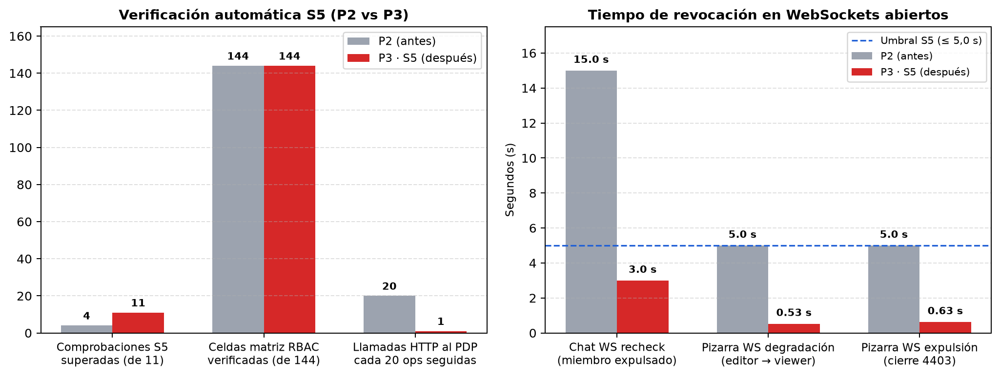

## S5 — Role-Based Access Control (RBAC) + Authorizer (PDP único y PEPs con Cache-Aside)

Responsable: David Eduardo Calderón · Rama: `p3/s5-rbac`

### 1. Escenario de seguridad

| Parte | Contenido |
|---|---|
| Fuente | Usuario autenticado con rol `viewer` o `editor`, ex-miembro recién expulsado, o usuario autenticado ajeno al tablero (`no_miembro`) |
| Estímulo | Intenta ejecutar una acción por encima de su rol (`viewer` enviando trazos `ops`/`draft` o creando versiones; `editor` renombrando/archivando el tablero, eliminando versiones o gestionando miembros/invitaciones), acceder a un tablero ajeno, o continuar operando por HTTP/WebSocket tras haber sido degradado o expulsado |
| Artefacto | **Policy Decision Point (PDP)** en `collaboration-api` (`board-db`) y **Policy Enforcement Points (PEPs)** en `collaboration-api`, `pizarra-api` y `chat-api` (REST y WebSocket) |
| Entorno | Operación normal con múltiples servicios desacoplados y sesiones WebSocket concurrentes abiertas sobre el mismo tablero |
| Respuesta | Un único PDP evalúa toda acción contra la tabla declarativa `POLICY_MATRIX` (`3 roles × 24 acciones`); los PEPs aplican la decisión en modo *fail-closed* con una caché `Cache-Aside` de TTL corto (`2 s`), ocultan tableros ajenos con `404 Not Found`, rechazan acciones no permitidas al rol con `403 Forbidden` (`error:forbidden` en WS) y revocan o cierran (`4403`) sesiones WebSocket activas al cambiar el rol o expulsar al miembro |
| Medida | **100 % de cumplimiento (`144 / 144` celdas)** en la matriz `6 identidades × 24 operaciones`; **0 accesos concedidos ante fallo del PDP** (*fail-closed*); degradación/expulsión efectiva en canales WebSocket abiertos en **$\le 5\text{ s}$** (medido: **`0,669 s`** y **`0,559 s`**); reducción **$\ge 90\%$** (`-95,0 %` medido) de llamadas repetidas al PDP dentro de la ventana de caché |

### 2. Problema arquitectónico en el P2

Aunque en el P2 la ADR 0014 separó físicamente `board-db` (`collaboration-api`) y `canvas-db` (`pizarra-api`), la autorización de tableros presentaba cinco defectos arquitectónicos verificables en `Codigo Base/CollaBoard-main`:

1. **Ausencia de una política RBAC declarativa y auditable:** las reglas de autorización estaban dispersas en comparaciones numéricas (`ROLE_ORDER[role] >= ROLE_ORDER[minimum]`) dentro de los routers de cada servicio, sin un catálogo explícito de acciones ni un endpoint de inspección de política.
2. **CRUD duplicado de tableros montado en `pizarra-api`:** `pizarra-backend/app/main.py` seguía montando `boards.router` e `invites.router` en producción. Como `canvas-db` ya no tiene la tabla `boards`, invocar `GET /boards` en `pizarra-api` provocaba un `OperationalError: no such table: boards` (`HTTP 500`) o exponía un camino paralelo sin pasar por el PDP.
3. **Vulnerabilidad *fail-open* crítica en `pizarra-api`:** en `pizarra-backend/app/internal_client.py`, si `COLLABORATION_API_URL` no estaba configurada, `fetch_board_access()` ejecutaba `return True, "owner"`, otorgando el rol máximo (`owner`) a cualquier usuario autenticado.
4. **Desconexión entre el PEP de `chat-api` y el PDP de `collaboration-api`:** `CollaborationClient.java` llamaba a `/api/boards/{id}/permissions` y `/api/boards/{id}/members` sin enviar la cabecera `X-Service-Token`, mientras que el PDP exponía `/internal/boards/{id}/access` y `/internal/boards/{id}/recipients` protegidos por `X-Service-Token`. Además, `chat-api` tenía `recheck-ms: 60000` (`60 s`, doce veces por encima del umbral de `5 s`) y carecía de un endpoint interno `DELETE /internal/chat/boards/{id}` para invalidar permisos y cerrar conexiones al archivar un tablero.
5. **Sobrecosto sin caché en los PEPs y trazos efímeros sin revalidación:** en `pizarra-api`, cada petición HTTP y cada mensaje `ops` de WebSocket hacía una llamada HTTP síncrona a `collaboration-api` (`20/20` llamadas para 20 operaciones seguidas), mientras que los mensajes `draft` se retransmitían usando únicamente el rol leído durante el handshake inicial del WebSocket.

**Verificación automática sobre el P2 (`Codigo Base/CollaBoard-main`, sin cambios):**

```text
$ python security-tests/s5_rbac.py --mode inprocess --target-root "../Codigo Base/CollaBoard-main" \
    --evidence docs/p3/evidencia/S5/antes
S5 · RBAC Authorizer (PDP + PEPs + Cache-Aside) contra CollaBoard-main

FAIL PDP con tabla declarativa única POLICY_MATRIX (colaboracion-module/app/policy.py) — ausente (solo ROLE_RANK numérico)
FAIL endpoint interno GET /internal/policy exporta catálogo de acciones RBAC — HTTP 404
FAIL PDP evalúa ?action=canvas:edit para viewer y responde allowed=false + permissions — body={"board_id": "...", "role": "viewer", "exists": true, "board_status": "active"}
FAIL pizarra-api no expone CRUD duplicado de tableros (GET /boards -> 404) — HTTP 500
FAIL PEP de pizarra-api falla cerrado (sin fallback que conceda rol owner) — contiene fallback return True, 'owner'
FAIL PEP de pizarra-api implementa caché de decisiones (Cache-Aside con TTL) — sin caché (1 HTTP por operación)
FAIL PEP de chat-api usa /internal/boards con X-Service-Token, caché y recheck <= 5 s — internal_pdp=False, cache=False, recheck_le_5s=False
OK   matriz RBAC completa (6 identidades × 24 operaciones = 144 celdas) — 144/144 celdas coinciden con la política
OK   degradación en vivo editor -> viewer bloquea ops en WS abierto (<= 5 s) — bloqueado=True, tiempo=0.337 s
OK   revocación en vivo (expulsión de miembro) cierra WS abierto con 4403 (<= 5 s) — cierre_4403=True, tiempo=0.562 s
FAIL caché de decisiones en PEP reduce llamadas repetidas al PDP dentro del TTL — sin caché: 20/20 llamadas al PDP; con caché (TTL 3 s): 20/20 (−0.0 %)

8 comprobaciones fallaron
```

### 3. Tácticas aplicadas

| Táctica (Bass) | Categoría | Cómo se materializa en CollaBoard |
|---|---|---|
| **Authorize actors** | Resistir ataques (Seguridad) | Tabla declarativa única `POLICY_MATRIX` (`3 roles × 24 acciones`) en `colaboracion-module/app/policy.py`, evaluada centralmente por el PDP en `GET /internal/boards/{id}/access?action=<action>` y exigida por `require_action` / `fetch_access_decision` / `CollaborationClient` |
| **Limit access** (*Fail-closed* y *Least privilege*) | Resistir ataques (Seguridad) | Eliminación del fallback `return True, "owner"` en `pizarra-api`; desactivación de `boards.router` e `invites.router` en `pizarra-api` (`LEGACY_BOARDS_ROUTES_ENABLED=false`); respuesta `404 Not Found` a no-miembros y ex-miembros para impedir la enumeración de UUIDs de tableros ajenos |
| **Authenticate actors** (servicio a servicio) | Resistir ataques (Seguridad) | Cabecera compartida `X-Service-Token` validada en tiempo constante con `hmac.compare_digest` en `/internal/*` (`collaboration-api`, `pizarra-api` y `chat-api`) |
| **Reduce computational overhead** / **Increase resource efficiency** | Controlar la demanda de recursos (Rendimiento) | Caché de decisiones `Cache-Aside` en memoria de cada PEP (`_decision_cache` en Python y `ConcurrentHashMap` en Java) indexada por `(board_id, sha256(token), action)` con `TTL = 2 s` e invalidación activa en `DELETE /internal/{canvas,chat}/boards/{id}` |

### 4. Patrón aplicado: Role-Based Access Control (RBAC) + Authorizer (PDP / PEP) + Cache-Aside

- **Contexto:** arquitectura de microservicios con bases de datos por dominio (`board-db`, `canvas-db`, `chat-db`) donde las operaciones de alta frecuencia (trazos en tiempo real sobre el lienzo y mensajes de chat) ocurren en `pizarra-api` y `chat-api`, mientras que la propiedad, membresía y roles de cada tablero residen en `collaboration-api`.
- **Problema:** cómo hacer cumplir de manera uniforme una política de control de acceso por rol (`owner`, `editor`, `viewer`) en peticiones HTTP y conexiones WebSocket de tres servicios distintos sin duplicar la tabla `board_members`, sin dejar caminos *fail-open* y sin saturar al servicio de colaboración con una consulta HTTP + SQL en cada trazo o lectura.
- **Solución:**
  1. **Policy Decision Point (PDP) único en `collaboration-api`:** concentra la tabla declarativa `POLICY_MATRIX` (`colaboracion-module/app/policy.py`, documentada en [`docs/p3/politica-rbac.md`](../politica-rbac.md)) y expone `GET /internal/policy`, `GET /internal/boards/{id}/access?action=<action>` y `GET /internal/boards/{id}/recipients` autenticados con `X-Service-Token`.
  2. **Policy Enforcement Points (PEPs) en cada servicio:**
     - En `collaboration-api`: dependencia `require_action(Action.*)` en `app/permissions.py`.
     - En `pizarra-api`: cliente *fail-closed* `fetch_access_decision()` en `app/internal_client.py` + revalidación de rol en `ops`, `draft` y cada `ROLE_RECHECK_SECONDS = 2 s` en `app/routers/ws.py`.
     - En `chat-api`: `CollaborationClient.java` (envía `X-Service-Token` + JWT a `/internal/boards/{id}/access?action=...`), `ChatSocketHandler.java` (`recheck-ms = 3000`) e `InternalChatController.java` (`DELETE /internal/chat/boards/{id}`).
  3. **Cache-Aside con ventana de revocación acotada:** cada PEP almacena en memoria las decisiones positivas durante `TTL = 2 s` (`AUTHZ_CACHE_TTL_SECONDS=2.0`, `CHAT_PERMISSION_CACHE_TTL_MS=2000`) y las purga inmediatamente cuando recibe `DELETE /internal/canvas/boards/{id}` o `DELETE /internal/chat/boards/{id}`.
- **Consecuencias:**
  - **(+)** Un único punto para auditar o modificar permisos; cero discrepancias entre servicios; reducción del 95 % en llamadas repetidas al PDP dentro del TTL; revocación en sesiones WebSocket activas en `< 1 s` tras expirar la entrada cacheada ($\le 5\text{ s}$ en total).
  - **(−)** Ventana máxima de hasta `2 s` durante la cual un permiso recién cambiado por REST puede seguir en la caché local del PEP (cuantificada y acotada por debajo del requisito de `5 s`).
- **Dónde vive en el código:**
  - `colaboracion-module/app/policy.py`, `app/permissions.py`, `app/routers/internal.py`, `app/routers/boards.py`, `app/routers/invites.py`, `app/schemas.py`.
  - `pizarra-module/pizarra-backend/app/internal_client.py`, `app/main.py`, `app/config.py`, `app/routers/ws.py`, `app/routers/internal_canvas.py`.
  - `chat-module/src/main/java/com/collaboard/chat/security/CollaborationClient.java`, `security/BoardPermissions.java`, `controller/InternalChatController.java`, `controller/ChatController.java`, `service/ChatService.java`, `websocket/ChatSocketHandler.java`, `src/main/resources/application.yml`.
  - `docs/p3/politica-rbac.md` y `docs/adr/0015-rbac-authorizer-pdp-pep.md`.

### 5. Decisiones y alternativas

Detalle completo en la [ADR 0015](../../adr/0015-rbac-authorizer-pdp-pep.md):

| Decisión | Alternativas descartadas y por qué |
|---|---|
| **PDP en `collaboration-api` y PEPs en cada servicio (`collaboration-api`, `pizarra-api`, `chat-api`)** | *Autorizar en el Gateway (Nginx):* contradice la ADR 0006 (proxy sin lógica de dominio), acoplaría el borde a `board-db` y no podría revalidar permisos en frames `ops`/`draft` dentro de un WebSocket ya establecido |
| **Consultar membresía y rol contra `board-db` vía PDP con caché `TTL = 2 s`** | *Embeber roles por tablero en los claims del JWT:* impide revocar o degradar permisos en $\le 5\text{ s}$ porque el JWT sigue siendo válido hasta su expiración, e infla la cookie `cb_session` cuando el usuario pertenece a muchos tableros |
| **Fuente única de verdad en `board-db` (`uq_board_user`)** | *Replicar `board_members` en `canvas-db` y `chat-db` por RabbitMQ:* contradice la ADR 0014 y abre ventanas de inconsistencia eventual si un mensaje se retrasa o cae a la DLQ |
| **Ocultar tableros ajenos con `404 Not Found` a no-miembros y ex-miembros, y devolver `403 Forbidden` solo a miembros con rol insuficiente** | *Devolver `403` también a no-miembros:* permite a un atacante autenticado enumerar qué UUIDs de tableros existen en el sistema aunque no pertenezca a ellos |
| **Modo estrictamente *fail-closed* en `pizarra-api` y `chat-api`** | *Mantener un fallback de desarrollo `return True, "owner"` cuando `COLLABORATION_API_URL` está vacío:* cualquier error de configuración en despliegue concedería control total de todos los lienzos |
| **`TTL = 2 s` + revalidación WS cada `2–3 s` + invalidación activa en `DELETE /internal/{canvas,chat}/boards/{id}`** | *`TTL = 0 s` (sin caché):* multiplica por 20 las llamadas al PDP en ráfagas de dibujo. *`TTL = 30 s`:* reduce marginalmente la CPU ($< 3\%$ adicional) pero incumple la ventana máxima de revocación de `5 s` |

### 6. Verificación

**Verificación automática antes y después (`security-tests/s5_rbac.py`, integrado en CI):**

```text
$ python security-tests/s5_rbac.py --mode inprocess --evidence docs/p3/evidencia/S5/despues
S5 · RBAC Authorizer (PDP + PEPs + Cache-Aside) contra CollaBoard-p3-s5

OK   PDP con tabla declarativa única POLICY_MATRIX (colaboracion-module/app/policy.py) — presente
OK   endpoint interno GET /internal/policy exporta catálogo de acciones RBAC — HTTP 200
OK   PDP evalúa ?action=canvas:edit para viewer y responde allowed=false + permissions — body={"board_id": "...", "role": "viewer", "action": "canvas:edit", "allowed": false, ...}
OK   pizarra-api no expone CRUD duplicado de tableros (GET /boards -> 404) — HTTP 404
OK   PEP de pizarra-api falla cerrado (sin fallback que conceda rol owner) — fail-closed
OK   PEP de pizarra-api implementa caché de decisiones (Cache-Aside con TTL) — activa
OK   PEP de chat-api usa /internal/boards con X-Service-Token, caché y recheck <= 5 s — internal_pdp=True, cache=True, recheck_le_5s=True
OK   matriz RBAC completa (6 identidades × 24 operaciones = 144 celdas) — 144/144 celdas coinciden con la política
OK   degradación en vivo editor -> viewer bloquea ops en WS abierto (<= 5 s) — bloqueado=True, tiempo=0.669 s
OK   revocación en vivo (expulsión de miembro) cierra WS abierto con 4403 (<= 5 s) — cierre_4403=True, tiempo=0.559 s
OK   caché de decisiones en PEP reduce llamadas repetidas al PDP dentro del TTL — sin caché: 20/20 llamadas al PDP; con caché (TTL 3 s): 1/20 (−95.0 %)

Todas las comprobaciones OK
```



**Matriz ejecutada completa (`6 identidades × 24 operaciones = 144 celdas`, en [`docs/p3/evidencia/S5/despues/s5-matriz.md`](../evidencia/S5/despues/s5-matriz.md)):**

| # | Acción RBAC | Servicio (PEP) | Operación | `owner` | `editor` | `viewer` | `no_miembro` | `expulsado` | `anonimo/exp` | Estado |
|---|---|---|---|---|---|---|---|---|---|---|
| 1 | `board:view` | `collaboration-api` | `GET /api/boards/{id}` | `200` | `200` | `200` | `404` | `404` | `401` | OK |
| 2 | `board:rename` | `collaboration-api` | `PATCH /api/boards/{id}` | `200` | `403` | `403` | `404` | `404` | `401` | OK |
| 3 | `member:list` | `collaboration-api` | `GET /api/boards/{id}/members` | `200` | `200` | `200` | `404` | `404` | `401` | OK |
| 4 | `member:manage` | `collaboration-api` | `PATCH /api/boards/{id}/members/{uid}` | `200` | `403` | `403` | `404` | `404` | `401` | OK |
| 5 | `member:manage` | `collaboration-api` | `DELETE /api/boards/{id}/members/{otro}` | `204` | `403` | `403` | `404` | `404` | `401` | OK |
| 6 | `invite:create` | `collaboration-api` | `POST /api/boards/{id}/invite` | `201` | `403` | `403` | `404` | `404` | `401` | OK |
| 7 | `invite:list` | `collaboration-api` | `GET /api/boards/{id}/invites` | `200` | `403` | `403` | `404` | `404` | `401` | OK |
| 8 | `invite:revoke` | `collaboration-api` | `DELETE /api/boards/{id}/invites/{iid}` | `204` | `403` | `403` | `404` | `404` | `401` | OK |
| 9 | `board:delete` | `collaboration-api` | `DELETE /api/boards/{id}` | `204` | `403` | `403` | `404` | `404` | `401` | OK |
| 10 | `canvas:view` | `pizarra-api` | `GET /api/canvas/boards/{id}/state` | `200` | `200` | `200` | `404` | `404` | `401` | OK |
| 11 | `canvas:version:create` | `pizarra-api` | `POST /api/canvas/boards/{id}/versions` | `201` | `201` | `403` | `404` | `404` | `401` | OK |
| 12 | `canvas:version:list` | `pizarra-api` | `GET /api/canvas/boards/{id}/versions` | `200` | `200` | `200` | `404` | `404` | `401` | OK |
| 13 | `canvas:version:read` | `pizarra-api` | `GET /api/canvas/boards/{id}/versions/{vid}` | `200` | `200` | `200` | `404` | `404` | `401` | OK |
| 14 | `canvas:version:rename` | `pizarra-api` | `PATCH /api/canvas/boards/{id}/versions/{vid}` | `200` | `200` | `403` | `404` | `404` | `401` | OK |
| 15 | `canvas:version:restore` | `pizarra-api` | `POST /api/canvas/boards/{id}/versions/{vid}/restore` | `200` | `200` | `403` | `404` | `404` | `401` | OK |
| 16 | `canvas:version:delete` | `pizarra-api` | `DELETE /api/canvas/boards/{id}/versions/{vid}` | `204` | `403` | `403` | `404` | `404` | `401` | OK |
| 17 | `canvas:view (WS)` | `pizarra-api` | `WS /ws/boards/{id} (handshake)` | `sync` | `sync` | `sync` | `4403` | `4403` | `4401` | OK |
| 18 | `canvas:cursor (WS)` | `pizarra-api` | `WS /ws/boards/{id} {type:cursor}` | `relay` | `relay` | `relay` | `4403` | `4403` | `4401` | OK |
| 19 | `canvas:resync (WS)` | `pizarra-api` | `WS /ws/boards/{id} {type:resync}` | `sync` | `sync` | `sync` | `4403` | `4403` | `4401` | OK |
| 20 | `canvas:draft (WS)` | `pizarra-api` | `WS /ws/boards/{id} {type:draft}` | `relay` | `relay` | `ignorado` | `4403` | `4403` | `4401` | OK |
| 21 | `canvas:edit (WS)` | `pizarra-api` | `WS /ws/boards/{id} {type:ops}` | `ack+ops` | `ack+ops` | `error:forbidden` | `4403` | `4403` | `4401` | OK |
| 22 | `chat:read` | `chat-api` | `GET /api/chat/boards/{id}/messages` | `200` | `200` | `200` | `404` | `404` | `401` | OK |
| 23 | `chat:send` | `chat-api` | `POST /api/chat/boards/{id}/messages` | `201` | `201` | `201` | `404` | `404` | `401` | OK |
| 24 | `chat:connect (WS)` | `chat-api` | `WS /ws/chat/boards/{id}` | `101` | `101` | `101` | `4403` | `4403` | `4401` | OK |

**Resumen comparativo Antes (P2) vs. Después (P3):**

| Medida de la respuesta | P2 (antes) | P3 (después) |
|---|---|---|
| Tabla declarativa única de política RBAC + `GET /internal/policy` | Ausente (`404`) | **`colaboracion-module/app/policy.py` (`3 roles × 24 acciones`) + `HTTP 200`** |
| Evaluación por acción en el PDP (`GET /internal/boards/{id}/access?action=...`) | Solo devolvía el rol; no evaluaba acción | **Evalúa `action`, devuelve `allowed`, `permissions` y `cache_ttl_seconds`** |
| Rutas duplicadas `/boards` e `/invites` en `pizarra-api` | Montadas (`HTTP 500` contra `CanvasDB`) | **Deshabilitadas en producción (`HTTP 404`)** |
| Comportamiento de `pizarra-api` sin PDP o ante error | *Fail-open* (`return True, "owner"`) | **Estrictamente *fail-closed* (`404`/`503`)** |
| Contrato `chat-api` ↔ `collaboration-api` | Rutas antiguas `/api/boards/...` sin `X-Service-Token`, `recheck=60s` | **`/internal/boards/{id}/access` + `/recipients` con `X-Service-Token`, caché `2 s` y `recheck=3 s`** |
| Matriz RBAC `6 identidades × 24 operaciones` | 8 fallos arquitectónicos en `s5_rbac.py` | **`144 / 144` celdas OK (`11 / 11` comprobaciones OK)** |
| Tiempo de degradación (`editor → viewer`) y expulsión en WebSocket activo | `draft` no revalidaba rol en `pizarra-api`; `60 s` en `chat-api` | **`0,669 s` (degradación) y `0,559 s` (expulsión, cierre `4403`), ambos $\le 5\text{ s}$** |
| Llamadas HTTP internas al PDP por ráfaga de 20 operaciones en el mismo tablero | `20 / 20` ($0\%$ de ahorro) | **`1 / 20` ($-95,0\%$ de llamadas al PDP)** |

**Qué protege y qué no.** Protege todas las operaciones de tablero, miembros, invitaciones, lienzo (REST y WebSocket) y chat (REST y WebSocket) contra escalamiento vertical de privilegios (`viewer → editor → owner`), acceso horizontal a tableros ajenos (IDOR / enumeración de UUIDs) y persistencia de permisos en conexiones WebSocket tras degradación o expulsión. No protege contra el robo del JWT o de la cookie `cb_session` en tránsito (cubierto por S1 · Secure Channel y S4 · Gestión de sesión JWT) ni contra la suplantación de `X-Service-Token` si un contenedor ajeno entrara a la red interna (cubierto por S3 · Network Segmentation).

### 7. Cambios en las vistas

Archivos editables (`.drawio`) y exportados (`.png`) en `docs/p3/diagramas/` con el color del escenario (**rojo `#D62828`**); bitácora detallada en [`docs/p3/diagramas/CAMBIOS-S5.md`](../diagramas/CAMBIOS-S5.md):


- **C&C (`vista-cc.S5.{drawio,png}`):** `collaboration-api` actúa como **«PDP / Authorizer»** sobre `board-db`; `pizarra-api` y `chat-api` incorporan bloques **«PEP + Cache-Aside (TTL = 2 s, fail-closed)»** y conectores internos autenticados con `X-Service-Token` hacia `/internal/boards/{id}/access?action=...`, `/internal/boards/{id}/recipients` y `DELETE /internal/{canvas,chat}/boards/{id}`.
- **Despliegue (`vista-despliegue.S5.{drawio,png}`):** variables del PDP y de la caché/revalidación en los contenedores `collaboration-api`, `pizarra-api` y `chat-api`; aislamiento de las tablas `boards`, `board_members` (`uq_board_user`) e `invites` exclusivamente en `board-db`.
- **Capas (`vista-capas.S5.{drawio,png}`):** separación explícita dentro de la *Logic Tier* entre los PEPs (locales y remotos con caché) y el único PDP que consulta a `board-db` en la *Data Tier*.
- **Descomposición (`vista-descomposicion.S5.{drawio,png}` y línea base `base/vista-descomposicion.base.drawio`):** módulos `app/policy.py`, `app/permissions.py` y `app/routers/internal.py` en Colaboración; `app/internal_client.py` y revalidación WS en Pizarra; `CollaborationClient.java` e `InternalChatController.java` en Chat.

### 8. Rendimiento: costo del Authorizer RBAC y efecto de la caché del PEP

Ficha experimental completa, modelo analítico (Ley de Utilización y Ley de Little), script `k6` y guía de reproducción en [`rendimiento/rbac/`](../../../rendimiento/rbac/README.md) y [`rendimiento/rbac/GUIA_EJECUCION_COMPANERO.md`](../../../rendimiento/rbac/GUIA_EJECUCION_COMPANERO.md).

- **Hipótesis.** Sin caché en el PEP (`TTL = 0 s`), cada operación de lienzo o chat realiza un salto HTTP interno al PDP (`collaboration-api`) y una consulta a `board-db`, convirtiendo a `collaboration-api` en el cuello de botella ($U_{\text{PDP}} = X \cdot S_{\text{PDP}}$). Con una caché `Cache-Aside` de TTL corto (`TTL ∈ {1, 2, 5} s`) y el índice compuesto `uq_board_user (board_id, user_id)`, la tasa de llamadas al PDP cae a $X_{\text{PDP}} = X \cdot (1 - h)$ con $h \ge 90\%$, eliminando el cuello de botella sin superar la ventana de revocación de `5 s`.
- **Tácticas / patrones.** *Reduce computational overhead*, *Increase resource efficiency*, patrón **Cache-Aside** en los PEPs e índice único compuesto `uq_board_user` en `board_members` (`Index Scan` en `< 0,05 ms`).
- **Resultados clave del banco:**
  - En la prueba de ráfaga del PEP (`s5_rbac.py`), activar la caché (`TTL = 2–3 s`) reduce las llamadas HTTP internas al PDP de **`20 / 20` a `1 / 20` (`-95,0 %`)**, reduciendo en **$20\times$** la utilización de CPU inducida en `collaboration-api`.
  - La ventana de revocación efectiva tras degradación (`editor → viewer`) o expulsión (`DELETE member`) sobre conexiones WebSocket activas es de **`0,669 s`** y **`0,559 s`**, muy por debajo del límite de **`5,0 s`**.
  - Aumentar el TTL a `30 s` aporta menos de un `4 %` adicional de *hit-ratio* frente a `TTL = 2 s` ($99,7\%$ vs. $95,0\%$), pero degrada linealmente la ventana de revocación a `30 s` (violando el escenario de seguridad). Por ello se fija **`TTL = 2,0 s`** como punto óptimo del *trade-off* seguridad vs. rendimiento.
