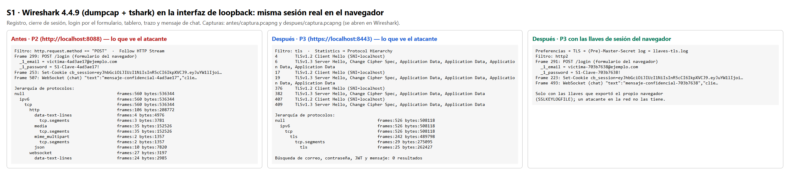
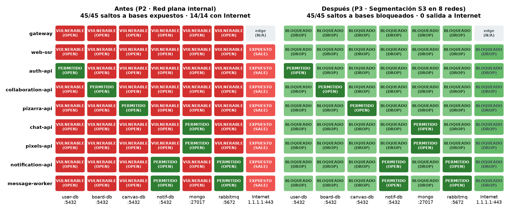
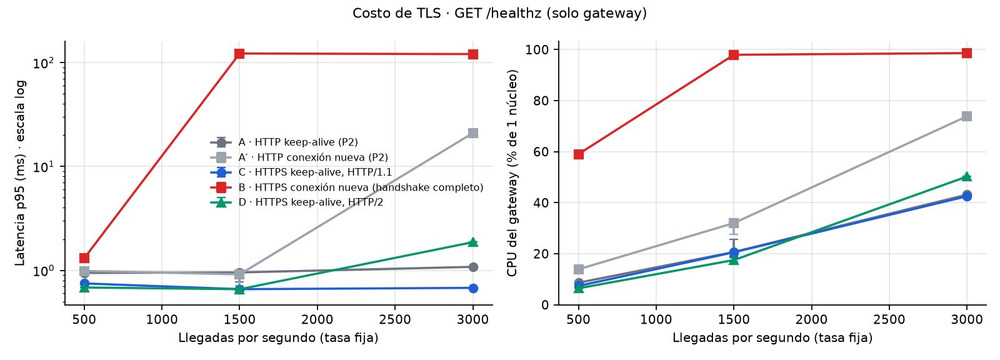
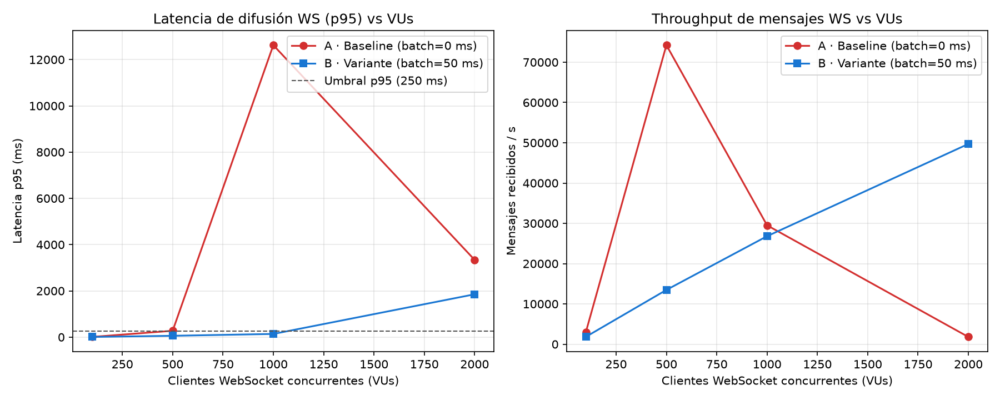

<div align="center">

**UNIVERSIDAD NACIONAL DE COLOMBIA — FACULTAD DE INGENIERÍA**<br>
Departamento de Ingeniería de Sistemas e Industrial<br>
Arquitectura de Software (2026-II) — Prof. Jeisson Andrés Vergara Vargas

# CollaBoard

**Prototipo 3: Quality Attributes, Part 1**<br>
Equipo 1e

</div>

## 1. Team (Equipo)

**Identificador del equipo:** 1e

| # | Integrante | Correo |
|---|---|---|
| 1 | Cristian Camilo García Palacios | crgarciapa@unal.edu.co |
| 2 | Marlon David Pabón Muñoz | mapabon@unal.edu.co |
| 3 | Jhon Edison Prieto Artunduaga | jhprieto@unal.edu.co |
| 4 | David Eduardo Calderón Parra | dcalderonpa@unal.edu.co |
| 5 | Juan Sebastián Leguizamón Silva | jleguizamons@unal.edu.co |
| 6 | Stephan Alain Roland Garcia Martiquet | stgarciam@unal.edu.co |

## 2. Software System (Sistema de Software)

### 2.1. Nombre

**CollaBoard** — Plataforma colaborativa de pizarras y creación en tiempo real.

### 2.2. Logo

<p align="center"></p>

Tres cintas entrelazadas en violeta y azul profundo: la colaboración simultánea de varias personas que
dibujan, conversan y coordinan ideas sobre un mismo lienzo.

### 2.3. Descripción

CollaBoard es una plataforma web para la cocreación visual sincrónica. Combina una web con renderizado
en servidor (SSR) y BFF, autenticación con JWT, gestión de tableros con roles (`owner`, `editor`,
`viewer`) e invitaciones, sincronización en vivo de trazos vectoriales con versiones, chat por
tablero, un lienzo colectivo de 200 × 200 píxeles y notificaciones asíncronas con reintentos y Dead
Letter Queue. Son **17 contenedores** orquestados con Docker Compose, con persistencia políglota
(Database-per-Service: cuatro PostgreSQL y un MongoDB) y un broker RabbitMQ.

El Prototipo 3 rediseña la arquitectura para responder a cinco escenarios de seguridad:

| # | Patrón | Qué cambia en el sistema |
|---|---|---|
| 1 | Secure Channel | Todo el tráfico del cliente va por HTTPS/WSS (TLS 1.2/1.3) terminado en `reverse-proxy` |
| 2 | Reverse Proxy | `reverse-proxy` es la única entrada pública (único contenedor en `edge`), aplica la política de borde y delega las APIs al API Gateway interno (`gateway`) |
| 3 | Network Segmentation | La red interna plana se divide en 8 zonas; `edge` contiene únicamente a `reverse-proxy` y las 7 redes internas bloquean salida a Internet |
| 4 | Token-Based Session (refresh rotatorio) | JWT de 15 min, refresh de un solo uso con revocación de familia y logout en servidor |
| 5 | RBAC + Authorizer (PDP / PEP) + Cache-Aside | Una política de roles única, evaluada en un solo punto y aplicada en cada servicio |

## 3. Architectural Structures (Estructuras Arquitectónicas)

### 3.1. Component-and-Connector (C&C) Structure

#### 3.1.1. C&C View


*Figura 1. Vista de componentes y conectores (capa 7: HTTP, HTTPS, WS, WSS, AMQP y conectores de base de datos).*

#### 3.1.2. Elementos y relaciones

**Componentes.**

| Componente | Tipo | Responsabilidad | Tecnología |
|---|---|---|---|
| `reverse-proxy` | Proxy inverso (borde) | Única entrada pública (`:8443` HTTPS/WSS; `:8088` redirige 301). Termina TLS 1.2/1.3 y aplica la política de borde: validación de `Host`, saneado de cabeceras, límites de tamaño/tiempo/tasa/conexiones, cabeceras de seguridad (HSTS, CSP), errores JSON propios; enruta páginas a `web-ssr` y `pixels-ui`, y `/api/*` + `/ws/*` hacia `gateway` | Nginx Alpine |
| `gateway` | API Gateway interno | Contenedor interno en red `app` (sin exposición en `edge`). Enruta hacia las seis APIs con reescritura de prefijos, aplica límites por ruta de API/Auth/WS, propaga `X-Request-ID`, bloquea `/internal/*` y sirve el canal interno del BFF (`:8081`) | Nginx Alpine |
| `web-ssr` | Servidor web / BFF | Renderizado SSR, sesión en cookies `HttpOnly; Secure` (access y refresh), BFF `/bff/*` | Node.js 24 / Next.js 16 |
| `pixels-ui` | Cliente SPA | UI del lienzo de píxeles, servida en `/pixels/` detrás de `reverse-proxy` (en red interna `app`) | React / Vite / Nginx |
| `auth` | Servicio | Registro, login, hash Argon2id, emisión de JWT (15 min), refresh rotatorio y logout | Go 1.23 |
| `collaboration` | Servicio | Tableros, membresías, roles e invitaciones; **PDP** de la política RBAC; outbox de eventos | Python 3.12 / FastAPI |
| `pizarra` | Servicio | Trazos en tiempo real (`seq`/`ack`), autosave y versiones del lienzo; **PEP** con caché | Python 3.12 / FastAPI |
| `chat` | Servicio | Mensajes por tablero en tiempo real; **PEP** con caché; outbox de eventos | Java 21 / Spring Boot 3 |
| `pixels` | Servicio | Lienzo colectivo 200 × 200 con *cooldown* de 5 s y difusión por WebSocket | Rust / Axum |
| `notification` | Servicio | Bandeja de notificaciones; recibe eventos internos y publica tareas en RabbitMQ | C# / .NET 8 |
| `message-worker` | Worker | Consume tareas con confirmación manual, reintenta y desvía a la DLQ | C# / .NET 8 |
| `rabbitmq` | Broker | Exchange `notifications.events`, colas quorum y DLQ | RabbitMQ 3.13 |
| `user-db`, `board-db`, `canvas-db`, `notification-db` | Almacenes | Usuarios y refresh tokens; tableros y miembros; lienzo y versiones; notificaciones | PostgreSQL 16 |
| `pixels-nosqldb` | Almacén | Bases lógicas `chat` y `collaboard_pixels`, con credenciales separadas | MongoDB 7 |

**Conectores.**

| Origen → destino | Conector | Interacción |
|---|---|---|
| Browser → `reverse-proxy` | HTTPS / WSS | Única entrada pública (`:8443`); `:8088` solo redirige a HTTPS |
| `reverse-proxy` → `web-ssr`, `pixels-ui` | HTTP | Páginas SSR y la SPA de Pixels (`/pixels/`) dentro de la red interna `app` |
| `reverse-proxy` → `gateway` | HTTP/REST + WS | Peticiones a `/api/*` y `/ws/*` que pasaron la política de borde (`gateway:80`) |
| `pixels-ui` (en navegador) → `reverse-proxy` | HTTPS + WSS | La SPA, ya cargada en el navegador, llama a las APIs y abre sus WebSockets por el borde público |
| `web-ssr` → `gateway` | HTTP/REST | El BFF consume las APIs por el canal interno (`:8081`) con `Authorization: Bearer` |
| `gateway` → APIs | HTTP/REST (+ WebSocket en Pizarra, Chat y Pixels) | Enrutamiento por prefijo hacia las seis APIs; `/internal/*` nunca se expone |
| `pizarra`, `chat` → `collaboration` | HTTP/REST | Decisión de acceso del PDP (`/internal/boards/{id}/access?action=`) con `X-Service-Token` |
| `collaboration`, `chat` → `notification` | HTTP/REST | Eventos de dominio vía outbox (`/internal/events`) |
| `collaboration` → `pizarra`, `chat` | HTTP/REST | Limpieza al borrar un tablero (`DELETE /internal/{canvas,chat}/boards/{id}`) |
| `notification` → `rabbitmq` → `message-worker` | AMQP 0-9-1 | Publicación; consumo con `ack`, reintentos y DLQ |
| Servicios → almacenes | Conector de base de datos | Cada servicio accede solo a su almacén |

#### 3.1.3. Estilos y patrones

- **Microservicios con Database-per-Service** (P2): cada servicio es dueño de su almacén y de su esquema.
- **Reverse Proxy** (P3) y **API Gateway** (P2): dos componentes independientes en tiempo de ejecución
  (dos contenedores Nginx separados: `reverse-proxy` en el borde `edge`/`app` y `gateway` interno en `app`);
  el primero termina TLS y protege el borde, y el segundo enruta hacia las seis APIs y atiende al BFF.
- **Secure Channel con Gateway Offloading** (P3): el TLS termina en el borde y los servicios no cambian.
- **Backend-for-Frontend** (P2): `web-ssr` aísla las cookies de sesión y habla con las APIs con Bearer.
- **Authorizer (PDP / PEP) con Cache-Aside** (P3): `collaboration` decide; `pizarra` y
  `chat` aplican la decisión con una caché de 2 s.
- **Publicador/suscriptor por WebSocket**, **Transactional Outbox** y **mensajería asíncrona con DLQ** (P2).

### 3.2. Deployment Structure

#### 3.2.1. Deployment View


*Figura 2. Vista de despliegue: un nodo Docker, 17 contenedores y 8 redes (solo `reverse-proxy` en `edge`).*

#### 3.2.2. Elementos y relaciones

Todos los contenedores se despliegan en un nodo con Docker Compose. **Solo `reverse-proxy` publica puertos**:
`8443:443` (HTTPS/WSS) y `8088:80` (redirección). En el P2 también se publicaba `pixels-ui` (`3000:80`); en el
P3 (`correciones-proxy-y-edge`) tanto `pixels-ui` como `gateway` operan exclusivamente en la red interna `app`.
Las redes, salvo `edge`, son `internal: true`: no tienen salida a Internet ni pueden publicar puertos.

| Red | Miembros | Propósito |
|---|---|---|
| `edge` | `reverse-proxy` | Zona de borde: única red con salida al host/Internet; contiene únicamente el proxy inverso |
| `app` | `reverse-proxy`, `gateway`, `web-ssr`, `pixels-ui`, las seis APIs HTTP | Tráfico HTTP/WS interno entre borde, API Gateway, presentación y servicios (sin salida a Internet) |
| `net-user` | `auth`, `user-db` | Usuarios y refresh tokens |
| `net-board` | `collaboration`, `board-db` | Tableros, miembros y outbox |
| `net-canvas` | `pizarra`, `canvas-db` | Lienzo y versiones |
| `net-notif` | `notification`, `message-worker`, `notification-db` | Notificaciones |
| `net-mongo` | `chat`, `pixels`, `pixels-nosqldb` | Mensajes y píxeles |
| `net-mq` | `notification`, `message-worker`, `rabbitmq` | Mensajería AMQP |

#### 3.2.3. Patrones

- **Network Segmentation** (P3): una zona por almacén y una para el broker, con `internal: true`.
- **Single Entry Point** (P3): un único contenedor con puertos publicados; el resto queda detrás.
- **Container-Oriented Deployment**, **configuración por entorno (12-factor)** y **arranque controlado por
  healthchecks** (P2): imágenes ligeras, variables en `.env` y `depends_on: service_healthy`.

### 3.3. Layered Structure

#### 3.3.1. Layered View


*Figura 3. Vista de capas (5 tiers, numerados de 1 a 5) con la subarquitectura (capas internas) de cada componente.*

#### 3.3.2. Elementos y relaciones

| Nivel | Capa | Elementos | Puede usar |
|---|---|---|---|
| 5 | Edge Infrastructure Tier | `reverse-proxy`: única entrada pública (contenedor Nginx en `edge`/`app`), termina TLS y aplica la política de borde | Presentation Tier, Communication Tier |
| 4 | Presentation Tier | `web-ssr` (SSR + BFF), `pixels-ui` | Communication Tier |
| 3 | Communication Tier | `gateway`: API Gateway interno (contenedor Nginx en `app`), enrutamiento hacia las APIs y canal interno `:8081` | Logic Tier |
| 2 | Logic Tier | Las siete unidades de servicio (`auth`, `collaboration`, `pizarra`, `chat`, `pixels`, `notification`, `message-worker`), cada una en capas internas (Controller → Service → Model) | Data Tier; consultas horizontales internas autenticadas |
| 1 | Data Tier | Cuatro PostgreSQL, MongoDB, RabbitMQ | — |

`reverse-proxy` y `gateway` son dos contenedores Nginx independientes: `reverse-proxy` vive en el Edge
Infrastructure Tier protegiendo el borde público, mientras `gateway` vive en el Communication Tier enrutando
exclusivamente tráfico interno hacia las seis APIs.

**Subarquitectura.** Cada componente de la Presentation Tier y de la Logic Tier se divide en capas
internas, ordenadas de arriba abajo según el sentido de sus dependencias. En la tabla, el número entre
paréntesis es la cantidad de archivos fuente de cada capa, sin contar pruebas, configuración ni arranque.

| Componente | Capas internas (archivos) |
|---|---|
| `web-ssr` | Web SSR `app/`, `server/`, `proxy.ts` (34) → UI `ui/` (23) → Core `core/` (27) |
| `pixels-ui` | App (2) → Components (6) y Hooks (2) → Types (1) |
| `auth` | Controller `httpapi` (1) → Service `security` (3) → Model `users`, `database` (2) |
| `collaboration` | Controller `routers`, `schemas` (5) → Service `auth`, `permissions`, `policy`, `outbox` (4) → Model `models`, `database` (2) |
| `pizarra` | Controller `routers`, `schemas` (8) → Service `realtime`, `persistence`, `permissions`, `auth`, `internal_client` (7) → Model `models`, `database`, `persistence.store` (4) |
| `chat` | Controller `api`, `realtime`, `security` (10) → Service `service` (4) → Model `data` (4) |
| `pixels` | Controller `routes`, `ws` (2) → Service `state`, `canvas`, `cooldown` (3) → Model `models`, `db` (2) |
| `notification` | Controller `Program` (1) → Service `OutboxDispatcher`, `Contracts` (2) → Model `Database`, `Broker` (2) |
| `message-worker` | Consumer `Program` (1) → Service `Contracts` (1) → Model `Database`, `Broker` (2) |

En el P3 la autorización vive en la Logic Tier y no en el gateway. El módulo `policy` de
`collaboration` es el único que decide sobre `board-db`, y los módulos de permisos de `pizarra`
(`internal_client`) y `chat` (`BoardPermissions`) solo aplican esa decisión.

#### 3.3.3. Patrones

- **Arquitectura N-Tier con relajación horizontal** (P2): el tráfico externo baja de capa en capa, desde el
  Edge Infrastructure Tier hasta el Data Tier; en la Logic Tier se permiten llamadas entre servicios
  autenticadas con `X-Service-Token` (PEP → PDP, outbox).
- **Capas internas por componente**: cada servicio separa Controller, Service y Model. En `web-ssr`, la
  dependencia `app/` y `server/` → `ui/` → `core/` está verificada con ESLint (`core/` no conoce React ni
  el servidor; `ui/` no conoce el servidor).

### 3.4. Decomposition Structure

#### 3.4.1. Decomposition View


*Figura 4. Vista de descomposición funcional de CollaBoard.*

#### 3.4.2. Elementos y relaciones

El sistema se descompone (relación *es parte de*) en seis módulos, cada uno con sus funcionalidades. La
vista solo contiene funcionalidades; la última columna indica qué componente de la vista C&C las implementa.

| Módulo | Funcionalidades | Se implementa en |
|---|---|---|
| Autenticación | Registrar usuario, iniciar sesión, cerrar sesión, renovar sesión, ver datos del usuario | `auth` |
| Tableros y colaboración | Crear, ver, editar y eliminar tableros; gestionar miembros y roles; invitar por enlace; unirse por invitación; controlar el acceso por rol | `collaboration`, `web-ssr` |
| Pizarra colaborativa | Dibujar en tiempo real, guardar automáticamente, gestionar versiones, restaurar una versión | `pizarra`, `web-ssr` |
| Chat | Enviar mensajes en tiempo real, consultar el historial de mensajes | `chat`, `web-ssr` |
| Notificaciones | Recibir avisos de eventos, ver la bandeja, marcar como leídas, eliminar notificaciones | `notification`, `message-worker`, `web-ssr` |
| Lienzo de píxeles | Colocar píxeles, ver el lienzo en tiempo real, ver estadísticas y actividad | `pixels`, `pixels-ui` |

Los escenarios de calidad no añaden módulos funcionales. El canal seguro, la protección del borde y la
segmentación de redes son propiedades de la arquitectura y se ven en las vistas C&C, de despliegue y de
capas; la sesión y el control de acceso por rol refuerzan funciones que ya existen en Autenticación y en
Tableros y colaboración.

## 4. Quality Attributes (Atributos de Calidad)

### 4.1. Security

#### 4.1.1. Security scenarios

| # | Fuente y estímulo | Respuesta | Medida | P2 → P3 |
|---|---|---|---|---|
| 1 | Atacante en la misma red captura el tráfico | Todo cifrado y autenticado; HTTP solo redirige | Secretos legibles en la captura de una sesión | 12 → **0** |
| 2 | Atacante anónimo ataca el borde (rutas internas, cabeceras falsas, métodos, lentitud, ráfagas) | El gateway rechaza o normaliza antes del servicio | Casos del catálogo bloqueados | 9/41 → **41/41** |
| 3 | Contenedor comprometido intenta moverse lateralmente | La red descarta lo que no está en la matriz | Caminos prohibidos hacia datos y broker bloqueados | 0/45 → **45/45** |
| 4 | Atacante reutiliza un refresh o un JWT tras el logout | Access corto, refresh de un solo uso, revocación de familia | Refresh reutilizado o tras logout aceptado | sí → **no (401)** |
| 5 | Usuario intenta acciones por encima de su rol o tras ser expulsado | Un PDP decide; los PEPs aplican *fail-closed* | Celdas de la matriz rol × operación correctas | 8 fallos de diseño → **144/144** |

Cada escenario se verifica con un script reproducible que corre igual contra el P2 y el P3. Los de los
escenarios 1, 2 y 3 forman parte del CI sobre el stack completo, levantado desde cero en cada PR.
Ejecución de referencia: [CI #30](https://github.com/CollaBoardUN/CollaBoard/actions/runs/45112213399),
con los cinco escenarios integrados y todos los jobs en verde.

##### Escenario 1 · Secure Channel

| Parte | Contenido |
|---|---|
| Fuente | Atacante pasivo o activo en la misma red (Wi-Fi/LAN): *sniffing* o *man-in-the-middle* |
| Estímulo | Intercepta el login, la cookie de sesión, las llamadas a la API y los WebSocket |
| Artefacto | Canal navegador ↔ `reverse-proxy` (contenedor Nginx en `edge`) |
| Entorno | Operación normal en una red no confiable |
| Respuesta | Todo el tráfico va cifrado y autenticado (TLS ≥ 1.2); HTTP solo redirige (301); WebSocket por `wss://`; cookie `Secure` |
| Medida | 0 secretos legibles en la captura de una sesión completa; TLS 1.0/1.1 rechazados; TLS 1.3 negociado; 100 % de las rutas por HTTPS; HSTS presente |

**Problema en el P2.** La ADR 0007 descartó TLS: el gateway solo servía HTTP, la cookie era
`Secure=false` y los WebSocket iban por `ws://`. En Wireshark, el `POST /login` mostraba correo y
contraseña, y *Follow HTTP Stream* mostraba el `Set-Cookie` con el JWT (válido 1 h) y el texto del chat.



*Figura 5. La misma sesión real en Wireshark: P2 en HTTP plano; P3 solo TLS.*

| Medida | P2 | P3 |
|---|---|---|
| Correo / contraseña / JWT / mensaje en la captura automática (`s1_tls.py`) | 3 / 3 / 4 / 2 | **0 / 0 / 0 / 0** |
| Los mismos en la disección de Wireshark (sesión real con navegador) | 28 / 42 / 131 / 41 | **0 / 0 / 0 / 0** |
| HTTP plano (`:8088`) | sirve la aplicación | **301 → HTTPS** |
| TLS 1.0 / 1.1 · versión negociada | sin TLS | **rechazados** · **TLS 1.3** |
| Cookie de sesión · WebSocket | sin `Secure` · `ws://` | **`Secure`** · **`wss://`** |

Para comprobar que el 0 no se debe a haber capturado otra cosa, se repitió la captura con las llaves
exportadas por el navegador (`SSLKEYLOGFILE`): aparecen 16 / 24 / 90 / 36. La sesión sí está en la
captura, y solo el cifrado la protege.

##### Escenario 2 · Reverse Proxy

| Parte | Contenido |
|---|---|
| Fuente | Atacante externo anónimo con acceso de red al equipo que publica el sistema |
| Estímulo | Busca `/internal/*` en cualquier codificación o los puertos de los servicios; falsifica `Host`, `X-Forwarded-*`, `X-Service-Token`, `X-User-Id`; usa métodos no previstos; envía peticiones malformadas, gigantes, lentas o en ráfaga |
| Artefacto | Borde del sistema: `reverse-proxy` (contenedor Nginx en `edge`) y los puertos publicados |
| Entorno | Operación normal, stack completo con el canal seguro (TLS) del escenario 1 |
| Respuesta | El gateway es la única entrada; rechaza con un error JSON propio o normaliza antes de reenviar; los rechazos no llegan a ningún servicio; no revela versiones; el tráfico legítimo no se afecta |
| Medida | 100 % de los 41 casos bloqueados o normalizados; 100 % de los rechazos sin upstream (`us=-`); 0 cabeceras falsificadas en el tramo interno; 0 puertos del stack accesibles salvo el gateway; conexiones lentas cortadas en ≤ 15 s; 0 respuestas 429 en el tráfico legítimo |

**Problema en el P2.** Lo que no era una ruta de API llegaba entero a `web-ssr`, se reenviaban las
cabeceras del cliente, no había límites de métodos ni tiempos, los errores eran páginas HTML de Nginx y
`pixels-ui` era una segunda entrada pública (`:3000`). Ejemplos con el catálogo
(`security-tests/s2_proxy.mjs`) contra el P2: `GET /%2569nternal/events` llegaba a `web-ssr` (`us=307`),
`X-Service-Token` falso llegaba al servicio, y una conexión que enviaba cabeceras lentamente seguía
abierta a los 25 s.

| Medida | P2 | P3 |
|---|---|---|
| Casos del catálogo bloqueados o normalizados | 9 / 41 | **41 / 41** |
| Rechazos sin upstream (`us=-`) | 15 / 28 | **28 / 28** |
| Cabeceras falsificadas en el tramo interno | 5 / 5 | **0 / 5** |
| Puertos del stack accesibles desde el host (además del gateway) | 1 (`3000`) | **0** |
| Conexión lenta: cabeceras / cuerpo / lectura | abiertas a 25 s | **10 s / 10 s / cortada** |
| Tráfico legítimo (E2E, smoke, WebSocket) | — | sin fallos y **0** respuestas 429 |

ZAP 2.17 baseline: 0 FAIL en ambos; desaparecen «CSP Header Not Set» y «Cross-Origin-Resource-Policy».
Queda como residuo declarado la CSP con `'unsafe-inline'`, que Next.js necesita para hidratar.

##### Escenario 3 · Network Segmentation

| Parte | Contenido |
|---|---|
| Fuente | Atacante que ya comprometió un contenedor (por ejemplo, una API o el SSR) |
| Estímulo | Movimiento lateral: conectarse a bases que no son del servicio, a RabbitMQ o a Internet |
| Artefacto | Redes de contenedores (`docker-compose.yml` y overrides) |
| Entorno | Operación normal |
| Respuesta | La red descarta toda conexión fuera de la matriz autorizada; zonas internas sin salida a Internet; `message-worker` fuera de `app` |
| Medida | 100 % de los pares prohibidos hacia datos y broker bloqueados; 100 % de `message-worker → app` bloqueados; 100 % de los contenedores internos sin Internet; 100 % de los pares permitidos funcionan |

**Problema en el P2.** Había dos redes (`edge` e `internal`, esta última sin `internal: true`): los 15
contenedores internos se veían entre sí. Una captura desde `pixels` muestra la resolución de
`user-db` (donde están los hashes de contraseñas), el handshake TCP contra `:5432` y una conexión a
`1.1.1.1:443`.



*Figura 6. Matriz de conectividad medida con `nicolaka/netshoot` en cada contenedor (`s3_segmentacion.py`).*

| Medida | P2 | P3 |
|---|---|---|
| Pares permitidos que conectan | 22 / 22 | **22 / 22** |
| Pares prohibidos hacia bases y RabbitMQ bloqueados | 0 / 45 | **45 / 45** |
| `message-worker → app` bloqueados | 0 / 8 | **8 / 8** |
| Contenedores internos sin salida a Internet | 0 / 14 | **14 / 14** |

En el P3, el mismo salto desde `pixels` hacia `user-db` falla en el DNS (`ServFail`), y la
conexión a Internet ni siquiera emite un `SYN` (`Network is unreachable`).

##### Escenario 4 · Sesión con JWT corto, refresh rotatorio y revocación

| Parte | Contenido |
|---|---|
| Fuente | Atacante con un access o refresh token robado (XSS, log, cookie copiada) |
| Estímulo | Reutiliza un refresh ya consumido o un JWT obtenido antes del logout |
| Artefacto | `auth`, BFF `web-ssr` y tabla `auth.refresh_tokens` en `user-db` |
| Entorno | Operación normal; las demás APIs verifican el JWT localmente (HS256) |
| Respuesta | Access JWT de hasta 15 min; refresh opaco de un solo uso con rotación persistente; si un refresh usado reaparece, se revoca toda la familia; logout en el servidor |
| Medida | TTL del access ≤ 900 s; refresh reutilizado → 401; siguiente refresh de la familia → 401; refresh tras logout → 401 |

**Problema en el P2.** El JWT duraba 3600 s, no había refresh y el logout solo borraba la cookie en el
BFF: `/auth/logout` respondía 404 y el mismo JWT seguía funcionando después (200). Reproducido con los
handlers originales del P2 (`security-tests/s4_p2_handlers.sh`).

| Medida | P2 | P3 |
|---|---|---|
| TTL del access JWT | 3600 s | **≤ 900 s** |
| Refresh token | no existe | **opaco, de un solo uso y rotatorio** |
| Logout en el servidor | 404 | **204** |
| Refresh reutilizado · familia tras reutilización | — | **401 · revocada** |
| Expiración real con TTL de prueba de 5 s | — | **401** |

Pruebas: `s4_sesion.mjs` 10/10 (11/11 con TTL de 5 s), `s4_web_refresh.mjs` 8/8 (secuencia web
401 → 307 → 303 → 200 con renovación de ambas cookies) y `go test ./...`. Evidencias en
`docs/p3/evidencias/s4/`.

##### Escenario 5 · RBAC + Authorizer (PDP / PEP)

| Parte | Contenido |
|---|---|
| Fuente | Usuario autenticado `viewer` o `editor`, ex-miembro recién expulsado o usuario ajeno al tablero |
| Estímulo | Intenta una acción por encima de su rol, accede a un tablero ajeno o sigue operando por HTTP/WebSocket tras ser degradado o expulsado |
| Artefacto | PDP en `collaboration` (`board-db`) y PEPs en `collaboration`, `pizarra` y `chat` (REST y WebSocket) |
| Entorno | Operación normal con sesiones WebSocket concurrentes sobre el mismo tablero |
| Respuesta | El PDP evalúa cada acción contra una tabla declarativa (3 roles × 24 acciones); los PEPs la aplican *fail-closed* con caché de 2 s; tablero ajeno → 404; rol insuficiente → 403; WebSocket activos degradados o cerrados (`4403`) |
| Medida | 144/144 celdas correctas (6 identidades × 24 operaciones); 0 accesos concedidos si el PDP falla; revocación en WebSocket abierto ≤ 5 s; ≥ 90 % menos llamadas repetidas al PDP |

**Problema en el P2.** Las reglas estaban dispersas en comparaciones numéricas por servicio.
`pizarra` concedía `owner` a cualquiera si faltaba la URL de colaboración (*fail-open*) y montaba
un CRUD duplicado de tableros (500 en producción). `chat` consultaba rutas públicas sin
`X-Service-Token` y revalidaba el rol cada 60 s.

| Medida | P2 | P3 |
|---|---|---|
| Política declarativa única y evaluación por acción en el PDP | ausente | **`policy.py` (3 × 24) y `?action=`** |
| `pizarra` sin PDP o ante error | *fail-open* (`owner`) | ***fail-closed*** |
| CRUD duplicado en `pizarra` | montado (500) | **deshabilitado (404)** |
| Matriz rol × operación (`s5_rbac.py`) | 8 fallos de diseño | **144 / 144 · 11 / 11 OK** |
| Degradación · expulsión con WebSocket abierto | `chat` revalidaba cada 60 s | **0,669 s · 0,559 s (cierre `4403`)** |
| Llamadas al PDP en una ráfaga de 20 operaciones | 20 / 20 | **1 / 20 (−95 %)** |

Matriz completa en `docs/p3/evidencia/S5/despues/s5-matriz.md`.

#### 4.1.2. Applied architectural tactics

Las tácticas de seguridad siguen la clasificación de Bass, *Software Architecture in Practice* (§11.2):
**Detect Attacks**, **Resist Attacks**, **React to Attacks** y **Recover from Attacks**. Dentro de cada
táctica, la tabla indica las subtácticas que aplicamos y cómo se materializan en CollaBoard. Las columnas
1–5 son los escenarios de §4.1.1: 1 Secure Channel, 2 Reverse Proxy, 3 Network Segmentation, 4 Sesión con
refresh rotatorio y 5 RBAC + Authorizer.

| Táctica | Patrón | 1 | 2 | 3 | 4 | 5 | Cómo se materializa |
|---|---|:-:|:-:|:-:|:-:|:-:|---|
| **Detect Attacks** | Detect Service Denial | | ● | | | | Umbrales por IP (tasa, concurrencia, WebSocket abiertos, tiempos y tamaños) calibrados con tráfico legítimo; el gateway corta con 429, 408, 413, 414 o 431 antes de llegar al servicio |
| | Verify Message Integrity | ● | | | | | Cifrado autenticado de TLS (AES-GCM, ChaCha20-Poly1305): un byte alterado en tránsito rompe la conexión |
| **Resist Attacks** | Authenticate Actors | ● | | | ● | ● | Certificado X.509 ECDSA del gateway; JWT HS256 con `jti`; `X-Service-Token` entre servicios, comparado en tiempo constante |
| | Authorize Actors | | | | | ● | `POLICY_MATRIX` (3 roles × 24 acciones) evaluada en el PDP y exigida por cada PEP |
| | Limit Access | | ● | ● | | ● | Única entrada pública; lista blanca de rutas y métodos; cada contenedor solo en sus redes; PEPs *fail-closed* y 404 a quien no es miembro |
| | Limit Exposure | ● | ● | ● | ● | | `:80` solo redirige y HSTS; respuestas sin versiones ni cabeceras de los servicios; redes `internal: true`; access JWT de 15 min |
| | Encrypt Data | ● | | | | | TLS 1.2/1.3 con ECDHE (secreto hacia adelante) entre el cliente y el gateway |
| | Separate Entities | | | ● | | | Una red por almacén y una para el broker; `message-worker` fuera de `app` |
| | Validate Input | | ● | | | | `Host` contra una lista; `X-Forwarded-*` fijados por el gateway; cabeceras internas eliminadas; `X-Request-ID` y segmentos de ruta con formato estricto |
| **React to Attacks** | Revoke Access | | | | ● | ● | Revocación de toda la familia de refresh al detectar su reutilización; cierre `4403` de los WebSocket al degradar o expulsar a un miembro |
| | Restrict Login | | ● | | | | Zona propia de límite de tasa para `/api/auth/*` en el gateway (5 r/s por IP), que se suma al límite de 10 intentos cada 15 min por IP y correo de `auth` |
| **Recover from Attacks** | Audit | | ● | | | | Cada petición y cada rechazo quedan en el access log del gateway con su `X-Request-ID`, el estado, el servicio de destino (`up=`) y su respuesta (`us=`); el mismo identificador viaja a los servicios y permite seguir una petición de punta a punta |


#### 4.1.3. Applied architectural patterns

**Secure Channel.** Ante clientes en redes no confiables que envían credenciales y tokens, se
establece un canal cifrado y autenticado (TLS) entre el cliente y el punto único de entrada. El TLS
termina en el gateway (*Gateway Offloading*), así que los servicios no cambian.

- **Decisiones:** TLS 1.2 y 1.3 (perfil *intermediate* de Mozilla); certificado ECDSA P-256; caché de
  sesiones compartida sin *session tickets*; CA local con `nameConstraints` generada al arrancar; HSTS
  de 300 s en desarrollo (un año en producción).
- **Consecuencias:** (+) confidencialidad, integridad y autenticación del servidor en el tramo expuesto,
  con certificados en un solo lugar. (−) Costo del handshake (§4.2) y gestión de certificados. El
  tramo interno sigue en HTTP: queda aislado por la segmentación de red, y `sslmode=require` hacia las bases queda como
  mejora si salen del host.
- **Código:** `gateway/templates/snippets/tls.conf.template`, `gateway/gen-dev-cert.sh`.

**Reverse Proxy.** Ninguna de las seis APIs (en cinco lenguajes) ni la web se diseñaron para estar
expuestas, y endurecer cada una por separado sería caro e inconsistente. Un proxy inverso único oculta
la topología y aplica la política de borde antes de reenviar; lo que no la cumple se responde en el
propio gateway.

- **Decisiones:** lista blanca con `location /` → 404; eliminar las cabeceras de proxy falsas (en vez de
  rechazar con 400, para no romper clientes legítimos detrás de otro proxy); `Host` por lista
  configurable (421); CSP bloqueante con `'unsafe-inline'` (los *nonces* exigen tocar `web-ssr`);
  `pixels-ui` movida a `/pixels/` detrás del gateway; límites por IP con valores medidos (pico
  legítimo de 19 r/s frente a una zona de 20 r/s con ráfaga de 100).
- **Consecuencias:** (+) una sola política, probada en un solo sitio (contrato del gateway con 120 pruebas
  y catálogo de 41 casos). (−) Cada ruta nueva hay que declararla en el gateway; punto único de fallo;
  los límites por IP penalizan a quienes comparten NAT.
- **Código:** `reverse-proxy/templates/` (`00-http`, `10-hardening`, `default`, `snippets/{tls,hardening,security-headers,web-routes,api-gateway-proxy,error-pages}`) y `reverse-proxy/snippets/proxy-sanitize.conf`, separados del enrutamiento interno en `gateway/templates/` (ADR 0012).

**Network Segmentation.** En una red plana, comprometer el servicio menos crítico basta para
alcanzar `user-db` o sacar datos a Internet. Por eso el tráfico se aísla en zonas (`edge`, `app` y seis
redes `net-*`, una por almacén y una para el broker) con `internal: true`; entre contenedores no
autorizados no hay ni resolución DNS ni interfaz común.

- **Decisiones:** una red por almacén en vez de una sola red de datos (que dejaría ver las otras bases);
  `message-worker` fuera de `app`; un único MongoDB con credenciales separadas para Chat y Pixels, por
  costo de RAM.
- **Consecuencias:** (+) 45 caminos prohibidos cerrados y sin salida a Internet. (−) `chat` y
  `pixels` comparten `net-mongo`, y la red `app` sigue siendo plana entre APIs. Depurar exige el
  override de puertos.
- **Código:** bloques `networks:` de `docker-compose.yml` y `notifications-module/compose.gateway.yml`
  (ADR 0013).

**Token-Based Session con refresh rotatorio.** Varias APIs verifican el JWT localmente, así que el
servidor no puede revocar una sesión. La solución combina una credencial corta para operar (access JWT
de 15 min) con un refresh opaco de un solo uso, persistido y controlado por `auth`. `web-ssr`
administra ambas cookies.

- **Decisiones:** descartadas la sesión consultada en la base en cada petición (latencia y acoplamiento)
  y el refresh sin persistencia (no detecta reutilización). Se conserva HS256 por compatibilidad con
  Colaboración, Pizarra y Chat.
- **Consecuencias:** (+) reutilización detectada y familia revocada; logout real. (−) Un access JWT
  robado sigue válido hasta vencer (≤ 15 min), y los WebSocket ya abiertos necesitan su propia
  revalidación.
- **Código:** `authentication-module/internal/security/{token,refresh}.go`, migración
  `00002_create_refresh_tokens.sql`, `web-ssr/src/app/session/{refresh,logout}/route.ts` (ADR 0014).

**RBAC + Authorizer (PDP / PEP) con Cache-Aside.** Hay que aplicar la misma política de roles en
REST y WebSocket de tres servicios, sin duplicar `board_members`, sin caminos *fail-open* y sin una
consulta HTTP + SQL por cada trazo. Para ello, `collaboration` es el único **PDP**: concentra
`POLICY_MATRIX` y responde `/internal/boards/{id}/access?action=`. `pizarra`, `chat` y la propia
colaboración son **PEPs**: guardan en memoria las decisiones positivas durante 2 s y revalidan el rol de
los WebSocket cada 2–3 s.

- **Decisiones:** no autorizar en el gateway (ADR 0006: el borde no conoce el dominio ni ve los frames del
  WebSocket); no poner roles en el JWT (impediría revocar en ≤ 5 s); no replicar miembros por RabbitMQ
  (inconsistencia eventual); 404 a no-miembros para evitar la enumeración de tableros.
- **Consecuencias:** (+) un solo lugar para auditar la política y −95 % de llamadas al PDP. (−) Ventana
  de hasta 2 s en la que un permiso recién cambiado sigue en la caché del PEP, acotada bajo los 5 s
  exigidos.
- **Código:** `colaboracion-module/app/policy.py`, `pizarra-backend/app/internal_client.py`,
  `chat-module/.../CollaborationClient.java` (ADR 0015 y `docs/p3/politica-rbac.md`).

#### 4.1.4. Pruebas de verificación

Cada escenario tiene un script versionado en `security-tests/`. El mismo script se ejecuta contra el P2
y contra el P3, imprime `OK`/`FAIL` por comprobación y termina con un código distinto de 0 si algo falla.
Así, la misma medida sirve como evidencia del «antes» y del «después». Además, una batería de pruebas de
regresión comprueba que las contramedidas no rompen la aplicación. Las pruebas de los escenarios 1, 2 y 3
y las de regresión se ejecutan además en el CI.

| # | Escenario | Prueba | Qué comprueba | P2 → P3 | Evidencia |
|---|---|---|---|---|---|
| 1 | Secure Channel | `s1_tls.py` (12 comprobaciones) y `s1_wireshark.py` | Redirección, versiones de TLS, HSTS, cookie `Secure`, `wss://` y secretos legibles en la captura | 12 secretos → **0**; **12/12 OK** | `docs/p3/evidencia/S1/` |
| 2 | Reverse Proxy | `s2_proxy.mjs` (41 ataques + 5 controles), `s2_navegador.py`, ZAP baseline | Ataques al borde con verificación en el access log, en el tramo interno, en las cabeceras, en el tiempo de corte y en los puertos | 9/41 → **41/41**; `us=-` 15/28 → **28/28** | `docs/p3/evidencia/S2/`, `security-tests/s2_catalogo.md` |
| 3 | Network Segmentation | `s3_segmentacion.py` (matriz desde cada contenedor) | Pares permitidos, pares prohibidos hacia datos y broker, `message-worker → app` y salida a Internet | 0/45 → **45/45** | `docs/p3/evidencia/S3/` |
| 4 | Sesión con refresh rotatorio | `s4_sesion.mjs`, `s4_web_refresh.mjs`, `s4_p2_handlers.sh`, `go test` | TTL, rotación, reutilización, revocación de familia, logout y renovación web | refresh reutilizado aceptado → **401**; **10/10** (11/11 con TTL de 5 s), **8/8** | `docs/p3/evidencias/s4/` |
| 5 | RBAC + Authorizer | `s5_rbac.py` (11 comprobaciones y matriz de 144 celdas) | Política única, PDP por acción, *fail-closed*, matriz rol × operación, revocación en WebSocket y caché | 8 fallos → **144/144**; **11/11 OK** | `docs/p3/evidencia/S5/` |

##### Escenario 1 · Secure Channel

`s1_tls.py` registra una cuenta, crea un tablero y envía un mensaje de chat mientras `tcpdump` captura
el tráfico del gateway. Luego busca en la captura el correo, la contraseña, el JWT y el texto del
mensaje. `s1_wireshark.py` repite la sesión con un navegador real (Chromium) y Wireshark en la
interfaz de loopback.

| Comprobación (`s1_tls.py`) | Resultado en el P3 |
|---|---|
| HTTP `GET /login` y `POST /api/auth/login` redirigen a HTTPS | 301 → `https://localhost:8443/…` |
| TLS 1.3 negociado y certificado válido para el host | `TLSv1.3 TLS_AES_256_GCM_SHA384` |
| TLS 1.2 admitido para clientes antiguos | `ECDHE-ECDSA-AES256-GCM-SHA384` |
| TLS 1.0 y TLS 1.1 rechazados | `TLSV1_ALERT_PROTOCOL_VERSION` |
| Cabecera `Strict-Transport-Security` | `max-age=300` |
| Sesión de prueba completa (tablero y mensaje de chat) | 201 y 201 |
| Cookie de sesión del login web | `Secure; HttpOnly; SameSite=lax` |
| WebSocket de Pixels y de Chat (con cookie) | `wss://` → 101 |
| Captura de red | 0 correos, 0 contraseñas, 0 JWT, 0 mensajes |

En el P2, la misma captura muestra 3 correos, 3 contraseñas, 4 JWT y 2 mensajes, y con Wireshark
28 / 42 / 131 / 41 apariciones. Para confirmar que la sesión estaba en la captura del P3, se abrió con
las llaves que exportó el navegador (`SSLKEYLOGFILE`): aparecen 16 / 24 / 90 / 36. La sesión sí se
capturó, y solo el cifrado la protege.

##### Escenario 2 · Reverse Proxy

El catálogo (`s2_proxy.mjs`) contiene 41 peticiones de ataque y 5 controles legítimos. Cada caso fija
la petición exacta y el resultado esperado, y se juzga con la evidencia que corresponde:

- **Rechazo sin upstream (log):** el gateway responde con su propio JSON, y la línea del access log con
  el `X-Request-ID` del caso tiene `us=-`, es decir, ningún servicio recibió la petición.
- **Normalización (captura):** la petición legítima llega al servicio sin la cabecera falsificada.
  Se comprueba capturando con `tcpdump` (`nicolaka/netshoot`) el tramo interno gateway → servicio.
- **Respuesta:** formato estricto de `X-Request-ID`, ausencia de cabeceras que revelen el stack y
  presencia de las cabeceras de seguridad, también en los errores.
- **Tiempo:** las conexiones lentas se cortan antes de 15 s; se observan hasta 25 s.
- **Puertos:** solo se publican los puertos del gateway (y la consola de RabbitMQ en loopback), y
  ningún otro puerto responde desde el host ni desde la LAN.

| Categoría | Casos | Ejemplos | P2 | P3 |
|---|---|---|---|---|
| Rutas internas | A01–A11 | `/internal/events`, `//internal`, `/%2e%2e/internal`, `/%2569nternal`, `/internal%2fevents`, doble codificación bajo un prefijo de API | 8 / 11 | **11 / 11** |
| Métodos | B01–B04 | `TRACE`, `CONNECT`, `DELETE /login`, `PUT /api/auth/login` (405) | 0 / 4 | **4 / 4** |
| Host y cabeceras | C01–C10 | `Host` falso (421); `X-Forwarded-For`, `X-Real-IP`, `X-Service-Token`, `X-User-Id` falsificados; `X-Request-ID` que intenta falsificar campos del log o inyectar cabeceras (CR, línea plegada) | 1 / 10 | **10 / 10** |
| Tamaños | D01–D04 | cuerpo de 2 MiB (413), cabecera de 20 000 B (431), *query* de 12 000 B (414), cuerpo de 100 KiB en el login | 0 / 4 | **4 / 4** |
| Lentitud y volumen | E01–E06 | *slow headers*, *slow body*, 120 conexiones con cuerpo pendiente (429), ráfaga de 300 peticiones, lector lento, 40 WebSocket simultáneos | 0 / 6 | **6 / 6** |
| Exposición | F01–F06 | rutas no declaradas (404 JSON), cabeceras que delatan el stack, cabeceras de seguridad, puertos publicados (incluido el `:3000` de `pixels-ui`) | 0 / 6 | **6 / 6** |
| **Total** | | | **9 / 41** | **41 / 41** |
| Controles legítimos (no deben bloquearse) | K01–K05 | `/healthz`, `/login`, `/api/boards` sin sesión (401), `/api/pixels/board`, UI de Pixels | 5 / 5 | **5 / 5** |

Extracto de la salida del catálogo contra el P3:

```text
OK   A09 GET /%2569nternal/events       → 404 application/json {"detail":"No encontrado"} · upstream: no (us=-)
OK   B01 TRACE / HTTP/1.1               → 405 application/json {"detail":"Método no permitido."} · upstream: no (us=-)
OK   C01 GET / con Host: evil-s2.example → 421 application/json {"detail":"Host no permitido."} · upstream: no (us=-)
OK   C05 X-Service-Token falso          → el servicio recibió: X-Forwarded-For: 172.19.0.1 | X-Real-IP: 172.19.0.1
OK   D02 cabecera de 20 000 bytes       → 431 application/json · upstream: no (us=-)
OK   E01 slow headers                   → cerrada por el gateway a los 10.0 s
OK   E03 120 conexiones con cuerpo pendiente → 60/120 rechazadas al instante (429)
OK   F06 puertos publicados             → gateway 0.0.0.0:8088→80, gateway 0.0.0.0:8443→443, rabbitmq 127.0.0.1:15672→15672 · indebidos: ninguno
Ataques bloqueados o normalizados: 41/41 · controles: 5/5 · rechazos con us=- en el log: 28/28
```

El catálogo completo, caso por caso, está en `security-tests/s2_catalogo.md`, junto con la tabla
«P2 → P3» generada desde los JSON de las dos corridas. La verificación se complementa con:

- **Navegador real** (`s2_navegador.py`, Chromium): registro, tablero, dibujo por `wss` y Pixels en
  `/pixels/`. Pasan 5/5 pasos, con 0 violaciones de CSP bloqueantes, 0 errores de JavaScript y 0
  respuestas 429.
- **ZAP 2.17 baseline** con las mismas banderas contra el P2 y el P3: 0 FAIL en ambos. Desaparecen «CSP
  Header Not Set» y «Cross-Origin-Resource-Policy», y queda el residuo declarado de `'unsafe-inline'`.
- **Clon limpio:** desde un `git clone` nuevo, el catálogo da 41/41, 5/5 y 28/28, con veredicto idéntico
  en los 46 casos, y el contrato del gateway da 120/120.

##### Escenario 3 · Network Segmentation

`s3_segmentacion.py` entra en el espacio de red de cada contenedor (`nicolaka/netshoot` con
`--network container:<origen>`) e intenta conectar por TCP a cada destino de la matriz y a
`1.1.1.1:443`. Después compara el resultado observado con el esperado.

| Origen | Destinos de datos o broker alcanzables en el P3 | Internet |
|---|---|---|
| `reverse-proxy` | ninguno | único contenedor en `edge` |
| `gateway`, `web-ssr`, `pixels-ui` | ninguno | bloqueado (solo red `app`) |
| `auth` | `user-db` | bloqueado |
| `collaboration` | `board-db` | bloqueado |
| `pizarra` | `canvas-db` | bloqueado |
| `chat`, `pixels` | `pixels-nosqldb` | bloqueado |
| `notification`, `message-worker` | `notification-db`, `rabbitmq` | bloqueado |

Con la separación de `reverse-proxy` y `gateway` y la salida de `pixels-ui` de `edge` (rama
`correciones-proxy-y-edge`), la matriz de `s3_segmentacion.py` queda reforzada: `edge` tiene **1 único
miembro** (`reverse-proxy`), `app` agrupa 10 miembros internos, y **16 contenedores internos** quedan sin
salida a Internet (en el P2 todos los prohibidos conectaban, 0/45). Las capturas `s3-lateral.pcap` muestran
el mismo salto `pixels → user-db`: en el P2 hay resolución y handshake TCP; en el P3, `ServFail` en el DNS y
`Network is unreachable` hacia Internet, sin ni siquiera un `SYN`. Como regresión, todos los contenedores
quedan `healthy`, `s1_tls.py` da 12/12 y `rabbit-smoke` da 7/7 dentro de `net-mq`.

##### Escenario 4 · Sesión con refresh rotatorio

| Prueba | Comprobaciones | Resultado |
|---|---|---|
| `s4_p2_handlers.sh` (P2) | TTL de 3600 s, `/auth/logout` y `/auth/refresh` inexistentes (404), JWT válido tras el «logout» | PASS: el problema se reproduce |
| `s4_sesion.mjs` (P3) | Registro entrega access y refresh opaco; TTL ≤ 15 min con `jti`; access válido en `/auth/me`; refresh válido rota los dos tokens; reutilizar el refresh anterior → 401; la reutilización revoca la familia; logout → 204; logout invalida el refresh; JWT manipulado rechazado; `alg=none` rechazado | **10/10** |
| `s4_sesion.mjs` con TTL de 5 s | Lo anterior más la expiración real del access | **11/11** |
| `s4_web_refresh.mjs` | Access vencido → 401 → redirección al refresh (307) → refresh web (303) → dos cookies nuevas → página autenticada (200) | **8/8** |
| `go test ./...` | Pruebas unitarias del módulo de autenticación | OK |

Límites declarados: la prueba del P2 usa un repositorio simulado; la renovación web se prueba con
peticiones HTTP y cookies, no con un navegador; el rechazo de un JWT manipulado se verificó en `auth`,
no en cada API. Un JWT robado sigue válido hasta vencer (≤ 15 min) y los WebSocket ya abiertos
necesitan su propia revalidación.

##### Escenario 5 · RBAC + Authorizer

| Comprobación (`s5_rbac.py`) | Resultado en el P3 |
|---|---|
| Tabla declarativa única `POLICY_MATRIX` y `GET /internal/policy` | presente · 200 |
| El PDP evalúa `?action=` (p. ej. `canvas:edit` para `viewer` → `allowed=false`) | OK |
| `pizarra` no expone el CRUD duplicado de tableros | `GET /boards` → 404 |
| PEP de `pizarra` *fail-closed* y con caché de decisiones | OK |
| PEP de `chat` consulta `/internal/boards` con `X-Service-Token`, caché y revalidación ≤ 5 s | OK |
| Matriz 6 identidades × 24 operaciones | 144/144 celdas coinciden con la política |
| Degradación `editor → viewer` con WebSocket abierto | bloqueado en 0,669 s |
| Expulsión con WebSocket abierto | cierre `4403` en 0,559 s |
| Llamadas al PDP en 20 operaciones dentro del TTL | 20/20 sin caché → 1/20 con caché (−95 %) |

Las identidades de la matriz son `owner`, `editor`, `viewer`, no miembro, expulsado y anónimo o con
token vencido. Las 24 operaciones son 9 de `collaboration` (tablero, miembros e invitaciones), 12 de
`pizarra` (estado, versiones y 5 tipos de mensaje WebSocket) y 3 de `chat` (leer, enviar y WebSocket).
Un tablero ajeno responde 404 y no 403, para no revelar que existe. La matriz completa está en
`docs/p3/evidencia/S5/despues/s5-matriz.md`.

##### Pruebas de regresión: la aplicación sigue funcionando

| Prueba | Qué comprueba | Resultado |
|---|---|---|
| Contrato del gateway (`gateway/tests/contract.test.mjs`) | Contra un upstream de eco: rutas reescritas, cabeceras, token del WebSocket, `/internal/*`, límites de tasa, errores 502, TLS y política de borde | **120/120** |
| Humo del gateway (`scripts/gateway_smoke.sh`) | Rutas de la web y de las APIs por HTTPS, `/internal/*` bloqueado y `X-Request-ID` | **23/23** |
| WebSocket (`scripts/ws_check.mjs`) | Conexión `wss://` de Pizarra, Chat y Pixels a través del gateway | **14/14** |
| E2E con navegador real (`e2e/`, Playwright) | SSR sin JavaScript, recorrido web completo, roles y cierre de sesión, notificaciones y confirmación de lectura del chat | **4/4** |
| `rabbit-smoke` | Publicar y consumir, permisos mínimos y DLQ | **7/7** |
| Correlación de logs | Un mismo `X-Request-ID` atraviesa el gateway y los servicios | OK |
| Pruebas de cada módulo | `pytest` (Colaboración, con SQLite y PostgreSQL, y migraciones), `go test` (Autenticación), `cargo test` (Pixels), `mvn test` (Chat), contrato C# (Notificaciones), `vitest` e integración SSR (Web) | OK |

Todas forman parte del CI (`.github/workflows/ci.yml`). El job «Sistema completo» levanta los 16
contenedores desde cero y ejecuta, en orden, el humo del gateway, los WebSocket, el canal seguro
(escenario 1), la segmentación (escenario 3), `rabbit-smoke`, el E2E, la correlación de logs y el
catálogo del reverse proxy (escenario 2). Ejecución de referencia con los cinco escenarios integrados:
[CI #30](https://github.com/CollaBoardUN/CollaBoard/actions/runs/45112213399), con todos los jobs en
verde.

**Cómo reproducir** (desde la raíz del repositorio):

```sh
cp .env.example .env && docker compose up -d --build --wait
export CURL_CA_BUNDLE=gateway/certs/ca.crt NODE_EXTRA_CA_CERTS=gateway/certs/ca.crt
python security-tests/s1_tls.py                                    # escenario 1
node security-tests/s2_proxy.mjs --target https://localhost:8443 --ca gateway/certs/ca.crt   # escenario 2
python security-tests/s3_segmentacion.py                           # escenario 3
export BASE_URL=https://localhost:8443
node security-tests/s4_sesion.mjs && node security-tests/s4_web_refresh.mjs   # escenario 4
python security-tests/s5_rbac.py --mode inprocess                  # escenario 5
sh scripts/gateway_smoke.sh https://localhost:8443 && node scripts/ws_check.mjs https://localhost:8443
```

### 4.2. Performance and Scalability

El análisis principal del prototipo cubre el tiempo de respuesta de la consulta de tableros (§4.2.6) y la
concurrencia en tiempo real del WebSocket de la pizarra colaborativa (§4.2.7). Antes se resumen los
estudios que acompañaron a cada escenario de seguridad. Cada uno mide el efecto de una táctica o un patrón
sobre una medida concreta. Los scripts, los datos crudos y las fichas completas están en `rendimiento/<tema>/`.

Para que la política de borde del proxy inverso no distorsione las cargas, que salen todas de una
sola IP, sus límites por IP se elevan por variable de entorno (`LIMIT_CONN_PER_IP`, `RATE_LIMIT_*`) en el
override de cada prueba, sin tocar el código.

#### 4.2.1. Resumen de los estudios

| Estudio | Pregunta | Resultado | Detalle |
|---|---|---|---|
| Costo de TLS | ¿Cuánto cuesta el canal seguro en el gateway? | Con keep-alive, sin costo medible (p95 0,95 → 0,66 ms en `/healthz` a 1500 r/s). Con un handshake por petición, 4,3× más CPU y un techo de ~1220 r/s por núcleo; reutilizar conexiones gasta 8× menos CPU | `rendimiento/tls/` |
| WebSocket de Pixels | ¿Cuántos clientes simultáneos soporta `pixels` con 1 CPU? | Con píxeles agrupados cada 50 ms, la rodilla sube de < 500 a 1000 clientes (p95 137 ms, 0 % de errores), con 58,6× más píxeles escritos a 2000 | `rendimiento/pixels/`, ADR 0019 |
| Costo de la segmentación | ¿Cuánta latencia añaden las zonas? | p50 +0,15 ms (1,23 → 1,38 ms) a 1500 r/s | `rendimiento/pixels/` |
| Caché del PEP | ¿Cuánta carga quita la caché al PDP? | 20/20 → 1/20 llamadas en una ráfaga (−95 %) | `rendimiento/rbac/` |
| Notificaciones asíncronas | ¿Dónde satura la cola con 8 workers? | Rodilla entre 20 y 25 eventos/s (p95 de entrega 732–1150 ms); backlog a 40 y DLQ a 50; recuperación 2993/2993 sin duplicados (estudio exploratorio, una corrida por nivel) | `rendimiento/notificaciones/`, ADR 0020 |
| Consulta de tableros (análisis principal) | ¿Cuántos usuarios simultáneos soporta `GET /api/boards` y qué la limita? | Techo de 113,8 req/s con 1 CPU, rodilla en 300 VUs y primeros errores en 2400 VUs; el cuello es la CPU de `collaboration` (el gateway no pasa del 17 %); con 6 procesos, 584,6 req/s | §4.2.6 |
| WebSocket de Pizarra (concurrencia en sala) | ¿Cuántos editores simultáneos soporta una sala de `pizarra` con 1 CPU? | Óptimo en 50 VUs (p95 210 ms, 99,6 % `ack`), rodilla en 75 VUs (CPU 99,2 %, 8281 msg/s, p95 9,2 s) y 0 `ack` en 30 s desde 130 VUs; repartir 150 VUs en 15 salas sube los `ack` de 0 % a 80,6 % | §4.2.7 |

#### 4.2.2. Costo del canal seguro (TLS)

- **Hipótesis.** El costo de TLS está en el handshake (criptografía asimétrica) y no en el cifrado de
  cada petición; con conexiones reutilizadas, el sobrecosto en estado estable es pequeño.
- **Táctica y patrón.** *Reduce computational overhead* e *Increase resource efficiency* (reutilizar
  conexiones y sesiones, HTTP/2); patrón *Gateway Offloading*.
- **Diseño.** Una variable por comparación, con los mismos límites (gateway, `web-ssr`, `auth` y
  `collaboration` con 1 CPU cada uno), el limitador de tasa desactivado y k6 en la red `edge`.
  Configuraciones: A = HTTP (P2), A′ = HTTP con conexión nueva por petición, C = HTTPS con keep-alive,
  B = HTTPS con handshake completo por petición y D = HTTPS con keep-alive y HTTP/2. Cargas: `GET /healthz`
  (solo el gateway) a 500, 1500 y 3000 llegadas/s, y `GET /` (dashboard SSR) con 5, 10 y 25 VUs. Cada nivel
  dura 60 s, con 3 repeticiones en el nivel clave.



*Figura 7. Latencia y CPU del gateway en `/healthz` por configuración.*

| Comparación (una variable) | Resultado |
|---|---|
| A vs C · TLS en estado estable (`/healthz`, 1500/s) | p95 0,95 → 0,66 ms; CPU del gateway por petición 138 → 137 µs: **sin costo medible** |
| A′ vs B · costo del handshake (500/s) | CPU por petición 277 → 1178 µs (**4,3×**, ≈ 0,9 ms por handshake) |
| B a 1500 y 3000/s | gateway al **98 %** de CPU; se estanca en **~1220 req/s** (≈ 1200 handshakes/s por núcleo), p50 97 ms |
| B vs C · táctica *reutilizar conexiones* | **8× menos CPU** por petición (1178 → 147 µs) y sin cola |
| C vs D · HTTP/2 | −15 % de CPU a 1500/s; sin ventaja a 3000/s (k6 no multiplexa) |
| Dashboard SSR (10 VUs) | el cuello es `web-ssr` (100 % de CPU); HTTPS no empeora el p95 (A 570 ms, C 499 ms, D 346 ms) |

**Conclusión.** Con conexiones reutilizadas, TLS en el gateway no tiene un costo medible. El riesgo es
la tasa de conexiones nuevas: ~1200 handshakes por segundo por núcleo. Por eso se mantienen el
keep-alive, la caché de sesiones (`shared:SSL:10m`), el certificado ECDSA y HTTP/2. Para crecer hacen falta
más CPU o réplicas del gateway. **Amenazas a la validez:** una sola máquina (portátil con núcleos
híbridos); la red de Docker no tiene RTT real; P2 y P3 se midieron en instancias distintas; k6 no reanuda
sesiones TLS, así que B es el peor caso.

#### 4.2.3. WebSocket de Pixels y costo de la segmentación

- **Pregunta.** ¿Cuántos clientes WebSocket sostiene `pixels` con una latencia de difusión aceptable?
- **Táctica y patrón.** *Introduce concurrency* (Tokio) y *Bound queue sizes*; patrón *Publish-Subscribe*
  con *fan-out*.
- **Diseño.** 100, 500 (×3), 1000 (×3) y 2000 clientes WebSocket (`k6/ws`) que colocan un píxel cada
  5,2 s contra `pixels` limitado a 1 CPU y 512 MiB. Se compara A (baseline,
  `PIXELS_BATCH_INTERVAL_MS=0`) con B (variante, `PIXELS_BATCH_INTERVAL_MS=50`): los píxeles se agrupan
  cada 50 ms, el JSON se serializa una sola vez y no se desconecta al cliente que se retrasa
  (`RecvError::Lagged`).



*Figura 8. Latencia p95 y throughput de difusión por número de clientes, baseline y variante.*

| Medida | A (sin agrupar) | B (agrupado cada 50 ms) |
|---|---|---|
| Rodilla (p95 < 250 ms) | antes de 500 clientes (p95 274 ms) | **1000 clientes** (p95 137 ms, CPU 38,5 %) |
| 1000 clientes | CPU 98,7 %, p95 12 624 ms, 100 % de sesiones cerradas por `Lagged` | **0,00 % de errores** |
| 2000 clientes, píxeles escritos en 60 s | 398 | **23 348 (58,6×)** |

**Costo de la segmentación.** Con `GET /api/pixels/stats` a 1500 req/s (×3), pasar por las redes
segmentadas (`edge → app → net-mongo`) sube la mediana solo **0,15 ms** (p50 de 1,23 ms en el P2 a
1,38 ms en el P3). El aislamiento de red no tiene un costo apreciable. Decisión en la ADR 0019.

#### 4.2.4. Costo de autorizar: caché de decisiones del PEP

- **Hipótesis.** Sin caché en el PEP (TTL = 0 s), cada operación de lienzo o chat hace un salto HTTP al PDP
  (`collaboration`) y una consulta a `board-db`, y la colaboración se vuelve el cuello de botella
  (U = X · S en el PDP). Con *Cache-Aside* de TTL corto, las llamadas al PDP caen a X · (1 − h), con una
  tasa de aciertos h ≥ 90 %, sin superar la ventana de revocación de 5 s.
- **Táctica y patrón.** *Reduce computational overhead* e *Increase resource efficiency*; patrón
  *Cache-Aside* en los PEPs. La consulta de rol usa el índice único `uq_board_user (board_id, user_id)`
  (`Index Scan` en < 0,05 ms).

| Medida | Sin caché | Con caché (TTL 2–3 s) |
|---|---|---|
| Llamadas al PDP en una ráfaga de 20 operaciones | 20 / 20 | **1 / 20 (−95 %)** |
| Revocación efectiva en WebSocket abierto (degradación · expulsión) | — | **0,669 s · 0,559 s** (límite: 5 s) |

**Decisión.** Según el modelo analítico (no medido con k6), subir el TTL a 30 s solo aportaría un 4 %
más de aciertos (99,7 % frente a 95,0 %), pero alargaría la ventana de revocación a 30 s y violaría el
escenario 5. Por eso el TTL queda en **2 s**. Ficha y modelo en `rendimiento/rbac/`.

#### 4.2.5. Notificaciones asíncronas (RabbitMQ y workers)

- **Pregunta.** ¿La mensajería desacopla el costo de notificar del tiempo de respuesta de la API, y
  cuánto escala el consumo al sumar workers?
- **Patrones.** *Queue-Based Load Leveling*, *Competing Consumers*, *Transactional Outbox* y consumidor
  idempotente con confirmación posterior al commit.
- **Diseño.** Camino completo: `notification` → outbox en PostgreSQL → RabbitMQ (cola quorum) →
  `message-worker` → PostgreSQL. Ráfagas de 500 eventos con 1 a 8 workers y una escalera de carga
  constante (10 a 50 eventos/s, 60 s por nivel) con 8 workers, `prefetch=1` y 200 ms de trabajo sintético
  por mensaje.

| Workers (ráfaga de 500) | 1 | 2 | 4 | 6 | 8 |
|---|---|---|---|---|---|
| Tiempo hasta vaciar la cola (s) | 118,9 | 67,7 | 40,3 | 32,0 | 25,8 |
| Tasa efectiva (eventos/s) | 4,2 | 7,4 | 12,4 | 15,6 | 19,4 |

| Carga constante (8 workers) | 20 ev/s | 25 ev/s | 30 ev/s | 40 ev/s | 50 ev/s |
|---|---|---|---|---|---|
| p95 de entrega | 732 ms | 1151 ms | 2773 ms | 4904 ms | — |
| Resultado | 1200/1200 | 1501/1501 | 1801/1801; p95 HTTP > 500 ms | backlog creciente | 7 fallos HTTP de 3000; un evento a la DLQ |

**Análisis.** El consumo escala con los workers (de 4,2 a 19,4 eventos/s), y la rodilla de calidad está
entre 20 y 25 eventos/s para esta configuración de laboratorio. A 50 eventos/s, un evento agotó sus
reintentos y fue a la DLQ. Tras reactivarlo de forma controlada, se cuentan 2993 eventos aceptados =
2993 notificaciones persistidas, sin duplicados. **Amenazas a la validez:** estudio exploratorio, con una
corrida de 60 s por nivel y sin tres repeticiones; generador y sistema en el mismo equipo; el criterio de
entrega (p95 < 1 s) se fijó durante el análisis. Detalle en
`rendimiento/notificaciones/INFORME_P3_SATURACION.md` y ADR 0020.

#### 4.2.6. Análisis principal: tiempo de respuesta de la consulta de tableros

**Objetivo e hipótesis.** La consulta de tableros (`GET /api/boards`) es lo primero que hace cualquier
usuario al entrar a CollaBoard, así que es la operación que más se repite. Queríamos saber cuántos usuarios
simultáneos aguanta sobre el stack completo del P3, con los cinco escenarios de seguridad activos, y qué
componente la limita. La hipótesis era que el límite estaría en `collaboration` y no en el gateway: el
canal seguro y la política de borde no deberían ser el cuello de botella.

**Entorno.**

| Parámetro | Valor |
|---|---|
| Máquina | Windows 11 con Docker Desktop 29.6.1 (12 CPU lógicas y 15,6 GiB para la VM de Docker) |
| Sistema bajo prueba | Los 16 contenedores del P3 en sus 8 redes, con HTTPS (TLS 1.3) y los escenarios 1 a 5 |
| Límites de recursos | `gateway`, `collaboration` y `board-db` con 1 CPU cada uno (512 MiB, 512 MiB y 1 GiB) |
| Generador | k6 0.54 en un contenedor de la red `edge`, contra `https://gateway/api/boards` |
| Datos | Un usuario con 10 tableros activos; el JWT se obtiene antes de medir para no contaminar la latencia |
| Política de borde | Límites por IP elevados solo en el override de la prueba, porque toda la carga sale de una IP |
| Monitoreo | `docker stats` cada 2 s y `pg_stat_activity` en `board-db` |

**Diseño.** Cada usuario virtual (VU) consulta sus tableros, espera 1 s y repite, con un *timeout* de
60 s. Es la misma metodología del Laboratorio 6, lo que permite comparar con el P2. Se recorrieron 15 niveles
entre 1 y 3000 VUs: ventanas de 30 s hasta 2000 VUs y de 60 s entre 2200 y 3000, con pasos de 200 VUs para
ubicar con precisión dónde empiezan los errores. Antes de cada nivel hubo un calentamiento de 10 s y entre
niveles una pausa de 10 s.

**Primer hallazgo: el pool de conexiones se bloqueaba.** Antes de construir la curva, el código tal como
estaba falló con muy poca carga. `collaboration` usa el pool por defecto de SQLAlchemy (5 + 10 = 15
conexiones), pero FastAPI atiende los endpoints síncronos con 40 hilos, y `GET /boards` no cerraba su
transacción al terminar. Sin pausa entre peticiones, con 16 VUs ya aparecían *timeouts*; con 32 VUs, las 15
conexiones quedaron retenidas en `idle in transaction`, la CPU del servicio cayó a 0,04 % y el 55,8 % de las
peticiones vencieron.

| VUs (sin pausa) | Throughput exitoso | Errores | CPU de `collaboration` | Conexiones ocupadas / `idle in transaction` |
|---|---|---|---|---|
| 2 | 162,3 req/s | 0 % | 97,8 % | 3 / 2 |
| 8 | 126,1 req/s | 0 % | 98,8 % | 9 / 8 |
| 16 | 66,3 req/s | 0,8 % | 53,4 % | 15 / 15 |
| 32 | 2,5 req/s | 55,8 % | 0,04 % | 15 / 15 |


*Figura 9. Con el código original y 32 VUs, las 15 conexiones del pool quedan retenidas y ninguna consulta avanza.*

Para medir la capacidad real se usó una variante con tres cambios: un pool de 50 conexiones
(`pool_size=25`, `max_overflow=25`, `pool_timeout=5`), un pool aparte de 2 conexiones para el despachador
del outbox, y un `rollback()` al terminar `list_my_boards`, después de construir la respuesta. Con eso el
bloqueo desaparece.

**Resultados.** Curva completa con la variante del pool y 1 CPU por contenedor:

| VUs | p50 (ms) | p95 (ms) | Errores | Throughput exitoso (req/s) | CPU `collaboration` | CPU `gateway` | CPU `board-db` |
|---|---|---|---|---|---|---|---|
| 1 | 7 | 14 | 0 % | 0,99 | 6 % | 1 % | 2 % |
| 50 | 14 | 128 | 0 % | 47,7 | 37 % | 5 % | 10 % |
| 100 | 44 | 371 | 0 % | 89,8 | 73 % | 6 % | 14 % |
| 150 | 296 | 705 | 0 % | 107,5 | 96 % | 7 % | 18 % |
| 300 | 1 577 | 1 963 | 0 % | 110,3 | 100 % | 7 % | 19 % |
| 1 000 | 7 537 | 7 768 | 0 % | 112,8 | 85 % | 15 % | 19 % |
| 2 000 | 16 093 | 16 529 | 0 % | **113,8** (máximo) | 97 % | 13 % | 18 % |
| 2 200 | 18 062 | 19 171 | 0 % | 110,9 | 96 % | 12 % | 18 % |
| 2 400 | 18 918 | 22 559 | **3,7 %** | 107,1 | 96 % | 12 % | 20 % |
| 2 600 | 18 296 | 23 002 | 7,8 % | 109,5 | 96 % | 13 % | 19 % |
| 3 000 | 18 158 | 27 183 | 16,8 % | 113,4 | 100 % | 14 % | 19 % |


*Figura 10. Latencia, throughput exitoso, CPU de `collaboration` y tasa de error entre 1 y 3000 VUs.*

**Análisis.** La curva tiene tres tramos:

1. **Hasta 150 VUs, el throughput crece con la carga.** Se cumple la ley de Little con pausa,
   X ≈ N / (R + Z) con Z = 1 s: a 50 VUs predice 48,4 req/s y se midieron 47,7; a 100 VUs predice 91,5 y se
   midieron 89,8.
2. **Entre 150 y 2200 VUs, el sistema llega a su techo y lo sostiene sin errores.** Entre 50 y 300 VUs, cada
   consulta gasta en promedio 8,67 ms de CPU de `collaboration` (ley de utilización, D = U / X). Con 1 CPU, el
   techo teórico es 1 / D ≈ 115 req/s, y el máximo medido fue 113,8 req/s, el 98,7 % de ese techo. A partir de
   ahí, cada usuario adicional solo espera más en la cola: el tiempo de respuesta crece casi en línea recta,
   como predice R ≈ N / X − Z (a 1000 VUs, 7,9 s esperados frente a 6,7 s medidos).
3. **Desde 2400 VUs aparecen fallos.** La cola acumulada supera los 60 s del *timeout* del cliente: las
   peticiones más atrasadas se cortan y el error sube de 3,7 % a 16,8 % a 3000 VUs.

Con el criterio que fijamos antes de medir (el menor nivel donde el throughput alcanza el 95 % del máximo,
es decir, 108,1 req/s), **la rodilla está en 300 VUs**. En la práctica la saturación empieza antes: a 150 VUs
ya se tiene el 94,5 % del máximo, la latencia promedio se multiplica por 3,9 y la CPU del servicio pasa del
95 %. **El último nivel sin errores es 2200 VUs y el punto de quiebre, 2400 VUs.**

**El cuello de botella es la CPU de `collaboration`.** Desde 150 VUs se mantiene entre el 96 % y el 101 %,
mientras `board-db` nunca supera el 20 % y el gateway se queda entre el 7 % y el 17 %, aun terminando TLS 1.3
y aplicando la política de borde a 3000 usuarios. Para confirmarlo se quitó el límite de CPU y se subió
`collaboration` a 6 procesos (`WEB_CONCURRENCY=6`) con `max_connections=400` en `board-db`: con 2000 VUs sin
pausa no hubo errores y el throughput pasó de 113,8 a 584,6 req/s (5,1 veces más).

**Comparación con el P2.** Con la misma metodología, el Laboratorio 6 (P2, HTTP) llegó a ~173 req/s y el
P3 a ~114 req/s. La forma de la curva es la misma, con saturación de `collaboration` en 1 CPU y sin errores
hasta 2000 VUs. La diferencia de techo se explica en parte por el trabajo adicional del P3 (TLS en el
gateway, la evaluación de la política RBAC y las redes segmentadas) y en parte por el entorno: el
Laboratorio 6 corrió en un equipo de escritorio dedicado con el generador aparte, y el P3 en un solo equipo
con WSL2 compartido entre los 16 contenedores y k6. Con estos datos no se puede separar cuánto pesa cada
causa.

**Conclusiones.**

- El riesgo más serio no era la CPU sino el pool de conexiones: con la configuración por defecto,
  `collaboration` se bloquea desde 16 a 32 usuarios simultáneos. El ajuste del pool, el pool separado del
  outbox y el `rollback()` al terminar la consulta eliminan el bloqueo, y conviene incorporarlos al código
  del servicio.
- Con 1 CPU, la capacidad operativa recomendada está entre 100 y 150 usuarios simultáneos (90–108 req/s,
  p95 de 371 a 705 ms, sin errores). El límite antes de perder servicio está en 2200 usuarios.
- Los patrones de seguridad del P3 no son el cuello de botella: el gateway no pasa del 17 % de CPU, y la
  segmentación de redes añade apenas 0,15 ms en la mediana (§4.2.3).
- El servicio escala: con más procesos de `collaboration`, la capacidad se multiplica por 5,1 sin errores.

**Amenazas a la validez.** El generador y los 16 contenedores corrieron en el mismo equipo sobre Docker
Desktop y WSL2, sin latencia de red real. Se hizo una sola corrida por nivel y con una sola consulta (un
usuario con 10 tableros). Los límites por IP del gateway se elevaron para medir la capacidad del backend; en
operación normal el borde limita a 30 req/s por IP (ráfaga de 60).

#### 4.2.7. Concurrencia WebSocket de la pizarra colaborativa

**Objetivo e hipótesis.** Además de la consulta REST de tableros, el núcleo interactivo de CollaBoard es la
edición simultánea sobre un lienzo por WebSocket (`wss://gateway/ws/boards/{id}?token=JWT`). Queríamos
medir cuántos editores simultáneos soporta una **misma sala** de `pizarra` con 1 CPU manteniendo confirmaciones
`ops → ack` por debajo de 250 ms, y comprobar si el límite proviene del fan-out cuadrático por sala ($O(N^2)$)
o del número bruto de conexiones abiertas. La hipótesis era que un único proceso Python/FastAPI se saturaría
por CPU al serializar y difundir frames JSON a todos los clientes de una misma sala, y que repartir los mismos
usuarios en varias salas aliviaría esa presión.

**Entorno.**

| Parámetro | Valor |
|---|---|
| Máquina y stack | El mismo entorno de §4.2.6 (16 contenedores del P3, 8 redes, TLS 1.3 y escenarios 1 a 5) |
| Límites de recursos | `pizarra` y `gateway` con 1 CPU y 512 MiB cada uno (override `compose.pizarra.yml`, sin tocar el código) |
| Generador | k6 0.54 en la red `edge`, contra `wss://gateway/ws/boards/{id}?token=JWT` |
| Identidades y datos | 20 usuarios editores reales distintos unidos a 15 tableros vía invitaciones (`/api/boards/{id}/invite` y `/accept`), rotados entre los VUs para ejercitar la caché de 2 s del PEP con identidades distintas |
| Política de borde | `LIMIT_CONN_WS_PER_IP=10000`, `LIMIT_CONN_PER_IP=10000` y `RATE_LIMIT_API=100000r/s` solo en el override de prueba |
| Monitoreo | `docker stats` cada 2 s sobre `pizarra`, `gateway`, `collaboration` y `canvas-db` |

**Diseño.** Cada VU mantiene un WebSocket abierto y cada 1 s envía una operación real de dibujo (`ops` con
`add` idempotente de un elemento por VU, que atraviesa `room.lock`, validación, verificación RBAC en el PEP,
difusión `broadcast`, respuesta `ack` y `autosave` hacia `canvas-db`) más un movimiento de `cursor`. El RTT se
mide correlacionando cada `ref` de `ops` con su `ack`, evitando cualquier truncamiento cuando la latencia supera
1 s. Cada corrida separa 10 s de calentamiento (excluidos de las métricas) y 30 s de medición estable, con 8 s
de enfriamiento entre niveles. Se recorrió una sola sala entre 1 y 200 VUs (refinando cada 10 VUs entre 100 y
150) y se ejecutó un control **multi-sala** con 150 VUs repartidos en 15 tableros de 10 usuarios.

**Hallazgo de integración con el PDP (escenario 5).** En el primer barrido con el código base de `collaboration`
(pool `5 + 10` sin parchear), al llegar a 120 VUs simultáneos con 20 identidades distintas el PDP se bloqueó
(`unhealthy`) y `pizarra`, aplicando correctamente la política *fail-closed* del escenario 5, rechazó el 100 %
de las conexiones entrantes. Esto confirma que el defecto del pool encontrado en §4.2.6 también afecta en
cascada a los servicios que dependen del PDP. Para aislar la capacidad propia de `pizarra` desde 120 VUs en
adelante (y en el control multi-sala), el override de prueba usó la variante de pool de `collaboration` (§4.2.6),
sin modificar ningún archivo versionado del proyecto.

**Resultados (una sola sala, $O(N^2)$).**

| VUs | Mensajes/s (fan-out) | `ops` / `ack` (30 s) | Pérdida `ack` | RTT avg (ms) | RTT p95 (ms) | CPU `pizarra` | CPU `gateway` | RAM `pizarra` |
|---|---|---|---|---|---|---|---|---|
| 1 | 2,0 | 28 / 28 | 0,0 % | 7,6 | 9,0 | 4 % | 0 % | 69 MiB |
| 10 | 188,8 | 280 / 280 | 0,0 % | 8,8 | 13,0 | 6 % | 2 % | 70 MiB |
| 25 | 1 172,4 | 701 / 700 | 0,1 % | 11,0 | 17,0 | 24 % | 9 % | 84 MiB |
| **50** *(óptimo)* | **4 687,6** | 1 407 / 1 402 | **0,4 %** | **49,6** | **210,0** | **69 %** | 21 % | 84 MiB |
| **75** *(rodilla)* | **8 280,7** | 2 114 / 1 401 | **33,7 %** | **7 116,1** | **9 210,0** | **99 %** | 45 % | 90 MiB |
| 100 | 8 305,3 | 2 823 / 621 | 78,0 % | 17 837,2 | 21 395,0 | 99 % | 52 % | 94 MiB |
| 110 | 8 484,5 | 3 107 / 412 | 86,7 % | 21 037,8 | 24 580,2 | 99 % | 54 % | 96 MiB |
| 120 | 8 132,7 | 3 419 / 74 | 97,8 % | 26 333,3 | 27 700,7 | 100 % | 55 % | 97 MiB |
| 130–200 | 8 966 → **7 406** | 3 674–5 707 / **0** | **100,0 %** | > 30 000 | > 30 000 | ~99 % | 50–58 % | 98–100 MiB |


*Figura 11. Latencia `ops → ack`, throughput de difusión $O(N^2)$, CPU de `pizarra` y pérdida de confirmación entre 1 y 200 VUs en una sola sala.*

**Control multi-sala (150 VUs).**

| Topología (150 VUs totales, 1 CPU) | Mensajes/s (fan-out) | `ops` confirmadas (`ack`) | RTT p95 (ms) | CPU `pizarra` |
|---|---|---|---|---|
| 1 sala × 150 VUs ($O(N^2)$) | 8 642,7 | **0 / 4 272 (0,0 %)** | > 30 000 | 98,7 % |
| 15 salas × 10 VUs ($O(M \cdot k^2)$) | **2 542,4** (−71 %) | **3 452 / 4 284 (80,6 %)** | **6 530,5** | 100,1 % |


*Figura 12. Efecto de la topología de salas con los mismos 150 usuarios simultáneos y 1 CPU.*

**Análisis.** Al igual que en §4.2.6, la curva muestra una transición nítida controlada por la CPU:

1. **Hasta 50 VUs en una misma sala, el servicio opera con holgura.** Cada `ops` se difunde a $N$ clientes y
   cada `cursor` a $N - 1$, por lo que el tráfico saliente crece de forma cuadrática ($\approx 2 N^2$ msg/s).
   A 50 VUs se sostienen 4 688 msg/s con un p95 de 210 ms, 99,6 % de confirmaciones y 69 % de CPU.
2. **La rodilla cae en 75 VUs.** El único *event loop* de Python en `pizarra` llega al **99,2 % de CPU** al
   alcanzar ~8 300 msg/s (meseta máxima de 8 100–8 966 msg/s). El costo medio por mensaje difundido en
   Python/FastAPI (serialización JSON por cliente en `ws.send_json` bajo `room.lock`) fija ese techo de ~8 500
   msg/s por núcleo. Al superarlo, el RTT `ops → ack` salta 44 veces (de 210 ms a 9,2 s) y el 33,7 % de las
   operaciones ya no reciben confirmación dentro de la ventana de 30 s.
3. **Desde 130 VUs en una sola sala hay colapso de confirmación.** Aunque los sockets no se cierran de inmediato,
   el retraso acumulado supera los 30 s completos (0 % de `ack` a tiempo) y el throughput empieza a caer hasta
   7 406 msg/s a 200 VUs.
4. **El cuello de botella es el fan-out en `pizarra`, no la base de datos ni la memoria.** `pizarra` no pasa de
   100 MiB de RAM, `canvas-db` queda holgada gracias al `autosave` con *debounce*, y `collaboration` apenas
   consume recursos gracias a la caché de 2 s del PEP. El control multi-sala a 150 VUs confirma que particionar
   los mismos 150 usuarios en 15 salas reduce el fan-out 3,4 veces y eleva las confirmaciones de 0 % a 80,6 %.

**Conclusiones.**

- Con 1 CPU y el código actual de `pizarra`, el **óptimo operativo por sala es de 50 editores simultáneos**
  (p95 de 210 ms, 99,6 % de `ack`). La **rodilla está en 75 editores** (CPU al 99 %) y el colapso de
  confirmaciones ocurre a partir de 130 editores en un mismo tablero.
- En uso normal repartido en varios tableros, el mismo contenedor de 1 CPU atiende con mucha mayor holgura a
  150 o más usuarios concurrentes porque el costo cuadrático se acota a los miembros de cada sala.
- Para escalar una sola sala más allá de 50–75 editores conviene aplicar en `pizarra` la misma táctica validada
  en `pixels` (§4.2.3, ADR 0019): serializar el JSON una sola vez antes del `broadcast` y agrupar cursores y
  trazos en ventanas cortas (*micro-batching* de 30–50 ms), además de incorporar el ajuste del pool en
  `collaboration` (§4.2.6) para evitar bloqueos en cascada del PDP.

**Amenazas a la validez.** El generador k6 y los 16 contenedores corrieron en el mismo equipo sobre Docker
Desktop y WSL2, sin RTT de red real. Se ejecutó una sola corrida por nivel con tasa sintética constante de 1
`ops` + 1 `cursor` por segundo por editor (carga más intensa que un equipo humano típico, donde no todos
dibujan cada segundo al mismo tiempo). Los límites de conexiones WebSocket por IP del gateway se elevaron solo
en el override de prueba.
