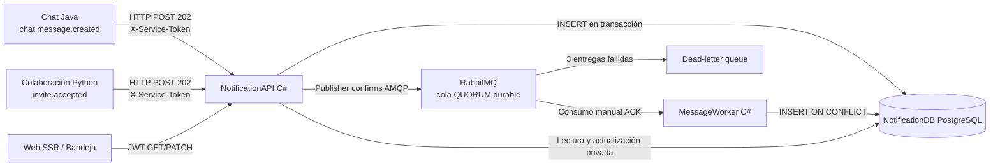

# Aporte de Cristian — Notificaciones C# y procesamiento asíncrono

**Responsabilidad:** NotificationAPI, NotificationDB, despachador de outbox, RabbitMQ (consumo/publicación) y MessageWorker.
**Lenguaje de implementación:** C# / ASP.NET Core 8 / Worker Service 8.
**Base técnica:** `Tiempo_real-y-chat`. **Infraestructura destino:** `gateway/nginx-rabbitmq` de Sebastian.

## Vista C&C del aporte

## Contratos y decisiones

- El evento incluye `event_id`, `type`, `occurred_at`, `actor_id`, `board_id`, `recipient_ids` y `payload`.
- `POST /internal/events` acepta únicamente productores con identidad de servicio. Tras confirmar el INSERT transaccional devuelve **202**. No espera RabbitMQ ni al worker.
- Outbox preserva eventos si el broker está caído. Solo marca publicado después de confirmación del broker; una republicación posterior a una caída es posible y segura.
- Worker consume con **manual ack después del commit**. `UNIQUE(event_id, recipient_id)` permite entrega *al menos una vez* sin duplicación visible.
- Ante fallo persistente, la cola QUORUM aplica límite de tres entregas y encamina a DLQ. La DLQ requiere intervención operativa para recuperar mensajes.
- API consulta/marca por `sub` extraído del JWT de Go. La cuenta ajena recibe 404 (sin revelar existencia).
- El frontend `web-ssr/src/ui/notifications/NotificationBell.tsx` ya existe y se reutiliza sin cambios.
- Exchange/cola y credenciales se toman de la infraestructura de Sebastian; la API no declara colas cuando `RABBITMQ_MANAGED_TOPOLOGY=true`.

## Evidencia que debe adjuntarse al informe final

1. Screenshot del flujo `smoke.py`: evento aceptado, repetido, notificación única y privacidad.
2. `docker compose ps`: NotificationAPI, NotificationDB, RabbitMQ y MessageWorker ejecutándose por separado.
3. Logs del dispatcher cuando el broker vuelve a arrancar, sin publicar datos sensibles.
4. Bandeja con notificación de chat e invitación aceptada (esta última depende de la conexión del evento de David).
5. Cola pendiente con worker parado; procesamiento al volver a arrancar; prueba de DLQ con mensaje inválido.
6. Resultados reales de `dotnet` build/checks y prueba Docker: no consignar como pasados sin ejecutarlos.

## Riesgos pendientes

- Integración con Colaboración: David debe producir `invite.accepted` estable al aceptar una invitación; Chat ya tiene productor con reintentos.
- Convergencia de ramas: usar el `compose.gateway.yml` contra Sebastian, no duplicar `rabbitmq`, no cambiar su gateway Nginx.
- La demo local usa `127.0.0.1:4100` para pruebas directas; nunca publicar ese puerto ni `/internal/events` en producción.
- Una cola compartida con varias réplicas de API exige controlar despachadores concurrentes; `FOR UPDATE SKIP LOCKED` protege la lectura del outbox.
- Verificar compilación y pruebas en Docker real antes de fusionar.
