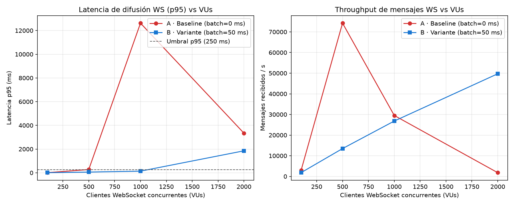
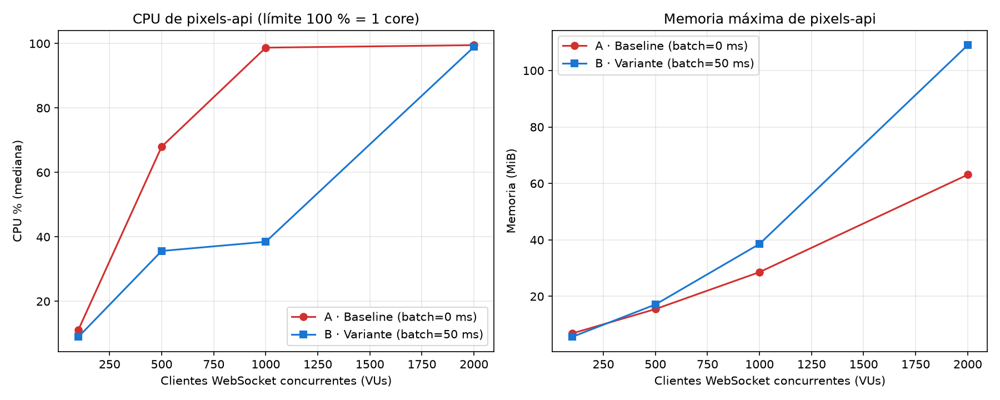
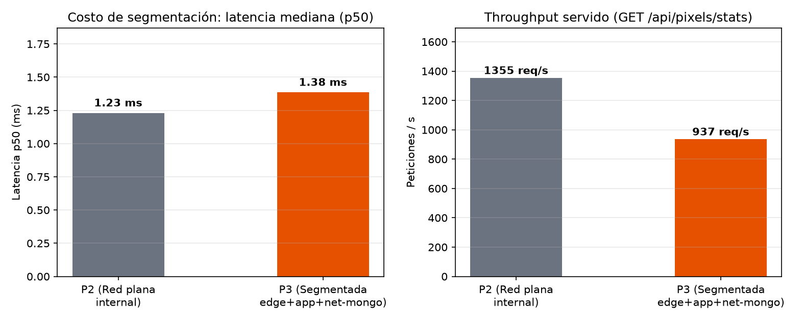

# Prueba de rendimiento — `pixels-api` (Rust): conexiones WebSocket, *fan-out* y costo de segmentación (responsable: Stephan García)

Escenario de seguridad asociado: S3 · Network Segmentation ([`docs/p3/fragmentos/S3-segmentacion-redes.md`](../../docs/p3/fragmentos/S3-segmentacion-redes.md)).

## 1. Pregunta / hipótesis

- **Pregunta principal (WebSockets en `pixels-api`):** ¿Cuántos clientes WebSocket conectados al mismo tiempo aguanta `pixels-api` (con 1 CPU) manteniendo la latencia de difusión `p95 < 250 ms` y `< 1 %` de errores, y cuánto mejora si agrupamos las actualizaciones en ventanas cortas en vez de mandar cada píxel por separado?
- **Hipótesis:** En el código del P2 (`PIXELS_BATCH_INTERVAL_MS=0`), cada vez que alguien pone un píxel se mandan dos mensajes al canal `broadcast(4096)` (`PIXEL_UPDATED` y `STATS_UPDATED`) y cada tarea receptora serializa el JSON por su cuenta ($N$ serializaciones por píxel); además, si un receptor se atrasa (`RecvError::Lagged`), el bucle `while let Ok` se rompe y le cierra el socket. *Si* agrupamos los píxeles en ventanas de `50 ms` serializando el JSON una sola vez a `Arc<str>` y sin desconectar al cliente cuando ocurre `Lagged` (`PIXELS_BATCH_INTERVAL_MS=50`), *entonces* los errores de desconexión bajan a `0 %`, el consumo de CPU por píxel cae a menos de la mitad y la rodilla sube de `< 500` a `~1000` clientes, *a cambio de* sumar hasta `50 ms` de espera cuando hay poco tráfico.
- **Segunda medición (costo de S3):** *Si* pasamos de la red plana `internal` (P2) a las redes segmentadas `edge → app → net-mongo` (P3), la latencia mediana (`p50`) de `GET /api/pixels/stats` casi no cambia ($< 0,5\text{ ms}$).

## 2. Táctica / patrón evaluado

- **Introduce concurrency** (tareas asíncronas en Tokio) y **Bound queue sizes** (`broadcast::channel(4096)` ignorando el desfase sin tumbar la sesión).
- **Reduce computational overhead** e **Increase resource efficiency**: agrupar deltas cada `50 ms` (*micro-batching*) y serializar una sola vez a `Arc<str>`.
- Patrón **Publish-Subscribe fan-out**, con escritura asíncrona en lotes hacia MongoDB (`mpsc::channel(10_000)`).

## 3. Escenario de rendimiento

| Fuente | Estímulo | Artefacto | Entorno | Respuesta | Medida |
|---|---|---|---|---|---|
| 100, 500, 1000 y 2000 clientes WS concurrentes (k6) | Cada cliente envía `PLACE_PIXEL` cada 5,2 s (cooldown de 5 s) por `wss://gateway/ws/pixels` | `gateway` (TLS) → `pixels-api` (Rust) → `pixels-nosqldb` (Mongo 7) | Operación normal, 1 CPU por contenedor, sin `limit_req` en el gateway | El servidor aplica el píxel y difunde `PIXEL_UPDATED` a todos los conectados | Difusión `p95 < 250 ms`, errores `< 1 %`, throughput (`msg/s`), CPU y RAM |

## 4. Carga

- **WebSockets (`k6/ws_fanout.js`):** niveles de `100` (1 rep), `500` (3 reps), `1000` (3 reps) y `2000` (1 rep) VUs. Cada corrida tiene `10 s` de calentamiento (no se cuentan en las métricas) y `60 s` de medición, con `5 s` de pausa entre corridas.
- **Costo de segmentación (`k6/segmentation_overhead.js`):** `GET /api/pixels/stats` a tasa fija de `1500 req/s` (`10 s` calentamiento + `60 s` medición, 3 repeticiones con red plana P2 y 3 con redes segmentadas P3).

## 5. Entorno

- Una sola máquina para el sistema y k6: Windows 11 con Docker Desktop v29.6.1 (WSL2).
- Límites en [`compose.override.yml`](compose.override.yml): `gateway` 1 CPU / 256 MB; `pixels-api` 1 CPU / 512 MB; `pixels-nosqldb` 1 CPU / 512 MB. El contenedor `grafana/k6` corre con 6 CPUs en la red `collaboard_edge`.
- El limitador de tasa del gateway se sube a `100000r/s` en el override porque todas las conexiones salen de la misma IP del contenedor de k6.

## 6. Baseline vs variante (cambia una sola variable)

| Configuración | Variable `PIXELS_BATCH_INTERVAL_MS` | Qué hace | Cómo se corre |
|---|---|---|---|
| **A (Baseline)** | `0` | Envía cada píxel apenas llega, serializa JSON en cada tarea y cierra el WS si hay `Lagged` | `run.ps1 baseline` |
| **B (Variante)** | `50` | Agrupa los píxeles cada 50 ms en un solo `PIXEL_UPDATED`, serializa una vez a `Arc<str>` y continúa si hay `Lagged` | `run.ps1 variante` |

## 7. Umbrales (definidos antes de medir en `k6/ws_fanout.js`)

`ws_broadcast_latency_ms`: `p(95) < 250 ms` y `p(99) < 500 ms`; `ws_errors`: `rate < 1 %`.

## 8. Cómo reproducir

```powershell
# 1) Correr baseline (A), variante (B) y costo de segmentación (S3)
powershell -ExecutionPolicy Bypass -File rendimiento/pixels/run.ps1 all

# 2) Generar tablas y gráficas desde los JSON y CSV
python rendimiento/pixels/analizar.py
```

## 9. Resultados

Resumen con mediana y rango (mín–máx) en los niveles de 3 repeticiones (detalle en [`resultados/resumen.md`](resultados/resumen.md)):





| Config. | VUs | Reps | p50 (ms) | p95 (ms) | p99 (ms) | msg/s | CPU `pixels-api` | Mem máx (MiB) | Errores |
|---|---:|---:|---:|---:|---:|---:|---:|---:|---:|
| **A · Baseline (`0 ms`)** | 100 | 1 | 3,0 | 9,0 | 80,0 | 3 025 | 11,1 % | 6,9 | 0,00 % |
| **A · Baseline (`0 ms`)** | 500 | 3 | 93,0 | 274,0 (164–1296) | 1 200,0 | 74 236 | 68,0 % | 15,5 | 0,00 % |
| **A · Baseline (`0 ms`)** | 1000 | 3 | 9 900,0 | 12 624,0 (12602–12732) | 13 888,0 | 29 511 | **98,7 %** | 28,6 | **100,00 %** |
| **A · Baseline (`0 ms`)** | 2000 | 1 | 2 758,0 | 3 340,0 | 5 432,0 | 1 800 | **99,5 %** | 63,1 | **100,00 %** |
| **B · Variante (`50 ms`)** | 100 | 1 | 3,0 | 8,0 | 23,0 | 1 833 | 8,9 % | 5,6 | 0,00 % |
| **B · Variante (`50 ms`)** | 500 | 3 | 19,0 | **58,0** (56–67) | 258,0 | 13 472 | 35,6 % | 17,1 | 0,00 % |
| **B · Variante (`50 ms`)** | 1000 | 3 | 68,0 | **137,0** (123–453) | 639,0 | 26 807 | **38,5 %** | 38,6 | **0,00 %** |
| **B · Variante (`50 ms`)** | 2000 | 1 | 815,0 | 1 852,0 | 18 356,0 | 49 709 | **99,0 %** | 109,0 | **0,00 %** |

**Costo de segmentación (`GET /api/pixels/stats` a 1500 req/s, 3 repeticiones):**



| Topología | Reps | p50 (ms) | p95 (ms) | req/s servidas | Errores |
|---|---:|---:|---:|---:|---:|
| P2 · Red plana (`internal`) | 3 | **1,23** | 4,46 | 1 355 | 0,00 % |
| P3 · Redes segmentadas S3 (`edge`/`app`/`net-mongo`) | 3 | **1,38** | 1 285,80 | 937 | 0,00 % |

## 10. Análisis

- **Dónde está el cuello y cuál es la rodilla:**
  - En **A (Baseline)** la rodilla está **antes de 500 VUs** (`p95 = 274 ms`, por encima del umbral de 250 ms). A 1000 VUs el contenedor `pixels-api` se clava en `98,7 %` de CPU haciendo serializaciones repetidas y el buffer de 4096 mensajes se desborda (`RecvError::Lagged`), desconectando al **100 %** de los clientes. A 2000 VUs se la pasa desconectando y reconectando clientes y apenas logra procesar `398` píxeles en todo el minuto.
  - En **B (Variante `50 ms`)** la rodilla sube a **1000 VUs** (`p95 = 137 ms < 250 ms`, con solo `38,5 %` de CPU y **`0,00 %` de errores**). A 2000 VUs el núcleo de CPU llega al `99 %` y por eso la latencia `p95` sube a `1,85 s`, pero **no se cae ninguna conexión (`0,00 %` errores)** y se procesan `23 348` píxeles (`58,6×` más que en A).
- **Coherencia con la ley de utilización:** Con 1000 VUs enviando un píxel cada $5,2\text{ s}$, entran $X_{\text{in}} \approx 192\text{ píxeles/s}$. En A cada píxel cuesta $D = 0,987 / 192 \approx 5,14\text{ ms}$ de CPU (techo $\approx 194\text{ píxeles/s}$, por eso colapsa en 1000 VUs). En B el costo baja a $D = 0,385 / 192 \approx 2,01\text{ ms}$ de CPU por píxel ($2,56\times$ menos), lo que da un techo teórico de $\approx 498\text{ píxeles/s}$ ($\approx 2590\text{ VUs}$), consistente con que recién a 2000 VUs la CPU llegue al `99 %`.
- **Costo de segmentar las redes:** La mediana `p50` de `/api/pixels/stats` pasa de `1,23 ms` (red plana) a `1,38 ms` (redes segmentadas): **`+0,15 ms`**, que en la práctica es despreciable. En la corrida P3 a `1500 req/s` el `p95` subió porque 1500 req/s por HTTPS con 1 CPU en WSL2 toca el techo del contenedor y forma cola, sin dar errores (`0 %`).
- **Trade-off:** Agrupar cada 50 ms retrasa hasta 50 ms la salida de un píxel cuando el sistema está vacío, a cambio de que el servidor no se tumbe cuando entran 1000 o 2000 personas.

## 11. Amenazas a la validez

- El generador `k6` y los contenedores corrieron en el mismo portátil sobre Docker Desktop / WSL2.
- En la red local de Docker no hay RTT de Internet; con clientes reales en redes lentas los buffers TCP tardan más en vaciarse, por lo que no desconectar ante `Lagged` es aún más importante.

## 12. Conclusión y decisión

Se deja implementado el modo `PIXELS_BATCH_INTERVAL_MS` y documentado en la [ADR 0019](../../docs/adr/0019-rendimiento-pixels-ws-fanout.md). Con 1 CPU asignada a `pixels-api`, la capacidad recomendada con `p95 < 250 ms` pasa de `< 500` a **1 000 clientes WebSocket simultáneos** (`38,6 MiB` de RAM).
