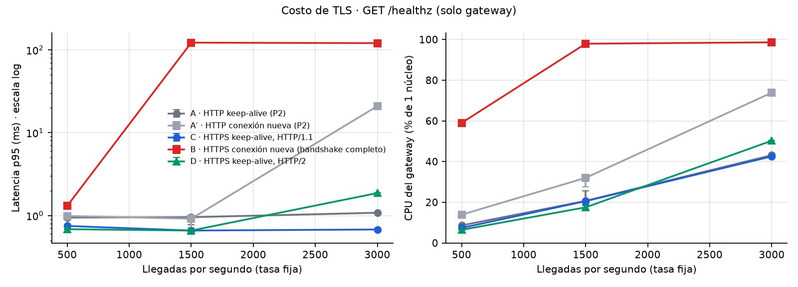
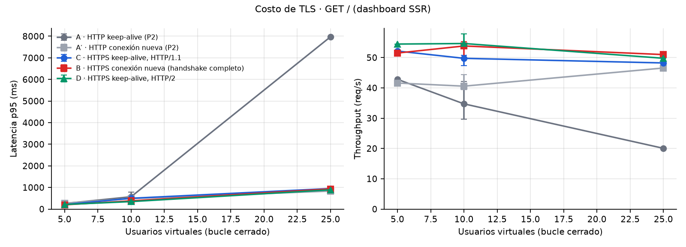

# Prueba de rendimiento — Costo de TLS y cuánto se recupera (responsable: Jhon Prieto)

Escenario de seguridad asociado: S1 · Secure Channel (`docs/p3/fragmentos/S1-canal-seguro.md`).

## 1. Pregunta / hipótesis

*Si* el canal pasa de HTTP (P2) a HTTPS terminado en el gateway (P3), *entonces* la latencia y la CPU
del gateway suben sobre todo cuando cada petición abre una conexión nueva (handshake TLS completo),
*y* con conexiones reutilizadas (keep-alive) o HTTP/2 el sobrecosto en estado estable baja a una
fracción pequeña, *porque* el costo dominante de TLS es el handshake (criptografía asimétrica), no el
cifrado simétrico (AES-GCM con instrucciones de hardware) de cada petición.

Predicción escrita antes de medir el P3: con keep-alive, p95 de `/healthz` < 2× el de HTTP y CPU del
gateway por petición < 1,5× la de HTTP; con conexión nueva por petición, CPU por petición ≥ 3× la de
HTTP; en el dashboard SSR la diferencia de p95 entre HTTP y HTTPS keep-alive < 10 %, porque el SSR
(web-ssr, ~26 ms de CPU por página: 100 % de 1 CPU a ~37 req/s en el ensayo previo contra el P2) pesa
mucho más que el canal.

## 2. Táctica / patrón evaluado

- **Reduce computational overhead** e **Increase resource efficiency**: reutilizar conexiones
  (keep-alive), multiplexar (HTTP/2) y reanudar sesiones (`ssl_session_cache`) para no repetir el
  handshake.
- Patrón **Gateway Offloading**: el TLS se paga una sola vez en el gateway; los servicios no gastan CPU en él.

## 3. Escenario de rendimiento

| Fuente | Estímulo | Artefacto | Entorno | Respuesta | Medida |
|---|---|---|---|---|---|
| Usuarios web concurrentes | `GET /healthz` (solo gateway) a tasa fija y `GET /` (dashboard SSR con sesión) | gateway (TLS) y la cadena gateway → web-ssr → auth-api + collaboration-api | Operación normal, recursos acotados, misma siembra | El sistema responde por HTTPS | p95 `/healthz` < 200 ms y dashboard < 1 s, errores < 1 %; sobrecosto de TLS cuantificado en latencia y en CPU del gateway por petición |

## 4. Carga

| Endpoint | Modelo | Niveles | Repeticiones |
|---|---|---|---|
| `GET /healthz` | Tasa fija de llegadas (`constant-arrival-rate`): la misma carga en todas las configuraciones, así la CPU por petición es comparable | 500 · 1500 · 3000 req/s | 3 en 1500, 1 en los demás |
| `GET /` (dashboard SSR) | Bucle cerrado sin pausa (*think time* 0): mide el máximo que sostiene la cadena | 5 · 10 · 25 VUs | 3 en 10, 1 en los demás |

Cada nivel dura 60 s, con 10 s de calentamiento descartado por configuración y endpoint y 10 s de
pausa entre niveles. La cuenta (con 5 tableros) y su token se crean antes de medir, así el login no
contamina la latencia. Sin pausa, porque el objetivo es el costo del canal, no simular un usuario.

## 5. Entorno

- Máquina única (SUT y generador): portátil Intel Core i5-1235U (10 núcleos: 2 de rendimiento y 8 de
  eficiencia, 12 hilos), 19,6 GB de RAM, Windows 11 Pro, Docker Desktop 28.1.1 sobre WSL2 (12 CPU y
  ~9,5 GiB asignados a Docker), conectado a la corriente.
- Límites (`compose.override.yml`): `gateway` 1 CPU / 256 MB; `web-ssr` 1 CPU / 512 MB; `auth-api`
  1 CPU / 256 MB; `collaboration-api` 1 CPU / 512 MB. Generador k6 (`grafana/k6`) en contenedor con 6 CPU,
  conectado a la red `edge` (entra por el gateway como un cliente).
- Limitador de tasa del gateway **desactivado** para esta prueba (100 000 r/s en el override): se mide el
  canal, no `limit_req`.
- Versiones: P2 = `main` @ `593b626` (HTTP); P3 = rama `p3/s1-tls` (HTTPS). El override es idéntico en ambos.

## 6. Baseline vs variantes (una variable por comparación)

| Configuración | Sistema | Canal | Conexión | Protocolo | Se activa con |
|---|---|---|---|---|---|
| A (baseline) | P2 | HTTP | keep-alive | HTTP/1.1 | `run.sh p2` |
| A′ | P2 | HTTP | nueva por petición | HTTP/1.1 | `run.sh p2` (`noConnectionReuse`) |
| C | P3 | HTTPS | keep-alive | HTTP/1.1 | `run.sh p3` (`GODEBUG=http2client=0`) |
| B | P3 | HTTPS | nueva por petición (handshake completo) | HTTP/1.1 | `run.sh p3` (`noConnectionReuse`) |
| D | P3 | HTTPS | keep-alive | HTTP/2 | `run.sh p3` (ALPN `h2`) |

Comparaciones: **A vs C** = costo de TLS en estado estable; **A′ vs B** = costo del handshake TLS;
**B vs C** = efecto de la táctica *reutilizar conexiones*; **C vs D** = efecto de HTTP/2.

## 7. Umbrales (declarados antes de medir, en `k6/tls.js`)

`http_req_failed < 1 %`; `p95 < 200 ms` en `/healthz`; `p95 < 1000 ms` en el dashboard.

## 8. Cómo reproducir

```bash
# 1) P2 (baseline) en un clon de main, con el mismo override
git worktree add ../collaboard-p2 593b626 && cp rendimiento/tls/compose.override.yml ../collaboard-p2/
(cd ../collaboard-p2 && cp .env.example .env && docker compose -p p2base -f docker-compose.yml \
   -f notifications-module/compose.gateway.yml -f compose.override.yml up -d --build --wait)
sh rendimiento/tls/run.sh p2 p2base && docker compose -p p2base down

# 2) P3 (esta rama)
cp .env.example .env
docker compose -f docker-compose.yml -f notifications-module/compose.gateway.yml \
  -f rendimiento/tls/compose.override.yml up -d --build --wait
sh rendimiento/tls/run.sh p3 collaboard

# 3) Tablas y gráficas
python rendimiento/tls/analizar.py
```

## 9. Resultados

Tablas completas (mediana y rango mín–máx de las 3 repeticiones del nivel clave) en
[`resultados/resumen.md`](resultados/resumen.md); datos crudos: resúmenes de k6 (`*.json`),
`index-*.csv` (ventana de cada nivel) y `stats-*.csv` (CPU y memoria por contenedor).





**`GET /healthz` (solo gateway), tasa fija:**

| Configuración | Nivel | p50 (ms) | p95 (ms) | p99 (ms) | req/s servidas | CPU gateway | CPU gateway por petición |
|---|---|---|---|---|---|---|---|
| A · HTTP keep-alive (P2) | 1500/s | 0,37 | 0,95 (0,78–0,97) | 4,95 | 1503 | 20,7 % | 138 µs |
| C · HTTPS keep-alive | 1500/s | 0,31 | 0,66 (0,61–0,67) | 1,03 | 1504 | 20,5 % | 137 µs |
| D · HTTPS keep-alive HTTP/2 | 1500/s | 0,30 | 0,66 (0,64–0,68) | 1,01 | 1504 | 17,5 % | 116 µs |
| A′ · HTTP conexión nueva (P2) | 500/s | 0,45 | 0,99 | 1,93 | 501 | 13,9 % | 277 µs |
| B · HTTPS conexión nueva | 500/s | 0,52 | 1,31 | 5,91 | 501 | 59,0 % | 1178 µs |
| B · HTTPS conexión nueva | 1500/s | 97,1 | 122,3 (121,7–122,8) | 199,6 | **1222** (≈ 300/s descartadas) | **97,9 %** | 788 µs |
| B · HTTPS conexión nueva | 3000/s | 98,6 | 120,7 | 200,5 | **1220** | **98,6 %** | 809 µs |

**`GET /` (dashboard SSR), 10 VUs (3 repeticiones):**

| Configuración | p50 (ms) | p95 (ms) | req/s | CPU web-ssr | CPU gateway | Errores |
|---|---|---|---|---|---|---|
| A · HTTP keep-alive (P2) | 239 | 570 (564–790) | 34,7 (29,6–42,2) | 100,8 % | 10,0 % | 0 % |
| A′ · HTTP conexión nueva (P2) | 192 | 487 (461–593) | 40,6 | 99,4 % | 12,9 % | 0 % |
| C · HTTPS keep-alive | 156 | 499 (468–499) | 49,8 (47,4–50,7) | 99,9 % | 12,3 % | 0 % |
| B · HTTPS conexión nueva | 148 | 380 (348–380) | 53,8 | 100,3 % | 21,6 % | 0 % |
| D · HTTPS keep-alive HTTP/2 | 148 | 346 (311–378) | 54,6 | 98,4 % | 14,3 % | 0 % |

Hipótesis frente a lo medido:

| Predicción (escrita antes de medir el P3) | Medido | ¿Se cumple? |
|---|---|---|
| Keep-alive: p95 de `/healthz` < 2× HTTP | 0,66 ms frente a 0,95 ms (0,7×) | Sí |
| Keep-alive: CPU por petición < 1,5× HTTP | 137 µs frente a 138 µs (1,0×) | Sí |
| Conexión nueva: CPU por petición ≥ 3× HTTP | 1178 µs frente a 277 µs (4,3×; 6,8× frente a HTTP keep-alive) | Sí |
| Dashboard: diferencia de p95 HTTP vs HTTPS keep-alive < 10 % | −12 % (499 frente a 570 ms), a favor de HTTPS y dentro del rango de A | Sí, en el sentido de la hipótesis (HTTPS no empeora); la diferencia es ruido entre corridas |

Umbrales: errores < 1 % y p95 < 200 ms / 1000 ms en todos los niveles **salvo dos**: B a 1500 y
3000 req/s cumple el p95 pero **no sostiene la carga ofrecida** (descarta ~20 % de las llegadas),
y A (P2) con 25 VUs en el dashboard (6,15 % de errores, p95 de 7,98 s; ver sección 11).

## 10. Análisis

- **Cuello de botella y dónde se gasta el costo.** En `/healthz` el único trabajo es del gateway. Con
  conexión nueva por petición (B), el gateway llega al 98 % de su CPU y se estanca en ~1220 req/s,
  mientras k6 se queda en ~180 % de sus 6 CPU: el límite es el gateway. El handshake TLS 1.3 completo
  (ECDHE X25519 + firma ECDSA P-256) cuesta ≈ 0,8–0,9 ms de CPU del gateway por conexión
  (1178 − 277 µs a 500/s), así que **un núcleo sostiene ~1200 handshakes completos por segundo**.
  Pasado ese punto, las peticiones esperan en la cola del handshake (p50 = 97 ms y handshake medio
  de 200 ms, sin errores).
- **Por qué la reutilización recupera casi todo.** Con keep-alive (C), la criptografía asimétrica se
  paga una vez por conexión y cada petición solo usa AES-GCM, que tiene instrucciones de hardware
  (AES-NI). Por eso la CPU por petición queda igual que en HTTP (137 frente a 138 µs) y la latencia no
  sube. B frente a C: **8× menos CPU por petición** (1178 → 147 µs a 500/s). Es la táctica *Reduce
  computational overhead*.
- **HTTP/2 (D).** A 1500/s baja la CPU por petición un 15 % (116 frente a 137 µs), con el mismo p95.
  A 3000/s es algo peor que HTTP/1.1 (50 % frente a 42,5 % de CPU y p99 de 50 ms). k6 manda una
  petición a la vez por VU, así que aquí no se aprovecha la multiplexación. Su beneficio está en un
  navegador que pide en paralelo los recursos de la página, y eso esta prueba no lo mide.
- **En una página real el canal no se nota.** En el dashboard, el cuello es web-ssr (≈ 100 % de su CPU
  en todas las configuraciones, ~26 ms de CPU por página). Incluso el peor caso (B) solo agrega CPU al
  gateway (21,6 % frente a 12,3 %: +1,5 ms por página, un handshake) sin mover la latencia, porque el
  gateway está lejos de saturarse. Las diferencias a favor de HTTPS (throughput de ~50 frente a
  ~35–41 req/s) no pueden venir de TLS: son variación entre las dos instancias del sistema (sección 11).
- **Trade-off.** Seguridad del canal (sección 6 del fragmento S1) a cambio de ≈ 0,9 ms de CPU por
  conexión nueva en el gateway y la gestión de certificados. La memoria de la caché de sesiones está
  acotada a 10 MB (≈ 40 000 sesiones). Se descartaron los *session tickets* por el riesgo de su llave.

## 11. Amenazas a la validez

- **Una sola máquina** para el SUT y el generador (Docker Desktop sobre WSL2). Se mitigó con límites
  de CPU por contenedor y midiendo la CPU de k6 (máximo 323 % de las 6 CPU asignadas, en A′ a 3000/s).
- **Portátil con núcleos híbridos y turbo:** "1 CPU" puede caer en un núcleo de rendimiento o de
  eficiencia, y la frecuencia varía con la temperatura. Por eso se reportan rangos de 3 repeticiones
  y se comparan cocientes (CPU por petición), no valores absolutos.
- **Red de Docker, sin latencia real.** El RTT entre k6 y el gateway es de microsegundos. En una LAN o
  en Internet, cada conexión nueva suma un RTT más por el handshake de TLS 1.3 (dos con TLS 1.2), así
  que el costo en **latencia** del peor caso sería mayor que el medido; el costo en CPU no cambia.
- **P2 y P3 son dos instancias distintas, medidas en momentos distintos.** La web del P3 se midió
  después de las pruebas E2E (Node y su JIT ya "calientes"). Eso explica que el dashboard rinda más en
  el P3 sin relación con TLS.
- **Anomalía de A con 25 VUs (P2):** 6,15 % de errores, máximo de 8,28 s (≈ el `GATEWAY_TIMEOUT_MS` de
  8 s de web-ssr) y web-ssr a solo 43 % de CPU, o sea, esperando y no trabajando. Es coherente con el
  bloqueo del pool de conexiones de collaboration-api (5 + 10 conexiones frente a 40 hilos) que se
  encontró en el laboratorio 6 y que sigue en `main`. No es un efecto de TLS. No se reprodujo en el P3,
  pero el defecto está en ambos (lo trata la prueba de S2).
- **k6 no reanuda sesiones TLS**, así que B es el peor caso. Un navegador que vuelve reanuda la sesión
  (`ssl_session_cache`) y evita la firma ECDSA.
- Una sola corrida en los niveles no clave; `docker stats` muestrea cada ~2 s.

## 12. Conclusión y decisión

1. **Se mantiene TLS terminado en el gateway** (Gateway Offloading). Con conexiones reutilizadas, su
   costo no es medible frente a HTTP: misma CPU por petición, sin aumento de latencia, y en una página
   SSR real no se distingue.
2. **El riesgo es la tasa de handshakes completos**, no el cifrado: ~1200 por segundo por núcleo del
   gateway. Configuración recomendada (la que queda en `tls.conf.template`): keep-alive de Nginx por
   defecto (75 s), `ssl_session_cache shared:SSL:10m` con `ssl_session_timeout 1d`, certificado
   ECDSA y sin *session tickets*. Para crecer: más CPU o réplicas del gateway detrás de un
   balanceador.
3. HTTP/2 queda activado: no empeora en la carga realista (dashboard) y beneficia a los navegadores;
   esta prueba no demuestra una mejora propia.
